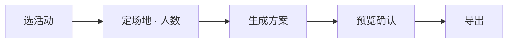

# 幕景 Scendance

**3D 活动方案全流程生成**

一场活动走完一条路：选活动，定场地和人数，生成一版方案，确认，再导出。布置、物料、执行资料是同一份方案的三块视图，不是三件产品。

**在线试用：<https://scendance-scene-planner-ewz.pages.dev>**


2026 年学军黑客松作品。当前仓库是 2026-10 的静态导出版本。

---

## 活动流程



| 步 | 你做的 | 系统做的 |
| --- | --- | --- |
| 选活动 | 点一张活动卡 | 记下这场是什么 |
| 定场地 · 人数 | 点场地和人数 | 立起可布置的场地 |
| 生成方案 | 只点一颗「生成方案」 | 出一版建议，先停在预览 |
| 预览确认 | 只点一颗确认 | 写入画布；不确认就不落盘 |
| 导出 | 从执行资料发起 | 再预览一次，确认后才在本机生成文件 |

对话可以加速，不负责考试。没选完也可以跟晴光说一句，效果与点选相同：先建议，再预览，唯一确认之后才写入。晴光只在画布场边出现一次。

### 三块视图，一份方案

生成之后，画布上的三块是同一份方案的看法，可以来回切，不另开产品：

| 视图 | 看什么 |
| --- | --- |
| 布置 | 三维场地里这一版怎么摆 |
| 物料 | 这一版用了哪些东西、各多少 |
| 执行资料 | 件数与场地，以及导出交接 |

### 左轨

左轨只有三枚：**布置 / 评审 / 执行**。

- 布置：选活动、定场地人数、生成、确认
- 评审：把已确认的方案准备给客户看
- 执行：内部资料与导出

没有第四枚图标。阶段不升成向导，也不把场景 / 物件 / 合成摆成首页并列入口。

### 留在面上 / 收进内部

| 留在面上 | 收进内部，不当首页 |
| --- | --- |
| 一颗动词「生成方案」 | 场景、物件、合成、动画、打印、氛围、3DGS、世界生成 |
| 空闲时没有绿色主按钮 | 六页执行台、n/4 向导、两颗确认、空闲绿色导出 |
| 活动卡，场地与人数 | 按钮旁的说明书、厂商名、模式轨、工具坞 |
| 画布占画面大约六成以上 | 第四枚左轨图标 |
| 预览之后只确认一次 | |
| 左轨三图标，晴光在场边 | |

---

## 能做什么

- **活动方案**：选活动、定场地和人数、生成、确认、导出
- **3D 编排**：确认后的布置可以选中、旋转、缩放、复制、锁定，支持撤销重做
- **模型库**：550 个 GLB 家具与装置模型，带中文标签与授权信息
- **方案生成**：一句话或首屏选择都能出预览；确认前不写入场地（云端路径最多 6 次工具调用 / 90 秒）
- **模板**：10 套预设场地布局，可直接改
- **协作**：邮箱登录；工作室 → 项目；编辑租约与版本校验，避免多人互相覆盖；可生成只读分享链接
- **重建与建模**：平面图预览、参数化模型脚本留在内部工具，不占活动方案首页

## 技术栈

前端 Next.js 15（静态导出）· React 18 · three.js · zustand · Tailwind / Radix
后端 Supabase（Postgres + Auth + Edge Functions）· Deno
AI DeepSeek · 测试 Vitest + PGlite

## 目录

```
frontend/            应用主体（工作台）
client/              分享客户端
supabase/
  functions/         scene-api、generation-worker、reconstruction-worker
  migrations/        19 个数据库迁移
assets/library/model 模型库（550 个 .glb）
scene/templates/     10 套模板
tools/               Blender 与平面图工具
docs/                设计与契约文档
introduction.html    介绍页
```

## 本地开发

```bash
cd frontend
npm install
npm run dev
```

需要复制根目录 `.env.example` 为 `.env.local` 并填写 Supabase 地址与匿名 key。数据库结构用 `supabase/migrations/` 初始化。

## 构建、检查、发布

```bash
cd frontend
npm run build          # 静态导出到 frontend/out
npm run test           # Vitest
```

部署在 Cloudflare Pages，监听 `main` 自动构建，输出目录 `frontend/out`；Supabase Edge Functions 单独部署。

## 边界与现状

- HY-3D 生成服务已下线，相关入口返回 410
- 模板目前只能本地使用，不支持云保存与 AI 改模板
- AI 规划有调用次数与时长上限，不是无限额度的免费服务
- 自动化测试覆盖的是关键路径，不等于生产环境验证

## 许可

模型库中部分资产来自第三方，授权信息记录在模型元数据中；使用前请逐个确认。
