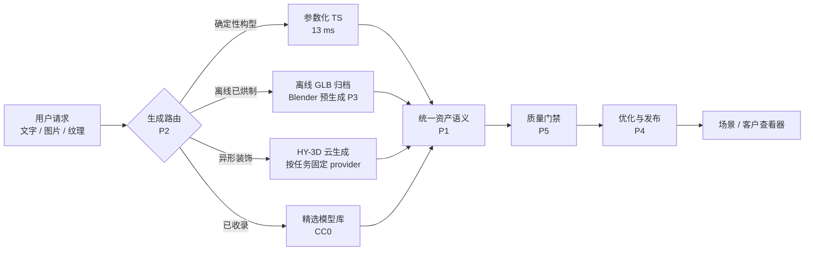

# 三维生成方案升级（v2）

本文是**三维生成链路**的升级方案与验收口径，替换散落在 `PLAN.md`、`tools/blender/README.md`、`docs/HY3_PROVIDER_AUDIT.md` 里的零散结论。
负责执行本方案的 agent 见 [`.github/agents/3d-expert.agent.md`](../.github/agents/3d-expert.agent.md)。

状态标记：**已有**（已实现）、**待做**（本方案要求）、**未验证**（缺凭据或未实测）。

---

## 1. 现状盘点

四条通道各自成立，但缺少统一的**入口、资产语义与后处理**：

| 通道 | 入口 | 现状 | 主要缺口 |
|---|---|---|---|
| 参数化 | `_shared/parametric.ts` | **已有**：6 个 family（`table/chair/counter/platform/backdrop/cabinet`），13.9 ms，指纹去重，包围盒容差 `1e-5` | 只能表达盒子/圆柱族；无 LOD、无倒角、无 UV 变化 |
| 云生成 HY-3D | `_shared/providers.ts`、`generation-worker/` | **已有**：`text`/`image`/`texture` 三 kind；tokenhub / legacy；`hy-3d-3.0` / `hy-3d-3.1` / `hy-3d-texture`；按任务固定 provider | 真实账号权限、结果质量、账单**未验证**；入口只有云，没有"先试便宜通道"的路由 |
| 精选模型库 | `assets/library/catalogue.json`、`tools/catalog/` | **已有**：30 个手挑 CC0 模型，`verify` 检查直链/许可证/无 Draco/sha256 | 补库靠人工；没有与生成通道共用资产语义 |
| Blender 离线 | `tools/blender/` | **已有探索**：几何与 TS 等价、11/11 通过；但 ~2.7 s、913 MB | 接入形态未定（未做）；`assets/` 共用性未评估 |

质量与契约层：`_shared/models.ts`（`validateModel` 硬上限）、`_shared/generation-quality.ts`（纹理通道逐 accessor 比对几何与 UV）、`client/scene-client.ts`（唯一 wire 契约）。
渲染层有两个消费方，**都要保留**：根目录 `renderer-webgl.js`（`introduction.html` 官网演示）与 `scene/scene-renderer.js`（场景模板查看器）。

**核心问题**：生成一条异形道具 → 只能走云；生成一张桌子 → 也可能走云。而参数化通道免费且 13 ms。渠道之间没有路由，产出物之间没有统一的资产语义，后处理（优化/减面/贴图）完全没有。

P2 已给出第一版路由（`_shared/generation-lane.ts`），但调用方仍需显式声明"这是一个确定性构型"；把它接到工具选择与资产查询上是 P1/P2 的剩余工作。

---

## 2. 目标与原则

1. **先便宜后昂贵**：能确定性构造的，不花钱调用云；云只用于参数化表达不了的东西。
2. **产出即资产**：任何通道的产物都带同一套语义（通道、版本/模型、指纹、许可、采购状态、质量报告）。
3. **不伪造成功**：失败返回真实错误码；不把内置物料冒充生成结果。
4. **可测才算完成**：每个阶段给出"改动前后"的耗时/面数/体积/draw call 对照与命令证据。
5. **不破坏 Blender 结论**：Blender 只做离线预生成，不进请求路径。



---

## 3. 阶段

### P1 统一资产语义 **待做**

- 新增 `supabase/functions/_shared/generation-lane.ts`：定义 `lane: 'parametric' | 'offline' | 'hy3d' | 'library'` 与统一的 `generation` 元数据（`lane`、`builderVersion|providerModel`、`fingerprint`、`license`、`procurementStatus`、`quality`）。
- 三条现有写资产路径（`createParametricAsset`、云生成落库、`scripts/import-model-library.ts`）改为共用同一构造函数，禁止各自拼 `metadata`。
- 指纹规则沿用 `sha256(canonical(...))`，把 `lane` 与版本一起纳入，跨通道可去重。
- **不改前端 wire 契约**；若必须新增字段，同步 `client/scene-client.ts` 并走评审 PR。
- 验收：同一参数经参数化与离线通道产出，指纹一致即命中同一资产；`npm test` 全绿。

### P2 生成路由 **已有（首版）**

- 已实现 `supabase/functions/_shared/generation-lane.ts`：纯函数 `chooseLane(request, capabilities)`，返回 `{ lane, reason, cost, available }`，无副作用、无 env 读取。
- 通道顺序：**声明的参数化构型** → `offline`（命中归档指纹）否则 `parametric`；无声明构型时 → `library`；否则 → `hy3d`（metered）。
- 图/纹理请求**不会**被路由到免费通道：它们变换的是只有供应商能消费的输入，改道就等于伪造结果。
- 已接入 `prepareGenerationRequest`：错误码与状态不变，`details` 现在带 `lane` 与 `reason`，因此"没有免费通道能覆盖"与"云未配置"可以区分。
- 覆盖测试：`tests/generation-lane.test.ts`（4 条通道、免费优先、拒绝非法参数、不可用时不替代通道）+ `tests/generation-input.test.ts` 的通道断言。
- 残留：`parameters` / `offlineFingerprint` / `libraryAssetId` 目前由调用方声明，尚未接上 `agent-runner.ts` 的工具选择与 P1 的资产查询；`HY3_RETIRED` 仍在 `prepareGenerationRequest` 最前面短路（语义正确，保持不动）。
- 验收（已达成）：`npx vitest run tests/generation-lane.test.ts tests/generation-input.test.ts` 全绿；`npm run typecheck` 通过。

### P3 Blender 离线预生成通道（`tools/blender/README.md` 的方案 A）**待做**

- `tools/blender/bake-parametric.mjs`：枚举参数组合 → 计算指纹 → 产出 `assets/offline/<fingerprint>.glb` + manifest。
- 运行时按指纹取用，未命中回退 TS 生成器；命中率可统计。
- 冷门参数不追求覆盖，回退是正常路径而非失败。
- 验收：每个归档 GLB 通过 `validateModel` 与包围盒校验（容差 `1e-5`）；`npm run blender:verify` 报 11/11 以上。

### P4 资产优化与发布 **待做**

- 用 `@gltf-transform/core`（+ `extensions`）建立优化管线：`dedup()` / `prune()` / `weld()` / `resample()`，道具贴图上限 1024。
- 优化目标：`scene/templates/` 10 个场景 GLB（4–6 MB）与云生成产物。
- **压缩红线**：vendored `GLTFLoader` 无 Draco/meshopt 解码器，禁止 `draco3d` / `EXT_meshopt_compression`，除非同步补解码器并更新 `tools/catalog/build_catalog.py verify` 的断言。
- 若在 Edge Function 运行时使用 `@gltf-transform/extensions`，需从 devDependency 提升为 dependency 并核对 `deno.json` 的 vendor。
- 验收：给出改动前后字节数、三角面、draw call 对照；产物仍通过 `validateModel` 且能在 `scene/` 与 `introduction.html` 两个查看器加载。

### P5 质量门禁扩展到全通道 **待做**

- `generation-quality.ts` 增加与通道无关的检查：包围盒足迹上限（对齐 `tools/catalog` 的 `MAX_SIZE_M = 8.0`）、三角面/primitive/节点/材质/贴图上限（与 `validateModel` 一致）、贴图通道的 PBR 可见性。
- 图生模型通道增加"产物与输入不等价、且非退化几何"的检查（现有 `compareTextureGeometry` 只覆盖纹理通道）。
- 质量报告写入资产 `metadata.generation.quality` 并在 UI 呈现。
- 验收：`tests/generation-quality.test.ts` 覆盖每条通道的通过/拒绝样例。

### P6 可观测性与成本 **待做**

- 按通道统计任务数、失败码分布、`ResultCreditConsumed`、预算账本使用率。
- 退役路径按 `docs/contracts/DEEPSEEK_AGENT.md`：`HY3_RETIRED=true` 下新请求读素材/计费前返回 410，队列全终态后才停 generation cron 并移除 `HUNYUAN_API_KEY`。
- 证据落到 `docs/evidence/`（沿用现有 json 格式）。

---

## 4. 验收命令

```sh
npm test                # vitest run tests/
npm run typecheck
npm run check:edge      # deno check：scene-api / generation-worker / reconstruction-worker
npm run library:check   # 模型库契约
npm run blender:verify  # 需要 BLENDER（离线通道）
python3 tools/catalog/build_catalog.py verify --root .   # 许可证/直链/无 Draco/sha256
```

本地验证与云端验证**分开汇报**；缺 `HUNYUAN_*` / `DEEPSEEK_*` 凭据时云路径记为**未验证**。

---

## 5. 明确不做

- 不把 Blender 放进 Edge Function 请求路径（~2.7 s / 913 MB）。
- 不引入 Draco/meshopt，除非同时提供解码器。
- 不做多层场地、吊挂、复杂叠放（首版边界见 `PLAN.md`）。
- 不合并两个渲染器：官网演示与场景查看器是不同消费方。
- 不补自托管 GPU / TRELLIS 部署（仍为未来候选）。
- 不擅自改数据库迁移、部署密钥、根依赖版本（后端负责人范围）。

---

## 6. 未验证清单（不要当成已完成）

- HY-3D 真实账号权限、生成结果质量、`hy-3d-3.1` 与纹理通道的实际产出与费用。
- `hy-3d-3.0` 与 `hy-3d-3.1` 在同一输入下的质量差异。
- Blender 产物跨版本字节稳定性（能否作为指纹/去重依据）。
- 模型库 30 个模型之外的补库成本。
- 优化管线对既有已发布版本的兼容性。
