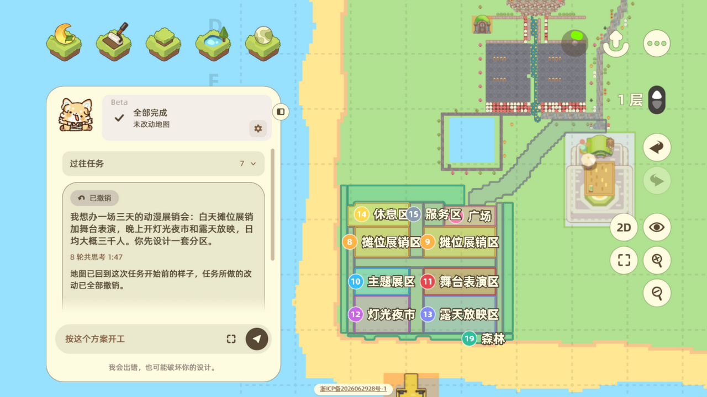

# 谷地工坊交互逻辑拆解与落地卡（2026-11-21）

> 定位：[49-Agent工具循环与双交付形态-对标收敛卡-20261121.md](49-Agent工具循环与双交付形态-对标收敛卡-20261121.md)（Phase F）的**交互层配套**。F 卡管 agent 决策架构（工具循环/分级监督/双交付），本卡管**人看见什么、在哪一步能做什么**——二者互为表里，F3/F4/F5 的验收依赖本卡落地。
> 依据：docs/48 四轮实测的 DOM 快照与画布截图（petitmaker.com.cn，2026-11-21）。

## 一、观察到的十条交互模式（逐条带证据）

**已存截图**（docs/images/petitmaker-20261121/）：

> 图 4：轮 4 收尾态全屏——画布上 9 个自创分区标记可见（休息区/服务区/摊位展销区×2/主题展区/舞台表演区/灯光夜市/露天放映区/广场），任务卡「已撤销 · 未改动地图 · 8 轮共思考 1:47」，composer 提示词「按这个方案开工」。P1 提案态、P7 两段式的直接证据。

**补拍清单**（本轮浏览器会话失效未拍到，下轮补齐后按编号入 images/ 同目录）：

| 编号 | 待拍状态 | 对应模式 |
| --- | --- | --- |
| 01 | composer 空闲态（「输入任务或问题」+ 常驻诚实声明） | P1/P8 |
| 02 | 运行中态（「为下一步添加备注」+ 停止 + 步数徽标 + 思考展开） | P1/P2/P4 |
| 03 | 破坏性审批卡（三键 + 「或用文字回答」） | P3 |
| 05 | 任务卡收尾报告（strong 小节标题 + 如实说明两点） | P6 |

| # | 模式 | PetitMaker 实况（观察证据） | 我们现状 |
| --- | --- | --- | --- |
| P1 | **composer 四形态** | 空闲「输入任务或问题」→ 运行中「为下一步添加备注」+停止（插话=给下一步的指引，不是打断）→ 审批态「或用文字回答」+三键 → 提案态提示词「按这个方案开工」 | composer 运行中只可取消，不可插话；审批只有整版确认卡一种形态；提案无提示词切换 |
| P2 | **任务卡步骤链外显** | 「共 114 步，显示最后 3 步」可展开整链；每步「查看思考内容（思考了 0:17）」+ 工具条目带参数（「铺设道路 锦花砖路 沿直线 (71,38)→(71,54) 宽 1」） | outdoor 任务卡有 designStep 留痕，但无模型思考、无工具参数明细、无步数常驻 |
| P3 | **破坏性单步审批卡** | 「清空区域 (清除物品与地形 14 格)」+ 批准/不用（跳过该步继续）/取消任务 + 可文字回答；建设性 46 步连跑不打扰 | 无单步审批概念；整版提案一张卡，确认粒度过粗 |
| P4 | **主动暂停控制** | 「在本步结束后暂停」——不打断当前步、停在下一条边界上 | 无；只有硬取消 |
| P5 | **任务级撤销 + 被撤销内容可查** | 「地图已回到这次任务开始前的样子，任务所做的改动已全部撤销」+「被撤销的内容」可查看、可归档 | 有「还原到本轮开始」快照写回（等价），但撤销后内容不可查看 |
| P6 | **非变更承诺可视化** | 收尾卡「已存在的树、花带花、16 座长桌……全部保持原样」+「未改动地图」标签 | 收尾卡列改动，不列「没动什么」 |
| P7 | **提案预览 + 回滚 + 一键开工** | 分区画上画布 → 回滚施工痕迹 → composer 提示词「按这个方案开工」→ 确认后沿分区施工 | 预览卡有（offer/apply/undo），但无「回滚待批+开工提示词」两段式 |
| P8 | **诚实声明常驻** | 「我会出错，也可能破坏你的设计。」小字常驻 composer 下 | 无 |
| P9 | **监督方式设置常驻** | 面板头部「模型、服务商与监督方式」按钮 | 有 provider/model 选择（设计卡内），监督档无面板级入口 |
| P10 | **低打扰弹窗** | 欢迎回来弹窗 12 秒无操作自动按「继续上次」 | 无自动确认机制（关键弹窗人工，正确；非关键弹窗可借鉴） |

## 二、落地卡（I1–I6，挂 Phase F 依赖）

### I1 — composer 四形态（依赖 F1 循环跑通；纯 UI 部分可先行）

- 运行中：composer 切「为下一步添加备注」+ 保留停止；备注进 F1 循环的下一轮上下文（「用户备注」段）。
- 审批态：渲染 F2 审批卡（I3）；文字回答 = 作为审批答复传回循环。
- 提案态：placeholder 切「按这个方案开工」（I5）；确认即开工。
- **验收**：四态互转无死角；运行中备注在下一步思考里被引用；Esc/外点不吞输入。

### I2 — 任务卡步骤链外显（可先行，不改架构）——**状态：壳已达成**

- 任务卡加：步数徽标「共 N 步」（点击展开整链）；每步=思考段（可展开，带时长）+ 工具条目（名称+参数人话版）。
- 数据源：F1 留痕（每步思考+工具名+参数）；F1 未落前先用 designStep 现有留痕搭壳。
- **2026-11-21 代码核对**：outdoor-workflow-card.tsx 已有「共 N 步，查看较早步骤」展开 + 「设计过程 N 步」折叠列表（L116/L421-425），当前数据水平下 I2 已达成；剩余的思考段与工具参数明细依赖 F1 数据源，随 F1 落码补全，不单独动 UI。
- **验收**：花家山庄类任务重放：步数、每步思考、工具参数三样都能在卡上回看（思考与参数部分待 F1）。

### I3 — 破坏性单步审批卡（依赖 F2 分级闸）

- 审批卡三要素：被批对象人话描述（「清空区域（清除物品与地形 14 格）」）+ 批准/不用/取消任务 + 文字回答改参数。
- 「不用」= 跳过该步继续后续步骤；「取消任务」= 整任务终止并回滚。
- **验收**：破坏性步必停；「不用」后任务继续且收尾卡如实记「该步被跳过」。

### I4 — 任务级撤销的「被撤销内容」查看（挪至 F1 落码后）

- 「还原到本轮开始」已有快照写回；补：撤销后任务卡展示「被撤销的内容」摘要（改动清单），并可归档。
- **2026-11-21 决策**：被撤销清单的数据源是步进留痕（F1），现在只有整盘快照 diff——先做会产出丢弃式 UI，挪到 F1 落码后一并做。
- **验收**：撤销后能看到被回退的改动清单；归档后列表不再打扰。

### I5 — 提案两段式（依赖 F3）

- 分区/设计提案：草稿层画布预览 + 回滚施工层 + composer 提示词「按这个方案开工」；确认后草稿转实体。
- **验收**：纯设计任务结束时地图零净变更 + 预览可见 + 开工后一条 undo。

### I6 — 常驻诚实声明（**已落码 2026-11-21**）

- composer 下常驻小字：「我会出错，也可能破坏你的设计。重要改动会先问你。」
- **已落**：agent-panel composer（ap-input 下方，ap-honesty-note）；docked 助手（室内）暂未挂，随 F 阶段统一。
- **验收**：常驻可见；文案与监督档联动（严格档补「每个改动都会先问你」）——联动部分未做，随监督档设置卡补。

## 三、执行顺序（2026-11-21 更新）

~~I6 立即可做~~（已落码）→ I2 壳已达成（思考段随 F1）→ I4 挪至 F1 后 → I1/I3/I5 依赖 Phase F 对应卡，随 F 落码同步做。全部在 agent-panel / outdoor 任务卡/offer 机制内，不新增框架。

## 四、非目标

不搬像素风格与游戏化表达；不做 12 秒自动确认的关键弹窗自动通过（只借鉴非关键弹窗）；不改变 docs/44 确认门语义。

## 五、台账

- 2026-11-21：I6 落码（agent-panel composer 常驻诚实声明）；I2 代码核对=壳已达成；I4 挪至 F1 后。I1/I3/I5 待 Phase F。
- 2026-11-21（续）：**I1-lite 落码**——户外任务运行中回车不再并发顶掉运行中的 job（start() 会替换 abort.current，旧任务被静默取消），改为排队、任务结束自动按序发出；busy 态 placeholder 切「为下一步添加备注（当前任务结束后自动发送）」+「已排队 N 条」状态行。深度注入（备注进下一轮思考上下文，PetitMaker 同款）归 F1。
