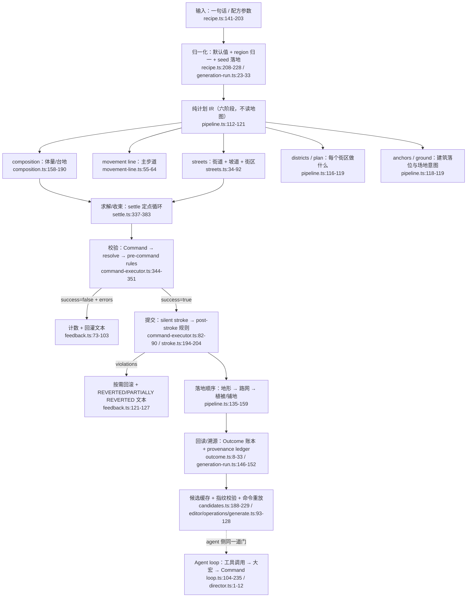

# PetitMaker「智能建造」生成链路研究
## 面向幕景 Scendance 3.0 的生成架构可移植证据

| 项 | 值 |
|---|---|
| 研究对象 | Stry233/PetitMaker（谷地工坊），浅克隆 HEAD = Release v2.0.673 |
| 本地只读路径 | `C:\mujing\_research\petitmaker`（未 pull / 未 install / 未改动） |
| 代码许可 | Apache-2.0（`LICENSE` / `NOTICE`）；**品牌与美术素材另有条款**，见 `docs/ASSET_LICENSES.md` |
| 目标项目 | `C:\mujing\Scendance2026`（幕景 3.0.0，Next.js 15 + React 18 + three.js + zustand） |
| 产出日期 | 2026-11-01 |
| 引用约定 | 所有 `路径:行号` 均相对 PetitMaker 仓库根；行号取本地副本实测，**未逐行复核 HEAD 之后的变动** |

本报告只回答一个问题：**「一句自然语言 / 一个配方参数」是怎么变成「地图上真实的建造结果」的**，并把这条链路拆成幕景可以对齐的阶段。凡是无法从代码直接证实的，一律进第 6 节存疑清单，不在正文里含糊过去。

---

## 1. 一页结论：最值得搬走的 5 个机制

**M1｜整份计划先于第一条命令存在。**
`planDesign` 是六个纯阶段函数（composition → movement line → streets → districts → plan → anchors/ground）的固定顺序，全程不读地图、不写地图、不用浏览器 API，所以整张图的"设计意图"可以在任何写入之前完整物化、被 worker 复算、被候选缓存复用。
证据：`src/tools/generation/designer/pipeline.ts:103-121`（顺序与纯度声明，原文："the whole plan exists before a single command does"）、`pipeline.ts:1-6`、`src/tools/generation/designer/types.ts:1-14`（"Data only: no state, commands or randomness"）。

**M2｜写入只有一道门：Command → 两阶段规则 → 返回值。**
生成器、宏工具、agent 工具**都不直接改地图**，一律构造粗粒度 Command 交给同一个 `CommandExecutor`；非法命令不抛异常，而是返回 `{ success: false, errors }`，并附带"哪一格/哪个对象身体"作为证据。这让"拒绝"成为可统计、可回灌、可重试的数据，而不是中断流程的异常。
证据：`src/core/commands/command-executor.ts:143-147, 339-351`、`src/rules/registry.ts:12-25, 56-74`、`src/core/model/types.ts:405-407`。

**M3｜几何不靠"生成一次就完事"，靠定点收束。**
街道层在 `settle` 里循环「补接近失手 → 收尾 → 到位判定 → 重建 → 可达性剪枝 → 重盖章」，直到"这一遍什么都没变 且 没有孤岛"，并给遍数上界；连两个常量（`JOIN_REACH` / `JOIN_LEFT`）都必须互相咬合，否则会来回振荡。
证据：`src/tools/generation/designer/streets/settle.ts:327-383`（settle 定点 + 上界）、`settle.ts:38-49`（振荡教训）、`streets.ts:49-78`（同一 settle 被反复调用）。

**M4｜候选在副本上生成，落地只重放命令并校验指纹。**
候选（candidate）在 detached 副本/worker 上跑完整生成，存下"被接受的命令序列 + 清空后地图的指纹"；点击落地时先真清空、再比对指纹，一致才把命令逐条重放到实时地图，不一致就重建候选。**不做"生成→undo"**，避免中断后用户地图被半成品替换。
证据：`src/tools/generation/run/candidates.ts:24-38, 152-163, 188-229`、`src/editor/operations/generate.ts:57-131`、`src/tools/generation/run/generation-run.ts:44-131`。

**M5｜降级必须留账：拒绝计数 + 溯源 taint。**
一次设计运行返回的不是一个 bool，而是 `refused{roads,anchors,lanes,crossings}` / `rampsMisplaced` / `lanesSkipped` / `unroadedGates` / `scopeEmpty` 的账本；同时每次命令写入都在 provenance ledger 里记 op（作者=human/procedural/ai，含 seed + configHash）。前者让"看起来成功了但其实缺一块"变成可断言事实，后者让"这块是谁弄的"可回答。
证据：`src/tools/generation/designer/pipeline.ts:66-89`、`src/tools/generation/run/outcome.ts:8-33`、`src/tools/generation/run/generation-run.ts:146-152`、`src/core/provenance/tracker.ts:64-85`。

一句话总括：**这套东西的护城河不是"生成得好看"，而是"生成过程可计划、可校验、可重放、可归因"。** 幕景最该抄的是这套骨架，而不是它的地形语法。

---

## 2. 端到端阶段图



同一件事的表格版（把"谁产出、谁消费、失败时发生什么"摊开）：

| # | 阶段 | 输入类型 | 输出类型 | 失败语义 | 证据 |
|---|---|---|---|---|---|
| 1 | 配方归一化 | `GenerateConfig`（designed/maze/stencil 三选一联合） | 补齐默认值的 config + `region` + `seed` | 未知算法直接 `TypeError` | `recipe.ts:176-228`、`generation-run.ts:23-33` |
| 2 | 纯计划 IR | `DesignInput{seed,template,richness,maxElevation?}` | `DesignBundle{composition,line,streets,districts,plan,anchors,ground}` | 纯函数，无失败态；不可行即产出空/少区域（`unplaced`） | `types.ts:32-38`、`pipeline.ts:92-121` |
| 3 | 求解/收束 | `StreetPlan` 候选 + 各自 `settle` | 稳定后的 runs/flights + `unserved[]` | 上界 `2*(streets+flights)+4` 遍后放弃稳定 | `settle.ts:350`、`streets.ts:82-92` |
| 4 | 地形提交 | `TerrainSculpt`（`TerrainPlan` 覆盖层） | `{commands, refused}` | 逐条命令被规则拒 → 只计数不中断 | `build/terrain-commit.ts:23-48` |
| 5 | 物件落地 | plans + `PlaceCtx` | `NetworkOutcome`（含 4 类 refused） | `tryPlace` 返回 null = 跳过该点 | `build/network.ts:48-118`、`placement/object.ts:136-188` |
| 6 | 植被/铺地 | 成品地图读数 | `DressOutcome` / `FloorOutcome` | 规则拒绝计入 `refused/spaced/overBudget` | `dressing/index.ts:92-150`、`pipeline.ts:143-159` |
| 7 | 运行外壳 | 上述全部 + executor | `Outcome`（cells/placed/violations/scopeEmpty） | 事务抛错→回滚→重抛；abort→整体回滚 | `generation-run.ts:44-131` |
| 8 | 候选/落地 | 同一 config + 当前地图指纹 | `Candidate` → 落地后的 `Outcome` | 指纹不符则重建；abort 撤销整次落地 | `candidates.ts:188-229`、`editor/operations/generate.ts:93-131` |

关键设计点（这一节的核心答案）：**"整个计划在第一条命令之前就存在"不是风格偏好，是被几何依赖逼出来的**——街道要跨台地，台地是 composition 算出来的；如果先改地形再规划街道，街道就得在地形已经落定的地图上重新求解，而地形一旦提交就受 post-stroke 规则约束（水位需要围堰、山体需要支撑），任何"先画一半"的中间态都可能被规则判非法。所以顺序被钉死为：**纯计划（含路网跨层）→ 地形一次提交 → 在已落地的地形上放路网/建筑 → 最后放植物与铺地**（`pipeline.ts:1-6`、`143-159`）。

---

## 3. 逐机制卡片

> 每张卡：机制名 / 源码证据 / 它解决了什么失败模式 / 移植到幕景需要什么前提 / 不可移植的部分。
> 卡 01–12 全部读过源码；未读者见第 6 节。

### 卡 01 · 配方即一次运行的身份

- **源码证据**
  - `src/tools/generation/recipe.ts:141-176`：`RecipeBase{seed,maxElevation,region}` + 按 `algorithm` 判别的联合 `GenerateConfig = DesignedConfig | MazeConfig | StencilConfig`；`DesignedConfig` 只有 `mode: 'earth'|'water'|'mixed'` 与 `richness?`（`recipe.ts:148-157`）。
  - `recipe.ts:189-203`：`RECIPE_RANGES` 把"调用方能给什么"写成数据：`seed 0..0xffffffff`（手抽 `drawnMax:100_000`）、`corridorWidth 1..3`、`richness 0..1 default 0.7`、`maxElevation` 按算法分档、`contrast 0.5..2.5 default 1.3`。
  - `recipe.ts:267`：`GENERATOR_VERSION = 6`，注释明确"一个配方在同一个模板与目录上只产出一张图/版本；故意改变生成结果就要 bump 它并更新 golden 摘要"，且版本不写进配方与分享码。
  - `recipe.ts:272-276`：`recipeHash()` = `hashJSON(config)`；stencil 额外把图片缓冲折成内容摘要（`stencilPlanDigest`，`recipe.ts:248-262`）。
- **解决的失败模式**：①「同一句话生成两次结果不同」——seed/richness/mode 全在 config 里，纯函数链可复算；②「缓存串味」——缓存 key 是 `地图指纹 | recipeHash`（`candidates.ts:116-118`），任何设置变化都换 key；③「改了生成算法但老存档/老候选还命中」——`GENERATOR_VERSION` 给一个显式代际闸门。
- **幕景移植前提**：幕景的"一句话布置"必须先落成一个**可序列化的配方对象**（场地、时间窗、风格、尺度、seed、region），并且这个对象能被 hash。前提是幕景已有或能建 `fingerprint(场地) `（对象 id + 变换 + 资产 id 的稳定摘要）——PetitMaker 的对应物是 `core/model/fingerprint.ts:mapFingerprint`（`generation-run.ts:16` 引用，未读实现）。
- **不可移植**：`terrainType/elevation` 语义、`stencilPlan`（把图片读成地形）、`maze corridorWidth` 这些字段本身。

### 卡 02 · 纯计划先于命令：六阶段、单向数据流

- **源码证据**
  - `pipeline.ts:112-121`：`planDesign(input)` 六行，每阶段吃前一阶段产物：`planComposition` → `planMovementLine` → `planStreets` → `planDistricts` → `plan.design` → `planAnchors`/`planKitGround`。
  - `pipeline.ts:103-111`：注释给出 A→B→C 的语义（体量在哪 → 街道切分 → 每个街区怎么处理），并声明"每阶段只读前一阶段，不读地图"。
  - 各阶段产物是纯数据类型：`CompositionPlan`（`composition.ts:38-55`）、`MovementLine`（`movement-line.ts:55-64`，含 `segments/stops/trace/waterWants/terminus`）、`StreetPlan`（`streets/model.ts:104-117`）、`DesignPlan`（`types.ts:124-135`，含 `seedInfo/hubArea/backingBand/regions/unplaced`）。
  - 阶段纯度证据：`composition.ts:1-7`（"Pure and deterministic for (seed, template, richness) so it can run in a worker"）、`movement-line.ts:1-6`、`streets.ts:1-6`。
- **解决的失败模式**：①**顺序性失败**——路网要跨越尚未存在的地形台阶，边算边写会互相踩；②**不可复算**——纯计划可以整体在 worker 里跑（`candidate-pool.ts:1-18`），也可以在失败后重算而不碰地图；③**不可解释**——中间 IR 可以被人读、被测试断言、被 UI 画出来。
- **幕景移植前提**：幕景必须先把"场地设计"拆出**与 three.js 场景图无关的 IR**（如 `VenuePlan{ zones[], circulation[], anchors[], groundTreatments[] }`）。这一步是纯结构工作，没有 three 依赖，可以完全在 Node/vitest 里跑。前提是幕景接受"先在数据层把方案定死，再一次性落地"的产品语义（不是拖拽即改）。
- **不可移植**：`CompositionArchetype`（north-wall / corner-highland / rim / distributed-massifs / low-relief，`composition.ts:24-26`）以及 `Plate` 台地概念——它们是游戏网格地形的专用词汇。幕景对应物更可能是"场地分区/动线主题"，类型设计要重做，但"枚举体量原型 + 权重随 richness 插值"的手法可搬（`composition.ts:67-76`）。

### 卡 03 · 单一风格旋钮 + 种子先行混合（确定性工程）

- **源码证据**
  - `recipe.ts:131`：`DEFAULT_RICHNESS = 0.7`；`recipe.ts:148-157`：`richness` 是"唯一的 0..1 风格旋钮"，同时缩放地形戏剧性、水体量、主题数量与装饰密度。
  - `composition.ts:158-178`：`planComposition` 内部 `const rng = makeRng(mix(seed, 0x51a7c0de))`，注释直接给出原因——"mulberry32 对相邻 seed 返回相邻首浮点，批量递增 seed 会总取到同一 archetype，所以先 avalanche"。
  - `composition.ts:173-178`：`maxElevation` 在这**一处**夹紧，注释："若在街道规划之后再夹紧台阶，会出现一段没有台阶可爬的坡道"。
  - `streets.ts:38-39`：同样的 `mix(seed, 0x2b7e1516)` 处理。
- **解决的失败模式**：①「批量出 6 张候选图，6 张长得一样」——种子混合；②「一个参数改动导致下游非法」——上限只在计划入口夹一次，下游按已夹紧的值规划（**先钳制后规划**，而非先规划后钳制）；③旋钮爆炸——单一 richness 承担全部风格插值。
- **幕景移植前提**：幕景已有 seed 概念的直接收益；需要先定义"哪些视觉结果必须由同一个旋钮驱动"（如布置密度/层次/水景/软装），否则会退化成几十个互相打架的滑杆。技术上是纯函数 + 可插值表，无外部依赖。
- **不可移植**：`ELEVATION_MAX` / `BASE_SUPPORT.reach` 等游戏规则常量。

### 卡 04 · 几何收束：`settle` 定点循环（本仓库最值得抄的一段）

- **源码证据**
  - `settle.ts:327-383`：`settle(board, streets, flights)` 每遍做「`joinNearMisses` → `trimTails` → `trimToArrivals` → 过滤碎片 `PIECE_MIN` → `restamp` → `prune` → `restamp` → 退役无用 flight」，终止条件是 **`!joined && stranded(board,kept)===0 && 长度全等 && 每段 from/to 未变`**（`settle.ts:372-376`）。
  - `settle.ts:350`：遍数上界 `2 * (streets.length + flights.length) + 4`，注释说明这是安全网而非预期（实际 1–2 遍收敛）。
  - `settle.ts:38-49`：`JOIN_REACH=3` 与 `JOIN_LEFT=1` 必须咬合，否则"补接近"与"判到位"会互相否定，导致每次 pass 都在来回撤销。
  - `settle.ts:53-60, 385-400`：不可达即剪枝；`prune` 会"重建而不是擦除"，避免留下 1 格宽的非法碎条。
  - 调用方 `streets.ts:49-78`：**同一套 settle 被调用 5 次**（铺街后 → 加 entry flight 后 → 加 opportunity 后 → 加 end flight 后 → 加 crossing 后），每次都"在上一轮真实残留上重新收敛"。
- **解决的失败模式**：①死胡同（街道尽头什么都没有）；②孤岛（铺装连不到中枢）；③振荡（两个判定互相打脸）；④"补丁叠补丁"——每次新增元素都可能破坏前面已成立的性质，所以必须**重跑同一个收敛器**而不是写一个"补丁检查"。
- **幕景移植前提**：需要一个可判定的"合法图"定义（例如：每个布置单元是否可达主通道？每个通道端点是否抵达某设施或场地边界？）与一个可重跑、幂等的收敛器。幕景的 3D 场景没有"格"，但**拓扑性质**（连通、无断头、无孤岛）同样存在，可用场地导航网格/连通域替代 `Board`。前提是愿意把"布置"看成图问题而非一次性摆放。
- **不可移植**：`Board`/`stamp`/`restamp`/`rank width`（trunk 3 格、branch 2 格，`types.ts:140-141`）等网格铺装机制；`ARRIVAL_REACH` 的具体数值。

### 卡 05 · 唯一的写入门：两阶段校验 + 返回值语义

- **源码证据**
  - `core/model/types.ts:293-299`：`CommandType` 只有 5 种（PaintTerrain / EraseTerrain / PlaceObject / RemoveObject / TrimCorners）；`types.ts:303-378` 给出每种命令的字段与联合。
  - `command-executor.ts:344-351`：`execute(requested)` 先 `registry.resolve(cmd)`，再 `validatePreCommand`；有错就 `return { success:false, errors }`，**state 不变、不抛异常**（`silentRuns` 决定要不要向 UI 报 refusal）。
  - `rules/registry.ts:12-25`：保证条款 "Never mutates state or a command… errors are accumulated, not short-circuited"；`registry.ts:47-54` 的 `resolve` 先跑所有 pre-command 的 resolve（坡道/桥会吸附到它的跨度上），`registry.ts:56-65` 再逐条判。
  - `rules/define.ts:30-55`：`definePreRule` 把 `appliesTo` 收窄成类型安全，并把 `F`ail 绑定成"只允许 `RULE_MESSAGES` 里的 key"（`rules/messages.ts:8-38`）。
  - `command-executor.ts:71-90`：`Stroke.commit({atomic})` 返回 `ValidationError[]`；`atomic` 时才整组回滚，否则**逐条 undo 直到地图合法**（`command-executor.ts:143-147` 文档明说）。
  - `command-executor.ts:240-267`：`transaction({source,silent}, body)` 是唯一能同时设定"作者身份"和"静默"的门；body 抛错则 `rollbackAfterThrow` 再重抛（`289-295`）。
- **解决的失败模式**：①非法状态半落地；②调用方靠 try/catch 猜失败原因（现在有结构化 `errors[]` 带回证据 `cells/rects/grid`，见 `types.ts:380-405`）；③生成器/agent/用户手改三套写路径产生分歧。
- **幕景移植前提**：幕景需要把场景变更定义成**少量、粗粒度、可序列化的 Command**（如 `PlaceAsset / RemoveAsset / SetSurface / ReflowZone`），并让 three.js 侧只做"应用命令 + 重建该变体"，而不是让 AI 直接改 zustand 深树。前提是有稳定的 `ValidationResult` 契约与 zod schema（幕景已有 zod 4）。
- **不可移植**：5 种命令的具体语义、`TrimCorners` 的 3-bit 角切、`StrokeScope.lifted`（描边期间抬起的对象）等网格细节。

### 卡 06 · 两种容错：点位 reject-and-skip 与整批硬边界回滚

- **源码证据**
  - 点级跳过：`placement/object.ts:136-188`，`tryPlace()` 文档写死 "on any rule rejection nothing changes (reject-and-skip)"；超预算/越界一律 `return null`，调用方只看 null 计数（`network.ts:60-64, 80-86`）。
  - 生成器内建两条比规则更严的策略：非道路物不得落在预留净空（门廊/桥头，`object.ts:152-163`），铺装不得穿过花床（`object.ts:164-173`）。
  - 批级硬边界：`agent/tools/stroke.ts:123-129` `firstStray()` 逐条历史项检查"是否越出用户圈定区域"（对象按**整个 footprint** 算，`entryCells`，`stroke.ts:81-100`）；`stroke.ts:194-204` `closeStroke()` 一旦发现 stray 就 `tx.rollback()` 并返回整批拒绝；`stroke.ts:173-182` 文本明确 "Nothing was applied… retrying the same coordinates cannot work"。
  - 崩溃兜底：`stroke.ts:230-231` / `282-291` 均用 `executor.transaction / transactionAsync` 包裹，documented "a crash never leaves half-applied, unvalidated edits"。
- **解决的失败模式**：①"一处非法毁掉整张图"——不是，点位拒绝只损失该点；②"边界外偷偷写了几格"——是，所以区域是**硬**边界、整批回滚；③崩溃/中断留下半成品——事务回滚。
- **幕景移植前提**：需要区分"可跳过的装饰性摆放"（植物、杯垫、花艺）与"必须整体成立的结构"（舞台/主通道/消防通道）。前者用 reject-and-skip，后者用整批回滚 + 明确 banner 文案。前提是幕景的校验器能回答"单点是否合法"与"整批是否越界"两个不同问题。
- **不可移植**：`clearance`/`roads` 两个 `Set<number>` 的网格索引方式（`object.ts:28-31`）。

### 卡 07 · 顺序即依赖：地形 → 路网 → 植被 → 铺地

- **源码证据**
  - `pipeline.ts:135-159`：`commitTerrain` → `buildNetwork` → `dressRegions` → `paveFloors`；注释分别给出理由：
    - 植被最后："a region is composed on the ground the terrain, the streets and the buildings actually left it, never on the lot it was planned as"（`pipeline.ts:143-145`）；
    - 铺地最后："they lay nothing outside a footprint, so the walkable network every stage above built is the one the map keeps"（`pipeline.ts:156-157`）。
  - `build/terrain-commit.ts:23-48`：先跑 `repairPlan` 修复不动点（"backstop rather than the mechanism"），再 `planToCommands` 逐条提交，被拒只计数。
  - `terrain-commit.ts:50-79`：`keepWaterWhole()`——区域裁剪时，抬高的水体若 3×3 围堰放不进区域，就**整块不切**（把水改成同高度地面），否则 post-stroke 会因"无围堰的水面"回滚整次运行。
  - `build/network.ts:58-64`：路网先铺，理由 "a building placed onto pavement is a placement tryPlace would refuse anyway"；`network.ts:92-95` 再补门口 2 格宽连接；`network.ts:119-131` 只铺"确实接入网络的那一段弧"，避免在图上留下无人可达的铺装口袋。
  - `generation-run.ts:90-99`：区域裁剪的接缝修复 `repairRegionSeam` 在 commit 前跑，理由："不修的话，一格缝会让整次运行（含清空）被回滚，访客看到的是什么都没发生"。
- **解决的失败模式**：①"在错误的基座上规划"（先摆建筑后改地形 → 建筑悬空/嵌山）；②"合法但不可达"的铺装/道路；③区域裁剪导致的接缝非法（单格翻转整次运行）。
- **幕景移植前提**：幕景需要先定义**可变基座**（地面/舞台/地毯）与**依赖物**（家具、装置、花艺、灯位）两层的落地顺序，并且允许"在成品基座上重读"（`plantableSurface/pavableMask` 的对应物 = 从场景图算出的可摆放掩码）。前提是接受"每次生成都从清空本 run 的 scope 开始"这一语义（`clearForRun`，`generate.ts:79-82`）。
- **不可移植**：`TerrainPlan` 的 `tier/water` 两层 Uint8Array 模型（读写在 `terrain-commit.ts:36-46` 与 `71-78`，类型定义在 `src/tools/generation/terrain-plan/types.ts`，未读）。

### 卡 08 · 拒绝计数账本：把"降级"变成可断言数据

- **源码证据**
  - `pipeline.ts:66-89`：`DesignedOutcome` 明确列出 `refused{roads,anchors,lanes,crossings}`、`crossings{ramps,bridges}`、`rampsMisplaced`、`lanesSkipped: string[]`、`unroadedGates[{regionId,catalogId}]`、`dressing`、`floors`；注释逐项解释"零 = 正常；非零 = 缺陷"。
  - `pipeline.ts:76-82`：`rampsMisplaced` 的语义是"坡道存储的 footprint 与街道规划画的不是同一个 → 说明在某处清错了走廊"；`lanesSkipped` 是"巷口没接到任何铺装 → 铺了就是广场到不了的铺装口袋"。
  - `build/network.ts:36-46`：`NetworkOutcome` 与上述字段一一对应。
  - `run/outcome.ts:8-33`：外壳 `Outcome` 带 `violations`（提交后仍存活的违规）与 `scopeEmpty: 'reclaimed'|'empty'`（"区域被外部地形借走地基" vs "设计什么都没放"），注释直说："一次看起来什么都没发生的点击，如果也不解释，就等同于坏按钮"。
  - `generation-run.ts:117-119`：`scopeEmpty` 是从**结算后的地图**读出来的，不是猜的。
- **解决的失败模式**：①静默降级（"成功了"但缺一条路）；②不可回归——这些计数可以写成断言（"干净地图上 refused 必须为 0"）；③用户困惑——空结果有明确原因文案。
- **幕景移植前提**：幕景的生成结果要返回一张 `Outcome` 报表（放置数、被拒数、被跳过项及原因、空结果原因），并把这些字段接进 UI 的"本次生成报告"。纯数据层，无技术门槛，**最大的门槛是产品是否愿意把"部分失败"暴露出来**。
- **不可移植**：具体计数维度（ramps/bridges/lanes 是网格铺设专有）。

### 卡 09 · 候选池 → 指纹校验 → 命令重放（落地路径）

- **源码证据**
  - `candidates.ts:24-38`：`Candidate{state,outcome,commands,config,region,base}`，注释："what lands has to be what was photographed, not whatever the settings say by the time the click arrives"。
  - `candidates.ts:40-49`：缓存上限 `24` 条 / `128MB`，并按 `cells*48 + objects*256 + commands*600` 估算占用。
  - `candidates.ts:152-163`：`generateCandidate` 先查缓存（`peekCandidate`），未命中才 `buildCandidate`；`buildCandidate` 优先 worker 池（`candidate-pool.ts:213-220`），池坏则本线程同构跑（`candidates.ts:196-213`）。
  - `candidate-pool.ts:1-18`：池大小 `min(3, cores-2)`，"breakage is a fallback, not an error"——worker 起不来/崩溃就整池标记 broken，调用方 catch 后本线程跑。
  - `editor/operations/generate.ts:93-99`：先用 `predictBare()`（在副本上模拟清空）算出"清空后的指纹"，据此找候选；`104-113`：真正清空后再比对 `mapFingerprint(state) !== landing.base`，不一致就重建候选（因为锁定图层会在真地图上拒绝清空）。
  - `generate.ts:117-128`：逐条重放命令，每 `REPLAY_CHUNK=250` 条让出一次主线程（`55`），abort 则整次回滚；最后 `tx.commit()` + `tx.setGeneration({record, scope})`（`127-128`）。
  - `generation-run.ts:60-77`：候选运行的账——先把 region 外的地基读一份（`readRegionBase`），再清空，再生成，`stencilBudget==='blocked'` 时整次 rollback 返回空。
- **解决的失败模式**：①主线程卡死（批量出 6 张图）；②"生成→undo"式预览导致中断后地图被替换；③候选与实时地图不一致（指纹闸门）；④重复生成同一配方浪费算力（缓存）。
- **幕景移植前提**：幕景的 three.js 场景状态必须能**被克隆成纯数据**（分离渲染资源与场景数据；PetitMaker 用 `cloneGridState` + `detachedContext`，`generation-run.ts:169-174`），且能算指纹。若幕景的资产是网络加载的 GLTF，则"候选"只能是**布置指令**的候选，其预览需要单独的低成本渲染路径（PetitMaker 的 preview 也是 worker 出图，`planet-preview.ts`，未读）。
- **不可移植**：`GridState` 的 wire 编解码（`grid-wire.ts`）、`CandidateCommands` 的重放假设（命令完全可重放且幂等）。

### 卡 10 · 工具契约单一真相：一份 shape 派生 schema、类型、校验

- **源码证据**
  - `agent/tools/spec.ts:17-33`：`ToolSpec{description,input,access,parentOnly?,verifies?,sketches?,example?,run?}`；文档："registry derives the wire schemas, the write and wide sets, the subagent surface and dispatch from these fields, so no second table can disagree"。
  - `agent/tools/schema.ts:1-9`：一个声明同时产出 JSON Schema（`toJsonSchema`）、handler 读取的参数类型（`Infer`）、以及每次调用前的校验（`checkArgs`），"so the three cannot disagree"；并且**关键词顺序是 wire 契约的一部分**。
  - `schema.ts:52-70`：数值字段**拒绝字符串/小数，绝不隐式转换**（"a silent rounding would build somewhere the model did not name"）；`schema.ts:141-190`：`obj({closed:true})` 生成 `additionalProperties:false` 并拒绝未声明参数。
  - `agent/tools/registry.ts:75-87`：`schemaOf` 用 getter 让 `inputSchema` 在读取时生成（枚举可来自后注册的数据）；`registry.ts:86-90` 父/子代理工具面（`parentOnly` 过滤）。
  - `registry.ts:115-124`：`checkToolArgs` 失败时返回 `argError(problem + " Nothing was changed.", example)` —— **拒绝一定附一个合法调用示例**。
  - `registry.ts:126-143`：`executeToolCall` 唯一分派点；`spec.run` 缺失 → `unknownTool`；抛错 → `toolCrashed(err)`（`nudges.ts:223-226`，含密钥脱敏）。
- **解决的失败模式**：①schema 与实现漂移；②模型传 `"x": "10"` 被静默 coercion 到别处；③模型不知道该传什么（example 兜底）；④工具越权（`access` 决定是否过审批门）。
- **幕景移植前提**：幕景可用 zod 直接复刻这套"单一声明→schema/类型/校验"三合一（zod 的 `.strict()` 对应 `closed`，`.describe()` 对应 description）。**这是本报告里性价比最高的可搬运件**：不依赖任何游戏语义。
- **不可移植**：`input` 里出现的游戏词汇（cells/x1..y2/zone 编号）。

### 卡 11 · Agent 只下"大宏"：loop + governor + nudge + compaction

- **源码证据（分工）**
  - `agent/tools/director.ts:1-12`：Director tools 是"high-level write tools wrapping the shared placement machinery (themes/nature/network/portals)"，一个 rect/region 进去，"Places MANY objects in one validated stroke"（`director.ts:78`）。
  - `agent/tools/terraform.ts:20-23` 直接 import `buildRiver/sculptTerrace/sculptWall/sinkPoolCourt` 等宏；工具只做参数裁剪与文案（`terraform.ts:34-38` 的 `regionClip` 注释明确："the spread is the tool's choice rather than the model's"）。
  - `agent/tools/registry.ts:28-68`：全部工具名一张表（`paint_terrain`/`sculpt_terrace`/`plant_forest`/`build_road_network`/`frame_crossing`…），没有"逐格画"的原子工具；一次调用 = 一次 undo 步（`stroke.ts:1-6`）。
  - `agent/skills/index.ts:1-13`：技能是**渐进披露**——只有 name/description 进模型（`list_skills`，`harness.ts:58-63`），`load_skill` 才返回正文（`harness.ts:65-75`）；正文是 Markdown（`src/agent/skills/*.md`，如 `street-grammar.md`）。
  - `agent/prompts/09-workflow.md`：「Batch independent calls」「Macros are valid finished work when they meet the brief」「After a rejection, use its cause to change the approach. Do not repeat unchanged calls」。
- **源码证据（turn 循环）**
  - `loop.ts:78-102`：`runJob(log, deps)` 的入口先做"首轮内容审查"（`deps.screen`）；
  - `loop.ts:104-235`：`for(;;)` 主循环：abort/pause → 投递 steer → stage checkpoint → **上下文压缩**（`111-119`）→ 轮数上限（`121-122`，`MAX_TURNS_DEFAULT=40`，`governor.ts:13`）→ 静默轮/截断轮计数（`124-133`）→ 组装 systemNote（`135-139`）→ `runAdapterTurn`（`158`）→ 结算或继续。
  - `loop.ts:174-211`：四种一次性 nudge 的触发条件：**零写入交付nudge**（`hasLandedWrite` 为假）、**复核nudge**（落地写入 ≥ `REVIEW_MIN_WRITES=3` 且无近期验证且剩余轮 ≥ `6`，`governor.ts:150,157`）、**计划收口nudge**（`planProgress` 未完成）、**草图未归档nudge**（`sketchedWithoutPlan`）。
  - `loop.ts:216-235`：无工具调用的纯文本轮 → 走 `answerClose()`（可能继续），否则结算；有工具调用 → `processCalls`。
- **源码证据（结果回灌与重试）**
  - `calls.ts:197-207`：**同一 (工具, 规范化参数) 已失败过**就根本不执行，直接回灌 `repeatRefusal()`（`nudges.ts:15-23`），并打 `detail.repeatRefused`；
  - `calls.ts:240-248`：结果 isError 时追加 `verbatimRetryNudge`，`detail.reverted` 时追加 `revertNudge`（`nudges.ts:71-90`，4 次回滚后升级为 "STOP: … Do not call it again until you have LOOKED"）；
  - `calls.ts:215-218`：是本 job 第一次写就记 checkpoint（回滚粒度）；
  - `calls.ts:259-260`：写操作之间固定 420ms 节拍，让地图渲染；
  - `calls.ts:249-254`：`toolResult` 事件写入 log（content + isError + image + detail），`detail` **永不发给 provider**（`core/types.ts:107`），只给本地面板。
- **源码证据（压缩）**
  - `compaction.ts:19-21`：`COMPACTION_RESERVE=16000`、`KEEP_RECENT=8000`；
  - `compaction.ts:131-176`：`compact()` 只把被驱逐的前缀送去摘要，摘要请求带 `tools: []`、`sameModel:false`；摘要器不可达/空则退化为**机械账本**（`mapLedger`：最后一条 order + 本 job 工具调用数，`nudges.ts:260-262`），"weaker prose but the same facts"。
- **解决的失败模式**：①LLM 逐格编辑 → 海量非法调用与 token 爆炸；②死循环重试（repeat/verbatim/revert 三级阻尼）；③空转与提前收工（delivery/review nudge）；④上下文溢出把 job 弄死（有界摘要 + 机械账本兜底）；⑤工具面失控（`parentOnly`、`access`、审批门 `gates.ts:13-26` 的 `strict|checkpoint|yolo`）。
- **幕景移植前提**：①幕景必须先有"宏"——即 3–5 个**整区级**确定性布置函数（例如 `layBanquet(zone, spec)`、`buildStage(...)`、`scatterFlorals(...)`），否则 agent 只能退化成分步微操；②工具层要有统一 `ToolSpec + zod` 契约（卡 10）；③要有命令日志/事件日志（可 append-only）才能做 governor 与 compaction。**这些都不依赖游戏网格。**
- **不可移植**：`cells/x/y/w/h` 参数语义；`src/agent/prompts/*.md` 与 `src/agent/skills/*.md` 里点名了游戏对象、规则与地形做法的具体文案（全文游戏专用，不能直接搬，只能借结构）。

### 卡 12 · 溯源账本：让"这块是谁弄的"可回答

- **源码证据**
  - `provenance/types.ts:3-6`：`ProvSource{Human=0,Procedural=1,AiWrite=2,AiAccepted=3,AiAnalysis=4,AutoRepair=5,AutoTrim=6,Imported=7,Unknown=8}`（数值持久化，不得改）；`types.ts:13-16` taint flags。
  - `types.ts:39-48`：`ProvenanceOperation{id,timestamp,appVersion,schemaVersion,source,actor,disclosure,tool?,status,derived?,scope,ai?,procedural?}`；`procedural` 带 `{seed, algorithm, configHash}`（`types.ts:21`）。
  - `types.ts:53-58`：`UnitTaint{createdByOp,lastModifiedByOp,origin,contribution{ai,human,procedural},flags}` —— 按**贡献比例**归属，不是简单覆盖。
  - `tracker.ts:64-85`：`record(kind, cells, objects, scope)` 生成 `op-N`，逐格/逐对象算 before→after，返回 `TaintDelta`（可撤销）；`tracker.ts:28` `LEDGER_MAX=2000`，超出丢最老 op，但"taint 仍然精确"。
  - `tracker.ts:152-159`：`applyDelta(delta,'before'|'after')` 让 undo/redo 与溯源同步；`tracker.ts:179-185` 标记 op 为 reverted。
  - `commands/provenance-recorder.ts:54-108`：`capture(cmd,…)` 把**每条 Command** 翻译成 op：PaintTerrain 按 create/replace/delete 分类；PlaceObject 若命中 tombstone 则是"重座"（保留原作者）；TrimCorners 区分删空与纯装饰。
  - `generation-run.ts:146-152`：生成运行登记 `{source: Procedural, tool:'generate', procedural:{seed, algorithm, configHash: recipeHash(config)}}`——**一次生成 = 一个可复算的指纹**。
- **解决的失败模式**：①AI/流程/人工内容混在一张图里无法披露（`MapProvenanceSummary` 直接产出 `aiTerrainPct / aiObjectCount / proceduralAreaPct` 与 `exportDisclosure`，`types.ts:60-67`）；②undo 后溯源错位（delta 双向）；③"谁把这条通道弄没了"无法回答。
- **幕景移植前提**：幕景是 3D 场景，可为每个 asset/地面 patch 挂一个 `UnitTaint`（三位贡献权重 + 来源枚举 + opId）。前提是幕景的 Command 有稳定 id 且 zustand store 的变更都走命令（否则 hook 溯源会漏）。工程成本主要在"所有写入都必须过命令层"这条纪律，而非算法。
- **不可移植**：`cellTaint[y][x]` 的格子矩阵结构；`DisclosureClass` 的具体文案分类（产品层要重定）。

---

## 4. Agent 工具契约摘录（真实片段）

### 4.1 工具声明（字段清单）

`agent/tools/spec.ts:17-33`（摘要，非完整引用）：

- `description: string`（模型读的文案）
- `input: ObjField<S>`（schema builder 产物）
- `access: 'read' | 'write' | 'wide'`（`core/types.ts:103-105`：read 不改图；write 只改参数点名的范围；wide 改到参数之外，例如整图路由/整区清空/共享历史）
- `parentOnly?: boolean`（只给父 job，不给 helper）
- `verifies?: boolean`（一次成功的"看"可以替之前的编辑做复核）
- `sketches?: boolean`（画规划标注，且必须走 plan 协议归档）
- `example?: string | (() => string)`（参数被拒时附在 error 里）
- `run?(deps, input): ToolOutcome | Promise<ToolOutcome>`（协议工具无 run，由 loop/executor 回答）

### 4.2 参数 schema 片段（保留原始字段名与枚举）

```ts
// src/agent/tools/director.ts:119-129  plant_forest
input: obj({
  ...rectFields,                                      // x,y,w,h (int) + zone
  density: num({ min: 0, max: 1, description: `Vegetation density 0-1 (default 0.6).` }),
  seed: int(),
}),
access: 'write',
```

```ts
// src/agent/tools/director.ts:169-175  build_road_network
input: obj({ seed: int({ description: 'Determinism seed (optional).' }) }),
access: 'wide',   // 注释：the router reaches every building on the map
```

```ts
// src/agent/tools/terraform.ts:92-101  sculpt_wall（枚举与上限的真实形态）
input: obj({
  ...coordProps,
  edge: oneOf(['N', 'S', 'E', 'W'], { description: '…abutting this edge of the buildable ground…' }),
  depth: int({ min: 7, max: 30 }),
  crest: int({ min: 2, max: ELEVATION_MAX }),
  flood: bool(),
  smooth: smoothEdges('round (default) …'),
}),
```

```ts
// src/agent/tools/annotations.ts:39-55  set_annotation（规划层契约，字段最多）
kind: oneOf(['zone', 'chip', 'route', 'measure']),
tag: oneOf([...SELECTABLE_ANNOTATION_TAGS.map(t => t.id), null]),
clip: oneOf(['unclaimed', 'ground', 'none']),
mode: oneOf(['replace', 'add', 'cut']),
size: oneOf(['s', 'm', 'l', 'none']),
shapes: list(shape, { minItems: 1, maxItems: 24 }),
// shape.type ∈ ['rect','ellipse','ring','polygon','band','fill']（annotations.ts:18）
```

```ts
// src/agent/tools/harness.ts:11-20  update_plan（协议工具：无 run）
input: obj({
  stages: list(obj({ label: req(str()) }), { minItems: 1 }),
  completedStages: int({ min: 0, description: '…consecutive completed stages…' }),
}),
access: 'read',
parentOnly: true,
```

### 4.3 拒绝与结果的回灌格式

- 参数拒绝（`registry.ts:122-123` + `feedback.ts:23-25`）：
  `Arguments: <problem>. Nothing was changed. Example: <example>`
- 单条/多条规则拒绝（`feedback.ts:73-103`），每条一行：
  `[V-MTN-03] <本地化为英文的规则消息> at (12,30) (13,30) … Hint: <RULE_HINTS[ruleId]>`
  - 证据合并策略：同 `ruleId + 文本` 的错误合并；对象类错误引用 `rects` 的**完整 footprint**（最多 4 个），格子类错误引用最多 4 个 cell 并注明还有多少未显示（`feedback.ts:90-97`）；上限 12 行（`feedback.ts:107-111`）。
- 整批回滚（`feedback.ts:114-127`）：
  - `REVERTED: <what> violated post-stroke rules and was rolled back. The map is unchanged.`
  - `PARTIALLY REVERTED: … Retained changes: N cell(s), M object(s). Inspect the current map before retrying.`
  - `OUT OF REGION: this edit reached (x,y), outside the region the user selected (…). Nothing was applied. …`
- 结构化 detail（`core/types.ts:108-126`，只给本地面板，不发给 provider）：
  `cells? objects? reverted? regionBlocked? partialRevert? banner? skill? damper? repeatRefused? violations[{ruleId,message,params}] childOps[] childError?`
- 循环自制拒绝（不执行调用）：`nudges.ts:15-23`
  `(system) Not run: this exact call just failed with: … Change the arguments or the approach; sending it again unchanged will not run.`

**"拒绝是抛错还是返回值"的明确答案**：规则层与执行层**返回值**（`ValidationResult{success,errors}`，`types.ts:405`）；只有事务体内真的抛异常时才回滚并重抛（`command-executor.ts:259-261`），且工具分派层把它 catch 成文本（`registry.ts:139-141`）。因此 **agent 永远看不到异常，只看得到结构化的"拒绝文本 + detail"**。

---

## 5. 三栏表：能搬 / 借思想 / 绝对不能搬

| ✅ 能直接搬（与游戏网格无关，几乎零改写） | 🟡 只能借思想（结构照搬，语义重写） | ⛔ 绝对不能搬 |
|---|---|---|
| 两阶段校验的**接口形状**：`RuleDispatcher{resolve,validatePreCommand,validatePostStroke,getRules}` + `ValidationResult{success,errors}` + `ValidationError{cells,rects,grid,ruleId,message,messageParams}`（`core/model/rule-dispatcher.ts:9-22`、`types.ts:380-405`） | **计划先于命令**的六阶段编排（`pipeline.ts:112-121`）→ 幕景改成"场地分区 → 动线 → 结构物 → 软装 → 地面处理"，阶段数可减但顺序纪律不变 | 全部地形/图层语义：`TerrainType{None,Mountain,Water}`（`types.ts:25`）、`elevation`、`Corners`/`TrimCorners`、`BASE_SUPPORT`/`V-MTN-03`/`V-WTR-02` 等规则集 | 
| 工具契约单一来源：`schema.ts` 的 `int/num/str/bool/oneOf/list/obj/req` → JSON Schema + 类型 + 运行时校验（`schema.ts:52-208`） | **定点收束** `settle`（`settle.ts:337-383`）→ 幕景用"连通/无断头/无孤岛"的场地图做同构收敛器，`Board` 换成导航网格 | `CommandType` 的 5 种命令与其字段（`types.ts:293-378`）、`cells[]` 批量语义、`halfStep`/`waterSpan`/`heightDrop` 摆放 trait（`types.ts:92-120`） |
| 拒绝计数账本字段（`refused{...}`/`scopeEmpty`/`violations`，`pipeline.ts:66-89`、`outcome.ts:8-33`）—— 换成幕景自己的维度即可 | **reject-and-skip vs 整批回滚**的双容错（`object.ts:136-188` / `stroke.ts:194-204`）→ 幕景按"装饰物 vs 结构物"重新划线 | 一切素材与品牌：目录图标（`src/assets/icons/catalog/`）、UI 图标、字体、LOGO、游戏专有名词；`docs/ASSET_LICENSES.md` 明确 class 2 为 **All Rights Reserved**，且项目是**非官方同人**、与游戏权利方无关联 |
| 候选-指纹-重放的**协议**：`Candidate{commands,base,config,region}` + `predict → clear → verify fingerprint → replay chunks → commit`（`candidates.ts:24-38`、`editor/operations/generate.ts:57-131`） | **候选 worker 池 + 字节预算 LRU**（`candidate-pool.ts:1-18`、`candidates.ts:40-62`）→ 幕景若把 three.js 渲染资源与场景数据分离，可复用；否则只能缓存"布置指令" | `stencil/`（图片→地形）、`maze/`（迷宫）、`transfer/`（地图迁移）、`planet-preview` 等强绑定网格的功能 |
| Agent governor/nudge/compaction 的**触发条件与计数**（`governor.ts:86-201`、`nudges.ts:15-123`、`compaction.ts:19-21,131-176`） | **宏（macro）而非原子编辑**的分工（`director.ts:1-12`、`terraform.ts:20-23`）→ 幕景需要先写自己的"整区布置宏" | `src/agent/prompts/*.md` 与 `src/agent/skills/*.md` 的全部正文（充满 `paint_terrain`/`V-WTR-03`/`elevation` 等游戏指令），只能重写 |
| 溯源数据模型：`ProvSource` + `UnitTaint` + `ProvenanceOperation` + delta 双向应用（`provenance/types.ts:3-82`、`tracker.ts:64-85,152-185`） | **单一 richness 旋钮**与其插值表（`recipe.ts:131`、`composition.ts:67-133`）→ 幕景定义自己的 2–3 个风格轴，不要照抄 8 档台地权重 | `recordedRecipe`/share code 的兼容字段（`recipe.ts:183-186`）——外部格式无迁移价值 |
| 命令事务外壳 `transaction/transactionAsync + Stroke{commit,rollback,collapse,setGeneration}` 的**语义**（`command-executor.ts:71-90,240-320`） | **区域 = 硬边界**（`build/scope.ts:1-41`、`stroke.ts:108-116`）→ 幕景的"选中场地/选中区域"可同构 | `GridState` 的 `cells[y][x]` / `chunkGrid` / `objectsVersion` 缓存键机制 |

---

## 6. 未读到 / 存疑清单（诚实列账）

**未读（本报告没有引用其内部实现，只引用其被调用的位置）**

1. `src/tools/generation/designer/places/districts.ts`（38 KB）——只通过 `pipeline.ts:116-119` 知道它产出 `districts.design` 与 `assignments`。
2. `src/tools/generation/designer/places/anchors.ts`、`region-list.ts`。
3. `src/tools/generation/designer/terrain/*`（`terrain-sculpt.ts` 20 KB、`landmark*.ts`）、`water/*`（`water-story.ts`、`fountain*.ts`、`cascade-stair.ts` 27 KB）。
4. `src/rules/placement.ts`（`traitPlacementRule`）、`zone-restriction.ts`、`zone-restriction`/`door-ground.ts`/`water-containment.ts` 等 17 个规则文件的**判据细节**——本报告只引用了 `rules/index.ts:32-50` 的注册顺序与 `rules/messages.ts` 的 key 集。
5. `src/core/provenance/policy.ts`（`SOURCE_ROLES`、`applyOpToTaint`、`dominantAuthor`、`deriveSummary`）。
6. `src/core/commands/command-executor.ts` 的 `commitStroke` 内部（第 400-640 行未读）——因此"逐条 undo 直到合法"这一条依赖文件头注释（`143-147`），**未逐行看实现**。
7. `src/agent/core/project-messages.ts`（消息投影）、`turn.ts`（流式一轮）、`calls.ts` 的 gate 分支（`resolveGate`）、`tool-facts.ts`（`writesMap` 判定）。
8. `src/tools/macros/*`（`plantPatch`/`layRoadNetwork`/`buildRiver`/`decorateRoom` 等宏本体）——本报告只确认了"工具层把工作转交给宏"（`director.ts:13-17`、`terraform.ts:21-23`）。
9. `src/tools/generation/run/planet-preview.ts`、`candidate.worker.ts`、`candidate-wire.ts`（worker 协议细节）。
10. `docs/ARCHITECTURE.md`（仓库自带架构文档，本报告刻意只以代码为证据，未交叉引用）。

**存疑 / 需要复核**

1. **行号基线**：所有行号取本地浅克隆 HEAD（Release v2.0.673）实测；若上游有新提交，行号会漂移，引用时建议同时给函数名。
2. **"生成器在 worker 内跑"的完整性**：`candidate-pool.ts:1-18` 声明池化与回退，但 worker 侧 `candidate.worker.ts` 未读；`generation-run.ts:169-174` 的 `runCandidateOn` 备注是"导出仅供 worker 入口"，未验证 worker 是否真的用了 `detachedContext`。
3. **`localStorage`/配额**：`tracker.ts:209-212` 注释称 ledger 随每次 autosave 走、无上限会顶爆配额，但 autosave 侧未读，未验证实际节流。
4. **`checkpoint` 与 gate 的互动**：`gates.ts:13-21` 的 `shouldGate` 是纯函数，但"宽工具在 checkpoint 级别每次都要批"在 `calls.ts` 中的实际调用点未逐行确认（只看到 `resolveGate` 被调用，`calls.ts:209`）。
5. **规则消息的语言**：`feedback.ts:73-76` 注释说规则文案经 `translateFor('en', …)` 渲染，但 `i18n/terms/rule-copy.ts` 未读，未验证是否所有 key 都有 en 文案。
6. **`V-*` 规则 ID 与 `RuleId` 的完整性**：`rules/index.ts:52-54` 的 `RuleId` 是联合类型；本报告第 5 节引用的 `V-MTN-03`/`V-WTR-02` 来自 `rule-hints.ts:16-35` 的 key 列表（**这些是 assistant 侧提示表的 key**，与注册规则 id 应当一致，但未做交叉断言验证）。
7. **素材许可边界**：`docs/ASSET_LICENSES.md` 明确代码 Apache-2.0、class 2 素材 All Rights Reserved、第三方字体另计、项目为非官方同人。本报告未逐项列出哪些 `src/assets/**` 属于 class 2；**任何移植前必须逐文件核对**，不能假设 `src/` 下都可用。
8. **幕景侧前提未验证**：报告里关于"幕景可以如何映射"的段落（如"幕景可用 zod 复刻"、"需先把场景数据与渲染资源分离"）是基于 `C:\mujing\Scendance2026` 的目录与 `package.json` 依赖（zod 4.6.5、Next 15、Vitest 5）做的判断，**未深读幕景的 `frontend/lib`（如 `assistant-context.ts`、`backend-generation.ts`、`geometry-workbench.ts`）内部实现**；这些前提若与幕景现状不符，对应卡片需要降级为"仅借思想"。

---

## 附：本报告的证据索引（按文件）

| 文件 | 引用行 |
|---|---|
| `src/tools/generation/recipe.ts` | 19, 28-53, 62-105, 128-131, 141-203, 208-228, 248-276 |
| `src/tools/generation/designer/pipeline.ts` | 1-6, 31-51, 53-101, 103-121, 123-171, 175-177 |
| `src/tools/generation/designer/types.ts` | 1-14, 32-38, 45-56, 60-72, 89-108, 116-135, 140-141 |
| `src/tools/generation/designer/composition/composition.ts` | 1-7, 24-26, 38-55, 67-133, 158-190 |
| `src/tools/generation/designer/composition/movement-line.ts` | 1-6, 55-64, 68-70 |
| `src/tools/generation/designer/streets/streets.ts` | 1-6, 34-36, 38-78, 82-92 |
| `src/tools/generation/designer/streets/model.ts` | 24-41, 57-71, 92-117, 120-123 |
| `src/tools/generation/designer/streets/settle.ts` | 20-60, 327-400, 402-429 |
| `src/tools/generation/designer/build/terrain-commit.ts` | 23-48, 50-79 |
| `src/tools/generation/designer/build/network.ts` | 22-46, 48-150 |
| `src/tools/generation/designer/build/scope.ts` | 1-41 |
| `src/tools/generation/designer/dressing/index.ts` | 1-14, 46, 74-150 |
| `src/tools/generation/designer/index.ts` | 1-22 |
| `src/tools/placement/object.ts` | 17-41, 77-91, 136-188 |
| `src/rules/registry.ts` | 12-25, 47-74 |
| `src/rules/define.ts` | 30-69 |
| `src/rules/index.ts` | 22-64 |
| `src/rules/messages.ts` | 8-38 |
| `src/core/model/rule-dispatcher.ts` | 3-22 |
| `src/core/model/types.ts` | 25, 92-120, 259-299, 303-407, 409-447 |
| `src/core/commands/command-executor.ts` | 58-90, 143-147, 240-321, 339-369 |
| `src/core/commands/provenance-recorder.ts` | 26-43, 54-108, 128-143 |
| `src/core/provenance/types.ts` | 3-82 |
| `src/core/provenance/tracker.ts` | 28, 59-85, 152-213 |
| `src/tools/generation/run/outcome.ts` | 8-33 |
| `src/tools/generation/run/generation-run.ts` | 23-33, 44-131, 146-174 |
| `src/tools/generation/run/candidates.ts` | 24-62, 112-118, 152-229 |
| `src/tools/generation/run/candidate-pool.ts` | 1-18, 52-69, 213-220 |
| `src/editor/operations/generate.ts` | 1-7, 53-55, 57-131, 133-159 |
| `src/editor/editing/generate-batch.ts` | 336-338, 368-409 |
| `src/agent/core/loop.ts` | 78-102, 104-235 |
| `src/agent/core/governor.ts` | 13-17, 34-36, 86-114, 150-157, 161-201 |
| `src/agent/core/calls.ts` | 197-207, 215-218, 240-260 |
| `src/agent/core/nudges.ts` | 15-123, 223-226, 260-262 |
| `src/agent/core/compaction.ts` | 19-21, 25-32, 131-176 |
| `src/agent/core/gates.ts` | 5-26, 29-39 |
| `src/agent/core/protocol.ts` | 5-12 |
| `src/agent/core/types.ts` | 98-126, 138-167 |
| `src/agent/tools/spec.ts` | 17-66 |
| `src/agent/tools/schema.ts` | 1-9, 52-208 |
| `src/agent/tools/registry.ts` | 28-124, 126-143 |
| `src/agent/tools/stroke.ts` | 1-6, 81-116, 123-129, 173-204, 211-292 |
| `src/agent/tools/feedback.ts` | 23-25, 73-127 |
| `src/agent/tools/director.ts` | 1-31, 77-129, 169-219 |
| `src/agent/tools/terraform.ts` | 20-38, 40-53, 92-105, 194-204 |
| `src/agent/tools/harness.ts` | 11-20, 58-88, 94-120 |
| `src/agent/tools/annotations.ts` | 18, 29-60 |
| `src/agent/tools/rule-hints.ts` | 16-40 |
| `src/agent/skills/index.ts` | 1-13, 42-135 |
| `src/agent/prompts/index.ts` | 1-15, 63-101 |
| `src/agent/prompts/02-rules.md` `06-recipes.md` `09-workflow.md` | 全文（游戏专用文案） |
| `docs/ASSET_LICENSES.md` `NOTICE` `LICENSE` | 许可边界（仅读头部） |
