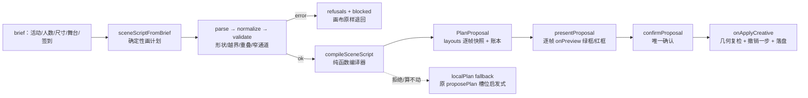

# 两份开源实现的共同点，以及幕景 3.0.0 的落地

> 2026-11-01 ｜ 基线：线上 3.0.0（https://scendance-scene-planner-ewz.pages.dev/）+ 仓库 `C:\mujing\Scendance2026` 当前工作树
> 上游证据：`petitmaker-construction-logic-2026-11-01.md`（Apache-2.0）、`oddenova-music-generation-2026-11-01.md`（AGPL-3.0）
> 基线证据：`scendance-generation-baseline-2026-11-01.md`
> 本文回答一个问题：**这两个看起来毫不相干的开源项目，为什么把"一句话变成结果"收敛成了同一套骨架？幕景该抄哪一段，抄完长什么样？**

---

## 1. 一句话结论

两条链路长得不像（一个是造地图，一个是写音乐），但**骨架是同一套**：

> **让模型只写一份「可读、可校验、可整段重写」的工件（受限 DSL / 计划 IR），把合法性判断交给一个不产生副作用的确定性校验器，把"放不下"变成返回值而不是异常，最后由一个终态动作一次性提交，并把被拒绝的东西逐条记账、读回给人和模型。**

模型负责**意图**，不负责**正确性**；正确性由代码保证。两个项目各自独立收敛到这里，说明这不是风格偏好，而是"LLM + 有物理/结构约束的产物"这一类问题的必然结构。

---

## 2. 上游各自怎么走完这一步

### 2.1 PetitMaker（智能建造，Apache-2.0 代码）

```
一句话/配方 → 六个纯计划阶段（不读地图、不写地图）
            → 整份计划 IR 先存在
            → 唯一 Command 写入门：两阶段规则，拒绝返回 {success:false, errors}
            → settle 定点收束（遍数上界 + 常量咬合，直到"这遍什么都没变且无孤岛"）
            → 候选在副本上生成，落地靠指纹校验 + 命令重放（不是生成后 undo）
            → 拒绝计数账本 refused{...} + provenance 归因
```

关键证据：`src/tools/generation/designer/pipeline.ts:103-121`（整份计划先于第一条命令）、`src/core/commands/command-executor.ts:344-351`（拒绝是返回值，state 不变）、`src/tools/generation/designer/streets/settle.ts:327-383`（定点收束）、`src/tools/generation/run/candidates.ts:188-229`（指纹 + 重放）。

Agent 层用的是**宏工具**，不是逐格画：`update_plan` 先把计划画成 annotation（"plan on the map"），人看得见、能改；随后 `build_road_network` / `decorate_zone` / `plant_forest` 这些宏按 zone 施工，每个 macro 内部还是走同一道 Command 门。

### 2.2 oddeNova（vibe 音乐，AGPL-3.0）

```
一句话 → 意图分类（chat 还是 compose）
      → Agent 循环（≤30 轮），只有三个工具：
           setCode(code, explanation)   整段全量重写，没有 patch/diff
           validate(code)               Proxy dry-run 抓幻觉 API + 白名单 + transpiler
           commit(explanation)          终态信号，内部再校验一次
      → 播放-落库同事务（先 play，再无条件写 session 真相）
      → 下一轮把"当前代码 + BPM + 音层摘要"注入 user 消息
```

关键证据：`src/agent/tools.ts:166-204`（整段重写）、`src/services/strudel.ts:2093-2134`（validate 真身是"真执行 + 兜底作用域"）、`src/agent/loop.ts:490-527`（模型不 commit 也自动收尾）、`src/lib/playback-commit.ts:1-24`（先播再落库）。

`/* @layer NAME */` 注释协议是这套东西的"地址系统"：同一份注释同时是输出格式约束、校验失败定位单位、diff 分组键、分享卡说明键。

---

## 3. 共同点：七条同构机制

| # | 机制 | PetitMaker 怎么做的 | oddeNova 怎么做的 | 为什么必然收敛到这里 |
|---|---|---|---|---|
| 1 | **单一工件**：模型不直接改媒介，只写一份完整工件 | 配方 + 计划 IR（六阶段纯函数产物） | 整段 Strudel 代码（`setCode` 无 patch） | 增量 op 流只能靠"重放"验证，半应用的 op 流就是坏房间/坏曲子；整段工件可读、可 diff、可重算 |
| 2 | **生成与校验分离** | 生成器产 Command，规则引擎独立判定 | Agent 写代码，validate 独立执行 | 自己判自己等于没判；校验器必须能对子单元单独跑（层/区），才能定位 |
| 3 | **拒绝是数据不是异常** | `{success:false, errors}` + 哪一格哪件 | `{ok:false, error:"..."}` 进 `role:tool` | 异常会中断循环，"放不下"是常态；只有返回值能被计数、回灌、重试 |
| 4 | **确定性执行 + 定点收束** | settle 循环 + 遍数上界 + 常量咬合 | 整段代码在同一引擎里 eval，结果可复现 | LLM 一次成型不可靠；靠有界迭代把几何/语法收敛到不动点 |
| 5 | **一次终态提交** | 候选 → 指纹校验 → 命令重放 | `commit` 抛 `CommitSignal`，只提交 `state.code` | 中间态不能泄漏给用户；提交必须唯一、可回滚、可复现 |
| 6 | **拒绝计数账本** | `refused{roads,anchors,lanes}`/`rampsMisplaced`/`unroadedGates` | 校验错误分类（语法/运行时/mini）+ 逐层定位 | "看起来成功但其实缺一块"是这类系统最贵的失败；必须变成可断言事实 |
| 7 | **可读回摘要**（给人和模型） | `get_annotations` / `evaluate_map` / outcome 摘要 | `parseScore` 的 BPM + 音层摘要注入下一轮 | 模型下一轮需要知道"现在是什么状态"，人需要知道"刚才到底改了啥"；摘要必须是结构化的，不是截图 |

**另有两条"便宜但有效"的**（两边都有，容易被忽略）：

- **单一权威名单**：oddeNova 用同一份 `sample-allowlist.ts` 同时生成 prompt 清单和运行时校验器（从根上消灭"prompt 说 A、校验器认 B"）；PetitMaker 的工具 schema、wire schema、approval gate 全部从同一个 `TOOLS` 派生（`src/agent/tools/registry.ts:28-124`）。幕景对应的是"不要再 fork 一份第四套 wire schema"。
- **兜底收尾**：模型经常忘记调终态工具；oddeNova 在循环结束时代码变了且校验通过就自动收尾。这条依赖"校验无副作用"，放进幕景时要有成本闸门。

### 3.5 横向交叉验证：五个外部系统怎么看这套骨架

为了确认这不是"两个项目恰好相似"，另做了一轮独立调研（`parallel-systems-generation-2026-11-01.md`，5 个系统、直连源码/论文）：

| 共性环节 | 独立验证者 | 结论 |
|---|---|---|
| 语言 → 单一受限工件 | LayoutGPT（CSS 风格布局文本）、Holodeck（房间/物件/关系 JSON）、SceneCraft（场景图 + Blender 脚本）、MAC-SQL（SQL） | 4/4 都是"只让模型写工件，不让它改世界" |
| 确定性解释/求解 | Terraform（HCL→plan）、Holodeck（DFS/MILP）、SceneCraft（关系打分） | 模型之后一定有一层非模型的确定性程序 |
| 结构化拒绝回灌 | MAC-SQL（`sqlite_error` + `exception_class`）、Terraform（tfdiags）、SceneCraft（VLM 指错） | 强验证，但**粒度差异极大** |
| 一次终态提交 | Terraform `apply`、oddeNova `commit` | 强验证 |
| 可读回摘要 | Terraform `change_summary`、Holodeck 俯视图 + scene JSON、SceneCraft 渲染图 | 都做到"人读一句 + 机器读一份" |
| **计划与执行分离** | 只有 Terraform 五件套齐全（plan 工件 + 审批门 + apply 不改参 + 事件流 + 计数） | 3D 三家与 MAC-SQL **都没有**这一层 |

**我们缺的三条**（已写进第 7 节）：

1. **计划工件**：Terraform 的 saved plan 把配置快照 + 基线 state + 变量一起钉住，apply 从内嵌基线起算、且不许改参。幕景的候选只是内存里的快照序列，确认时用的是对象引用相等（`agent-panel.tsx:883`）——能防"改过场景"，但防不了"改完需求再套旧候选"，也没有审计。
2. **逐条诊断**：Terraform 每个问题是 `{severity, summary, detail, subject}`，MAC-SQL 把错误分类后回灌；幕景云端是"遇错整批 422"（`_shared/ai.ts`）+ 前端只有 `dropped: number`。
3. **生成前算可行域**：Holodeck 把边界/不重叠/贴墙写成硬约束，LayoutGPT 用越界率事后度量。幕景本次已把"容量反算"做进编译器（见 6.3），但还没有"布置前先算出这块地最多能坐多少、再让人做选择题"的独立模块。

---

## 4. 两边不一样的地方（以及为什么）

| 维度 | PetitMaker | oddeNova | 对幕景的含义 |
|---|---|---|---|
| 产物介质 | 离散网格，几何约束硬 | 时间轴音频，约束软（难听但能播） | 幕景更接近前者：桌椅撞墙是真的不能用 |
| 校验强度 | 规则引擎，逐命令 | 真执行 dry-run + 静态白名单 | 幕景两者都要：结构几何 + 目录存在性 |
| 反馈周期 | 秒级（构建） | 即时（下一个 cycle 就能听见） | 幕景用"预览 → 确认"替代"即时"，必须保住"确认前不落盘" |
| 人介入点 | 计划画在 annotation 层，可改 | 代码面板可见可改 | 幕景已有预览 + 撤销一步；缺的是"计划本身可读" |
| 许可证 | Apache-2.0（代码可移植，需保留 NOTICE；素材/品牌另有条款） | **AGPL-3.0**（整个仓库） | **oddeNova 只能借机制，不能抄代码进闭源分发**；本次落地没有复制它一行代码 |

许可证这条不是形式主义：oddeNova 的 AGPL 传染范围覆盖整个 workspace，把它的 agent 循环贴进幕景前端会改变幕景的分发义务。所以本次落地是从机制重新实现的。

---

## 5. 幕景原来缺什么（基线实测）

审计报告的结论：**"生成方案"有两条互斥链路**（本地 `proposePlan` 槽位启发式 / 云端 `agent-runner` 六轮工具循环产 `commands`），IR 有两套且不统一——服务端 `commands` 受限 DSL（`supabase/functions/_shared/ai.ts:42-51`），前端只有 `PlanProposal.layouts` 快照序列（`frontend/components/room-organizer/lib/agent-proposal.ts:68-96`），**没有 op 级 IR，也没有"计划"这一层**。

对照第三节的七条：

| 机制 | 落地前 | 说明 |
|---|---|---|
| 单一工件 | ⚠️ 半有 | 云端有 candidate，本地只有"最终快照序列"，中间没有可读的计划 |
| 生成/校验分离 | ⚠️ 半有 | `validate_candidate` 只校验 op 回放结果，不校验"意图是否合理" |
| 拒绝是数据 | ✅ 有 | `PlanProposal.blocked/dropped/refusals` 已是返回值 |
| 确定性执行 | ❌ 没有 | 槽位启发式，不是约束求解；换一版靠 `variant` 轮转 |
| 终态提交 | ✅ 有 | `onApplyCreative` 是唯一落盘通道 |
| 拒绝计数 | ✅ 有 | `added/removing/dropped/keptLocked/overlapCount` |
| 可读回摘要 | ⚠️ 半有 | `planLines()` 报数，但不报"计划长什么样" |

缺的核心是第 1、2、4 条：**没有一份"计划"可以被读、被拒、被重算**。这正是两个上游都做了、而幕景只做了结果没做计划的地方。

---

## 6. 落地：场景脚本（scene script）

### 6.1 设计

新增一层声明式计划，位于"人说的话"和"画布上的椅子"之间：

```ts
// supabase/functions/_shared/scene-script-contract.ts（前后端同一份 zod 契约）
{
  version: 1,
  seed,                        // 同脚本 + 同场地 + 同 seed → 同一个房间
  layoutMode: 'dining' | 'desk-chair',
  guests?,
  zones: [                     // 米制、场地居中；rect 是西北角 + w/d，z 向南
    { role: 'stage' | 'checkin' | 'seating' | 'booth' | 'plant' | 'aisle' | 'reserved',
      rect: { x, z, w, d }, count?, label? },
  ],
  constraints: { aisleMinM, wallGapM },   // 通道/墙距是尺度不是风格
}
```

`aisle` / `reserved` 不摆东西：它们只负责**挖出**通道——这是 PetitMaker"zone 先行、施工受限"的直接对应物。

### 6.2 数据流



编译器内部的顺序纪律（对应上游"结构先于装饰"）：

```
清场（保留锁定件与结构标记，报出撤掉几件）
  → stage（背板贴区北沿，面南）
  → checkin（签到台居区中，面南）
  → seating（按一组桌椅的**真实包围盒**排网格 + 定点收束）
  → booth / plant（装饰，放不下只记账）
  → 回读：重叠计数、座位数、结构闸
```

### 6.3 已经写进仓库的代码

| 文件 | 作用 |
|---|---|
| `supabase/functions/_shared/scene-script-contract.ts` | zod 契约 + 11 个 issue code 的统一词表 + `SCENE_SCRIPT_AXES`（unit `m` / origin `center` / axis `XZ`）显式声明坐标约定（前后端共享，不 fork 第四套 schema） |
| `frontend/components/room-organizer/lib/scene-script.ts` | `parseSceneScript` / `normalizeSceneScript` / `validateSceneScript` / `sceneScriptFromBrief` / `describeSceneScript` |
| `frontend/components/room-organizer/lib/scene-script-compiler.ts` | `compileSceneScript`：纯函数、确定性、`acceptBatch` 整组接受或整组拒绝、两种朝向取位子多的、`settle` 有界收束、容量反算、逐角色账本 |
| `frontend/components/room-organizer/lib/local-plan.ts` | 本地生成的唯一门：脚本路优先，被拒（或一个座位都排不出）则退回原 `proposePlan`（`via: 'script' \| 'fallback'`） |
| `frontend/components/room-organizer/panels/agent-panel.tsx` | `runLocal` 里一次调用替换（原 `proposePlan` → `localPlan`），预览/确认/撤销三道门一行没动；气泡里先报一句「计划」（`scriptSummaryOf`），再报件数 |
| `lib/scene-script.test.ts` / `scene-script-compiler.test.ts` / `local-plan.test.ts` / `scene-script-regressions.test.ts` | 50 个用例，最后一个是评审发现的回归集（P0/P1 逐条钉住） |

三条上游机制在代码里的具体落点：

1. **拒绝是数据** → `acceptBatch` 返回 `{accepted, reason}`，编译器把每次拒绝写进 `refusals` + `ops[role].refused`，从不抛异常；脚本本身不成立时返回 `blocked`，`layouts` 原地退回而不是给一版半成品。
2. **确定性 + 有界收束** → `measureSet` 量一组桌椅的真实包围盒（含椅子），网格按它排，两种朝向各排一次取位子多的；某一格被顶住时，`settle` 把这一格从候选里剔除后重来，最多 6 遍，收敛与否写进 `settled`。第一版实现是"少要一组但保留同一前缀"，被测试抓出死循环，改成"剔除坏格"；第二版 4 遍上界在"一件顶住连带顶到邻组"的用例上不够，被测试抓出后改成 6 遍。
3. **一次终态提交** → 编译器只返回候选；确认仍走原 `confirmProposal → onApplyCreative`，撤销一步整体退回。预览与落盘之间用 `proposalBase` 比对，场景变了就作废。

容量不是"放不下就算了"：`fillSeating` 同时反算这块座位区**最多能坐多少**（`slots.length × 每桌座位`），座位不够时 `W_CAPACITY` 写的是"最多 16 座、这一版摆出 16 个、还差 8 位"，而不是只报一个差额。

### 6.4 评审发现与修复

写完就被独立评审打回来了（`scene-script-code-review-2026-11-01.md`，P0 1 / P1 4 / P2 9 / P3 8）。最值得记的三条，因为都属于"测试全绿也发现不了"：

| # | 问题 | 为什么全绿也抓不到 | 修法 |
|---|---|---|---|
| P0 | 旋转版式把每件家具朝向拧了 180°：位置转了 −90°，`rotation` 却加 +90°，主路径 16/16 椅子背对桌子 | 差的正好是 π，`rotatedHalfExtents` 用 `|cos|/|sin|`，包围盒、碰撞、keep-out 全部照旧正确 | 位置与朝向同号（`rotation − π/2`），并补一条"每把椅子必须面向最近的桌子"的断言 |
| P1 | 一组桌椅都装不下的场地（2 m 宽）报"最多 26 座""52 件放不下" | `buildFurnitureSet` 返回空样本 → 包围盒 0 → 网格用 0.5 m 间距排满整块地 | 空样本直接判 `E_ROLE_UNFIT`，不走网格 |
| P1 | "加座，再排一版"按钮实际无效 | 座位优先分支原先在早返回之后，永远到不了 | 分支提到早返回之前，真重编译一遍填满座位区 |

其余已修：`dropped` 单位统一成"件"且不重复计数、容量扣除被锁定件永久占死的格、`refusals` 不再为空、标准 brief 不再自带 5 条假 `E_ZONE_OUTSIDE`、`W_DUPLICATE_ROLE` 文案与实现一致、`count` 上限对齐 `guests`、签到台补"装得下"检查、座位数把锁定椅子算进来、多座位区 `settled` 取各区与运算、`summary` 用归一化后的脚本生成、`seatsPerSet` 改成数椅子而不是 `count − 1`。

回归集 `scene-script-regressions.test.ts` 把上面每条都钉成一条断言。

### 6.5 验证证据

```
frontend: npx vitest run scene-script / scene-script-compiler / local-plan / scene-script-regressions
  → 4 files / 50 tests passed（确定性、通道禁入、锁定件保留、清场计数、重叠为 0、旋转朝桌、
     假容量拦截、账本单位、加座生效、容量扣障碍、settle 收敛、小场地退回启发式）

frontend: 生成相关 8 个既有套件（agent-proposal / furniture-sets / collision / geometry /
  layout-review / brief-agent / workbench-agent / material-generate）
  → 161 tests passed，0 失败（替换接入点没有回归）

frontend: npx tsc --noEmit
  → 仍有 7 处既有错误（审计记录为 6，均在在研面板/图纸标尺文件里，与新增 4 个文件无关；新增文件 0 错误）

frontend: npm run build
  → "✓ Compiled successfully in 17.3s" 后停在类型检查：
    ./components/room-organizer/lib/bingo-feedback.ts:121:48（在研文件里的既有类型缺口），
    与本次新增模块无关 —— 新链路能过编译，构建被既有 WIP 类型错误挡住。
```

**没验证的**（诚实列出）：

- 浏览器里的真实观感：帧数、绿框/红框、`presentProposal` 的 420 ms 节奏。`agent-panel.react.test.tsx` 在本机 Node 26 + jsdom 下因原生 `localStorage` 覆盖而红，是环境问题不是代码问题（审计报告已记录）。
- `npm run build` 没有跑绿：见上，停在既有 WIP 类型错误（`bingo-feedback.ts:121`），不是本次新增模块。
- 座位数量是否"够漂亮"（例如 12×9 摆 24 人是否刚好）只做了下界断言，没有做人眼评估。

---

## 7. 下一步（按价值排序）

1. **让云端 agent 也能写脚本**（最大收益）：现在云端 `agent-runner` 只有 `submit_candidates(commands)`。加一个 `submit_scene_script` 工具，让模型写计划而不是写 op，服务端用同一份 zod 契约校验，前端用同一个 `compileSceneScript` 落地。这样两套 IR 合成一套，`validate_candidate` 退化成"脚本能不能编译"。需要改 `_shared/agent-runner.ts` + `ai.ts` + 部署，超出本次"不改云端"的边界。
2. **计划工件 PlanArtifact**（横向调研排第一）：`{id, createdAt, expiresAt, baseHash, layoutHash, counts}`，出方案时生成，确认时比对内容哈希而不是对象引用，成功后写一条审计。Terraform 的 saved plan 是它的完整形态；幕景现在的 `agent-panel.tsx:883` 用引用相等，能防"场景改过"，防不了"改完需求套旧候选"。
3. **逐条诊断 Diagnostic**：`{severity, code, opIndex, ids, message, hint}` 替代服务端"遇错整批 422"和前端 `dropped: number`，repair 仍限一次。Terraform tfdiags 与 MAC-SQL 的错误分类都是这个形状。
4. **通道与容量做成硬约束**：容量反算与"最多 N 座"文案已落地（6.3/6.4），拒绝与警告也已经接进气泡（`scriptNotesOf`）；`aisleMinM` 目前仍只用于警告和禁入判定，下一步是把"主通道 ≥1.2 m、入口净空"在生成**前**变成可行性掩码。

2、3 两条与"计划读回给人"（`describeSceneScript` 的人话 + `refusals` 的第一条原因已经接进气泡）共用同一套 issue code，不需要第二套词表。

---

## 8. 存疑与边界

- 两份上游报告的 `file:line` 是各自本地副本的行号（PetitMaker 浅克隆 HEAD=v2.0.673；oddeNova 来自 codeload zip，无 git 历史），上游后续提交可能移动行号。
- PetitMaker 的**代码**是 Apache-2.0，但**美术素材/品牌**另有条款：本次只借机制，没有取用任何素材、字体或界面资源。
- oddeNova 是 **AGPL-3.0**：本次没有复制它的任何一行代码，第 3 节的机制是对报告中的行为描述的重述与重新实现。
- "两个项目独立收敛到同一骨架"是基于本次读到的两份实现的归纳，不是对全部同类系统的统计结论。横向交叉验证见 [parallel-systems-generation-2026-11-01.md](2026-11-01-五系统交叉验证.md)：Terraform / Holodeck / SceneCraft / LayoutGPT / MAC-SQL 五个系统里，五环共性基本被独立验证，只有 Terraform 同时具备"计划工件 + 审批门 + 不可变参数 + 机器可读事件 + 计数摘要"。
