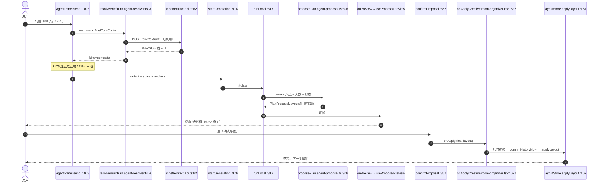

# 幕景 Scendance 3.0.0 生成链路基线审计（2026-11-01）

> 只读审计：不改业务代码、不提交、不部署。工作树含未提交在研改动（`frontend/components/room-organizer/panels/*`、新增 `lib/material-generate.ts`、`lib/material-library-meta.ts`、`panels/material-create-cell.tsx` 等），下文结论均按**当前工作树**记录。仓库 `frontend/package.json:3` 仍是 `2.2.0`，线上 3.0.0 与包版本号尚未对齐，引用版本时需注意。

## 0. 结论速览

1. "生成方案"是**两条互斥链路**，由"是否连上云项目"分流：未连云 → 前端本地模板/启发式（`proposePlan`）；连云 → 服务端 LLM + 工具调用产 `Proposal`。两者共用右栏同一张确认卡与"确认布置"。
2. 真正的 IR 有两套：**服务端 `commands` 受限 DSL**（`supabase/functions/_shared/ai.ts:42-51`）与**前端 `PlanProposal.layouts`（RoomLayout 快照序列）**。前端没有 op 级 IR，也没有 zod 校验层。
3. 确定性求解器不存在：`proposePlan` 是槽位启发式 + 线性扫描找空位，不是约束求解。
4. 校验分四层且都已存在（几何/结构/边界/云契约），但只校验**结果几何**，不校验"脚本语义"。
5. "确认前不写入"靠 5 道机制保证，最关键的是 `onApply` 是唯一落盘通道（`room-organizer.tsx:1627-1635`）。
6. 基线不全绿：根 typecheck 绿、根 test 4 例超时红、**frontend typecheck 6 错**、agent-panel 套件因 Node 26/jsdom 环境红；生成相关 9 个 lib 套件 167 例全绿。

## 1. 生成链路全景

### 1.1 本地族（未连接云项目，默认路径）

| 步 | 代码位置 | 说明 |
|---|---|---|
| 入口 | `agent-panel.tsx:1078` `send(text)` | 右栏唯一入口，尺寸表单与"大绿钮"已砍（13-15） |
| 意图分流 | `agent-panel.tsx:1081/1099/1116/1122/1131` | 停一下 / 按图纸估 / 加物料 / 体检 / 出方案 |
| 听懂 | `frontend/lib/agent-resolver.ts:20-36` | `NEXT_PUBLIC_AGENT_ENABLED=1` 且后端可用时走 `/brief/extract`，否则规则版 |
| 模型槽位 | `backend-session.ts:1134-1137` → `api.ts:62-79` | 提示词唯一事实源 `_shared/brief-extract-contract.ts:28`；12s 超时回退（`agent-resolver.ts:24-27`） |
| 记忆/防复读 | `brief-agent.ts:93-147` | 跨句槽位累积，`kind: generate/ask/ack/none` |
| 出方案闸门 | `agent-panel.tsx:1136-1184` | `turn.kind !== 'generate'` 只说回话；连云走 1173，否则 1184 |
| 真正跑一趟 | `agent-panel.tsx:994-999` → `976-991` | 60s 超时护栏（977） |
| 立场地（先落壳） | `agent-proposal.ts:116` `raiseVenue` / `158` `replaceVenueWithShell`；`venue-shell.ts:60` `buildVenueShell` | 场地是"已确认真相"，先 `onApply` 落壳（`agent-panel.tsx:833`） |
| 算候选（纯函数） | `agent-proposal.ts:306` `proposePlan` | 输入 `PlanInput`（48-66），输出 `PlanProposal`（68-96）：`layouts[] / added / removing / dropped / overlapCount / blocked` |
| 推预览 | `agent-panel.tsx:726-745` `presentProposal` | 逐帧 `onPreview(layouts[step])`，420ms/帧 |
| 画布预览 | `room-organizer.tsx:1661-1665` `onPreviewAi` → `hooks/use-proposal-preview.ts:18-39` → `three/proposal-preview.ts:54` | 只挂在 three 场景里，候选与 base 不一致即丢弃（use-proposal-preview.ts:22-24） |
| 确认 | `agent-panel.tsx:867-880` `confirmProposal` | `blocked` 拦截、base 变了作废（875） |
| 落盘 | `room-organizer.tsx:1627-1635` `onApplyCreative` | 再校验 `canApplyLayoutGeometry` → `commitHistoryNow()` → `actions.applyLayout` |
| store | `hooks/use-layout-store.ts:167` → `hooks/layout-reducer.ts:882-892` | `applyLayout` 走 `normaliseLayout`，并在 180 行跳过 work-order 补齐 |
| 撤销 | `hooks/use-history.ts:53/180`；`room-organizer.tsx:887` | 整版一次 applyLayout = 一个撤销步 |

不产方案的同入口旁支：`addMaterials`（456-492→`proposeAddition` `agent-proposal.ts:460`）、`reviewNow/applyReviewFix`（387/413→`layout-review.ts:240/583`）、`resizeVenueOnly`（760，只落壳）。

### 1.2 云端族（已连接云项目）

`agent-panel.tsx:980-984` 判 `connection === '项目已连接'` → `cloudRun`（965-973，带 `requirePreview: true`）→ `creative-studio.tsx:822` `generate` → `backend-session.ts:1073-1080` `startAgentRun` → `POST /projects/:id/agent-runs`（`api.ts:120`）→ `agent-runner.ts:58` `executeAgentRun`：DeepSeek 工具循环（`20-32`，含 `get_scene / search_resources / create_parametric_model / validate_candidate / submit_candidates`），最多 6 轮、第 6 轮强制 `submit_candidates`（111/118）→ `ai.ts:60` `buildProposal` 把 `commands`（42-51）打到 `base_scene` → `sceneSchema.parse` + `canApplyStructuralChange` + `sceneWarnings`（128-134）→ 存 proposal（`api.ts:200-205`）。前端 `consumeRun`（`creative-studio.tsx:715-724`）校验基线与有效期 → 卡片 → `applyPreview`（936）→ `applySceneProposal`（`backend-session.ts:1165-1197`）→ `client/scene-client.ts:68-74` → `POST /proposals/apply`（`api.ts:211-217`，再校验 `dimensionConflicts`、结构变更与 `sceneHash`）。

### 1.3 单件物料生成（与布置方案无关）

`material-create-cell.tsx:55/69` → `lib/material-generate.ts:33` `submitMaterialGenerate` → 只打本机 Lux3D 代理 `DIRECT_BASE`（`aholo-assets.ts:4`，`/text-to-3d`、`/image-to-3d`），代理未开即返回 stub、不发请求（`material-generate.ts:35`）。云端通道是另一条：`POST /jobs`（`api.ts:297-302`）→ `generation-worker/index.ts:1-6` → `worker-handler.ts:6-20`（Bearer `GENERATION_WORKER_SECRET`）→ `worker.ts` `processGeneration`；通道选择纯函数 `chooseLane`（`generation-lane.ts:41-63`，offline/library/parametric 免费优先）。**`generation-worker` 不生成布置方案，只生成 3D 资产**，改布置链路不必碰它。

### 1.4 时序图



## 2. 现有 IR 与校验

### 2.1 三层数据结构

1. **画布模型** `RoomLayout`/`FloorLayout`/`FurnitureItem`：`lib/types.ts:122-160`（含 `materialId/assetId/glbUrl/locked/structuralOpeningId/handoff` 等 30+ 字段），`Vec2` 在 `types.ts:6`。
2. **线上契约** `Scene`：zod 判别联合 `sceneSchema`（`domain.ts:146-159`），`objectSchema`（38-55）、`venueSchema`（68-…）、`structureSchema`（107-…）、`proposalRequestSchema`（228）。前端类型直接取自 `_shared/domain`（`types.ts:1-4`、`backend-adapter.ts:4`），遵守 `frontend/AGENTS.md` 的"不另立 wire schema"。
3. **操作 IR** `commands`：`ai.ts:42-51`，8 个 op 全 zod strict（`add / remove / move / rotate / recolor / replace / add_resource / replace_resource`），提示词见 `ai.ts:22-31`。**仅服务端存在，前端无对应类型**。

前端 `lib/schema.ts` 是**手写守卫**（无 zod）：`isFurnitureItem:183`、`isFloorLayout:245`、`isRoomLayout:310`、`parseStoredLayout:418`，上限常量 `MAX_ITEMS_PER_FLOOR=2000`（53）、`MAX_LAYOUT_JSON_BYTES=8MB`（68）；`applyLayout` 分支再 `normaliseLayout`（`layout-reducer.ts:885`）。即"前端手写守卫 + 服务端 zod"双层。

### 2.2 几何/碰撞/边界校验怎么用

- 成对重叠：`geometry.ts:32` `itemsOverlap`（OBB，`toObb:52`），`283` `hasCollisions`（带 `CollisionContext`：keep-out/结构/内墙）、`91` `itemInBounds`、`104` `itemFullyOutside`。
- 结构/边界（真正闸门）：`structural-layout.ts:81` `canApplyLayoutGeometry(before, after)`——把 RoomLayout 转成 `SceneV2`（`layoutGeometryScene:14`）再调 `_shared/structural-geometry.ts:22` `structuralViolations`、`31` `canApplyStructuralChange`、`89` `dimensionConflicts`；`92` `structuralItemCollides` 给单件用。
- 生成器内部：`agent-proposal.ts:199` `tryAdd`、`213` `countOverlaps`、`431` `findAdditionSpot`、`488` 用 `canApplyLayoutGeometry` 兜底判 `blocked`。
- reducer 硬闸：`layout-reducer.ts:200`，`STRUCTURAL_ACTIONS` 若过不了 `canApplyLayoutGeometry` 直接返回原 state；`191-199` 先把门窗标记吸附回墙。
- **`lib/catalog-placement-guard.ts` 不是几何守卫**：它捕获 `layoutStore` 快照 + 后端会话身份（`16-43`），`assertCurrent()` 校验"场景/楼层/登录/租约"未变，失败抛"场景、楼层或登录状态已变化"。异步下载/生成落盘应复用它。

### 2.3 "确认前不写入"靠什么保证

1. 生成器不 import store（`agent-proposal.ts:1-12` 全是纯模块，全文注释 14-24 明说"只算不写"）。
2. Provider 只暴露 `onPreview`（`agent-panel.tsx:211`），预览落到 `room-organizer.tsx:1661-1665` 的 React state，不 dispatch。
3. three 叠加层按 base/candidate 引用相等条件渲染（`use-proposal-preview.ts:22-24`），不会污染持久化数据。
4. 唯一落盘通道 `onApply` → `onApplyCreative`（`room-organizer.tsx:1627`），二次几何校验 + `commitHistoryNow` + `applyLayout`；`agent-panel.tsx:832` 注明"直接 applyLayout 会绕过撤销"。
5. 云端另有 `assertFreshProposal`（`client/scene-client.ts:15-18`：project/session/generation/revision/base_hash 全比对）与服务端 `proposals.apply` 的 `sceneHash` 比对（`api.ts:211-216`）。

## 3. 缺口清单（对照理想链路）

| 环节 | 状态 | 证据与缺口 |
|---|---|---|
| 自然语言 → 槽位 | **部分有** | 8 个槽（`brief-extract-contract.ts:8-17`）+ 规则兜底（`brief-agent.ts:93`）。缺分区/动线/预算；`creative-brief.ts:5-16` 的风格字段不进生成器 |
| 受限 DSL / IR | **部分有** | 服务端 `commandsSchema`（`ai.ts:42-51`）已有 8 op；前端 `PlanProposal` 只有快照序列（`agent-proposal.ts:68-96`），无 op、无版本号、无 zone/elevation/size 表达，无法"只读脚本、不看几何"地评审 |
| 确定性求解 | **没有** | `proposePlan` 用 `FURNITURE_SETS`（`furniture-sets.ts:32`）+ `setPlacementSlots:207` + `findAdditionSpot:431` 线性扫描，放不下即 `dropped`（484）；无容量/通道/视线目标函数，无失败重解 |
| 校验 | **已有（几何层）** | 见 2.2；业务规则只在 `layout-review.ts:240` 做软体检，不进确认闸；无脚本语义校验（"主通道≥1.2m"只是 issue，`layout-review.ts:18-19`） |
| 预览 | **已有** | 本地逐帧快照（`agent-panel.tsx:731-737`）+ three 叠加（`proposal-preview.ts:54`）；云卡片半透明模型（`creative-studio.tsx:1487`）。缺 op→快照映射，不能只重放某个 op |
| 唯一确认 | **已有** | 本地 `confirmProposal:867`；云 `applyPreview:936`；忙/过期/基线变都不亮确认（`agent-panel.tsx:1035-1040`）。缺结构化确认事件，本地确认不产 `requestId` |
| 落盘 | **本地已有 / 云部分有** | 本地 `applyLayout` + 一步撤销（`use-history.ts:53`）；云 `proposals.apply` 返回 `undoGroup`（`scene-client.ts:70`）。缺口：本地不写云、无 revision；撤销粒度是整版而非脚本步 |

## 4. 接入点清单（新增 scene-script 编译器）

### 4.1 建议新增

1. `supabase/functions/_shared/scene-script-contract.ts`：zod `sceneScriptSchema`（`{version:1, ops:[...]}`，建议 `place_set / place_item / place_row / zone / anchor / remove / move / rotate / resize_venue`），与 `domain.ts` 共用 `uuid/pointSchema`。放 `_shared` 保证前后端同一契约（`frontend/AGENTS.md`）。
2. `frontend/components/room-organizer/lib/scene-script-compiler.ts`：
   ```ts
   export interface CompileContext { base: RoomLayout; floorIndex: number; guests?: number | null; layoutMode?: 'dining' | 'desk-chair'; anchors?: LayoutAnchors }
   export interface CompileResult { layouts: RoomLayout[]; ops: SceneScriptOp[]; added: number; dropped: number; blocked: string | null; warnings: string[] }
   export function compileSceneScript(script: SceneScript, ctx: CompileContext): CompileResult
   ```
   纯函数：只收 `RoomLayout` 与脚本，id 由调用方注入工厂（`agent-proposal.ts:98` 的 `uid` 目前是模块私有且用 `crypto`，建议参数化以保可测）。
3. 入口接线（本地路径）：`agent-panel.tsx:1159-1184`，`turn.kind === 'generate'` 且未连云时，用 `extraction + anchors` 生成 `SceneScript`（先用 `layoutAnchors` 规则，后续可换 LLM），再 `compileSceneScript`，把 `CompileResult.layouts` 塞进 `PlanProposal`，复用 `presentProposal:726` 与 `confirmProposal:867`。
4. 想保留 op 可解释性：给 `PlanProposal`（`agent-proposal.ts:68`）加可选 `ops?: SceneScriptOp[]`，纯增量，不影响现有卡片。

### 4.2 必须复用、不要重写的纯函数

| 用途 | 位置 |
|---|---|
| 目录查询 | `lib/constants.ts:70` `FURNITURE_CATALOG`、`:291` `EVENT_CATALOG`；`lib/catalog-taxonomy.ts`（在研） |
| 组套与槽位 | `lib/furniture-sets.ts:32/184/207/251`（`setFitsRoom / setPlacementSlots / buildFurnitureSet`） |
| 空位搜索 | `agent-proposal.ts:431` `findAdditionSpot`（**目前私有，需 export**）、`199` `tryAdd`、`213` `countOverlaps` |
| 拼层 | `agent-proposal.ts:102` `withItems`（私有，需 export） |
| 几何 | `geometry.ts:32/91/104/283`；`lib/floor-keep-out.ts` `floorKeepOut` |
| 结构闸门 | `structural-layout.ts:81/92/14`；`_shared/structural-geometry.ts:22/31/32/89` |
| 场地壳 | `venue-shell.ts:36/60` |
| 适配 | `backend-adapter.ts:74` `backendSceneToLayout`、`layoutToBackendScene` |
| 可行性诊断 | `layout-review.ts:240/583` |
| 撤销 | `room-organizer.tsx:887` `commitHistoryNow`（暴露给 Provider 的 `onApply` 已包含） |

### 4.3 必须走 store action 的部分

- 任何改 `layout` 的写入只能经 `onApply`（`agent-panel.tsx:211`）→ `onApplyCreative`（`room-organizer.tsx:1627`），或 `layoutStore` action（`use-layout-store.ts:167`）；**不要**直接 import reducer 或改 `layoutStore.getState().layout`。
- `layoutStore.getState()` 只作只读身份校验（`catalog-placement-guard.ts:17-28`）；异步生成物用 `captureCatalogPlacement`（`:16`）保身份后再 `onApply`。

### 4.4 云端备选接入

若希望脚本在服务端生成：在 `agent-runner.ts:20-28` 的 `schemas` 增加 `submit_scene_script`，在 `ai.ts:42-51` 旁新增 `sceneScriptSchema` 并在 `buildProposal:60-135` 用同一编译器语义校验；或给 `commandsSchema` 追加 `size/zone` 变体。不建议改 `/brief/extract` 契约（`brief-extract-contract.ts:8-20`），那要同时改提示词与前端 `toExtraction`（`agent-resolver.ts:39-50`）。

## 5. 基线验证（命令 / 退出码 / 失败项）

| 命令 | 工作目录 | 退出码 | 结果 |
|---|---|---|---|
| `npm run typecheck` | 仓库根 | **0** | 绿。`tsconfig.json:14` 只 include `supabase/functions/_shared/**`、`tests/**`、`client/**`，**不含 frontend** |
| `npm test` | 仓库根 | **1** | 4 例失败（详见下），其余通过 |
| `npm run typecheck` | `frontend/` | **2** | 6 个 TS 错误（见下） |
| `npx vitest run <9 个生成相关 lib 套件>` | `frontend/` | **0** | 9 文件 / **167 例全过**，6.89s（agent-proposal 26、workbench-agent 29、geometry 32、collision 27、creative-brief 15、backend-adapter 17、brief-agent 12、material-generate 3、catalog-placement-guard 6） |
| `npx vitest run agent-panel.react.test.tsx three/proposal-preview.test.ts hooks/use-proposal-preview.react.test.tsx` | `frontend/` | **1** | `agent-panel` 38/52 失败；另两套全过 |

**根 `npm test` 4 个失败用例**（vitest 5.0.3）：
- `tests/config.test.ts > rejects unsafe or non-exact origins: https://app.example.com#part`（Test timed out 5000ms）
- `tests/config.test.ts > rejects invalid cost amounts and amounts above the current SQL budgets`（Test timed out 5000ms）
- `tests/hunyuan-config.test.ts > checks only Hunyuan fields, without requiring or printing other service credentials`（`setTestAcl` 处 spawn 超时，`tests/hunyuan-config.test.ts:29`）
- `tests/merged-library.test.ts > contains unique, Chinese-labelled assets with matching GLBs and previews`（Test timed out 30000ms）
四例都依赖 PowerShell 子进程或大文件读取，属环境/超时而非逻辑断言，需在更宽松环境复跑确认。

**frontend `npm run typecheck` 6 个错误**（全在未提交在研文件）：`bingo-feedback.ts:121`（`Pick<BingoPlan,...>` 缺 `reviewPlanKey`）、`agent-panel.tsx:1284`（`jumpToQingguang` 未使用）、`agent-panel.tsx:1603` 与 `qingguang-rail-button.tsx:22`（`RefObject<X|null>` 不能当 `LegacyRef`）、`floor-plan-ruler.tsx:125/126`（`image.width` 可能 undefined）。这些是"typecheck 绿"的阻塞项，与生成链路无直接关系。

**agent-panel 套件红的根因是环境**：`agent-panel.react.test.tsx:114` `localStorage.clear()` 报 undefined，测试首行已有 `// @vitest-environment jsdom`。当前 Node **v26.2.0** + jsdom 30 + vitest 4.1.11，stderr 反复出现 `localStorage is not available because --localstorage-file was not provided`——Node 26 原生 `localStorage` 覆盖了 jsdom 实现。建议固定 Node 24；根与 frontend 的 vitest 版本不同（5.0.3 / 4.1.11），复现前先确认。

## 6. 附：读取的关键文件

`agent-panel.tsx`、`agent-proposal.ts`、`workbench-agent.ts`、`brief-agent.ts`、`creative-brief.ts`、`material-generate.ts`、`scene-presets.ts`、`types.ts`、`schema.ts`、`constants.ts`、`geometry.ts`、`structural-layout.ts`、`venue-shell.ts`、`catalog-placement-guard.ts`、`backend-adapter.ts`、`layout-review.ts`、`furniture-sets.ts`、`collision.test.ts`、`room-organizer.tsx`、`creative-studio.tsx`、`use-layout-store.ts`、`layout-reducer.ts`、`use-history.ts`、`use-proposal-preview.ts`、`three/proposal-preview.ts`、`frontend/lib/backend-session.ts`、`frontend/lib/agent-resolver.ts`、`client/scene-client.ts`、`supabase/functions/_shared/{domain,ai,agent-runner,agent-contract,brief-extract-contract,generation-contract,generation-lane,api,worker-handler,structural-geometry}.ts`、`supabase/functions/{scene-api,generation-worker}/index.ts`。
