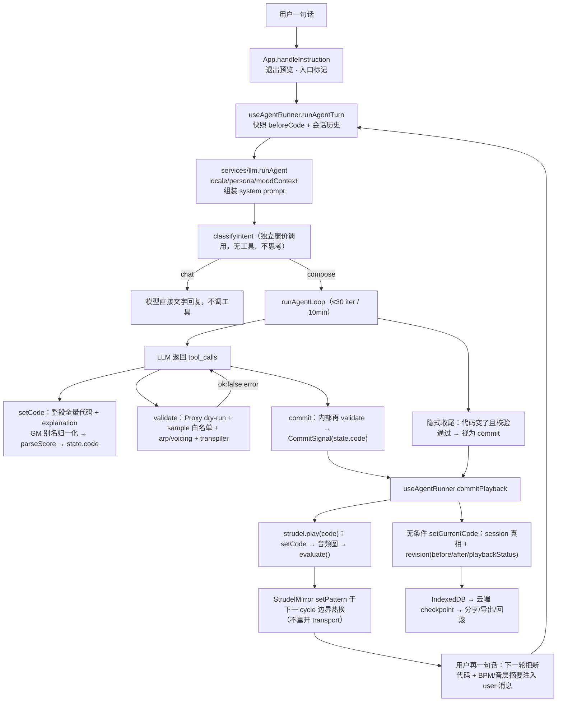

# oddeNova「一句话 → 正在响的音乐」生成链路研究

> 研究日期：2026-11-01 ｜ 研究人：oddenova-analyst（Team task-2）｜ 目的：为幕景 Scendance 的「自然语言 → 受限 DSL → 校验 → 实时呈现 → 迭代」生成架构提供可移植证据。
>
> **证据来源**：本地目录 `C:\mujing\_research\oddeNova`（由 Lead 以 codeload zip 解包，**无 `.git`，不是 git 仓库**，故无法给出 commit sha；下文所有 `文件:行号` 均为该 zip 工作树内的物理行号）。我在 2026-11-01 01:49 观察到的常规文件数为 688（含二进制/字体/图片），Lead 报 699，差异未逐一核对，见 §7。
>
> **只读声明**：未安装依赖、未运行上游、未修改上游任何文件。本报告是本次任务唯一写入的文件。

---

## 0. 直问速答（Lead 的 5 个问题）

| # | 问题 | 结论（一句话） | 关键证据 |
|---|---|---|---|
| ① | `setCode` 入参 schema / 整段重写 vs 按 layer 增量 | **每次都是整段全量重写**：`setCode` 只有两个字段 `code`（完整 Strudel 程序）+ `explanation`（必填，一句话进度）；没有 patch/diff/replaceLayer 接口。「layer」不是编辑单位，而是**代码内的结构协议**（`/* @layer NAME */`），被 parser 解析成可寻址切片，供校验定位、diff 展示、小票渲染共用。 | `src/agent/tools.ts:166-204`、`src/prompts/versions/v25.ts:267`、`src/agent/parser.ts:28,75-138` |
| ② | `validate` 用什么手段验证 | **不是 AST 白名单，是「真执行 + 兜底作用域」**：`@strudel/transpiler` 转译后，用 `new Function('__s__', 'with (__s__) { ... }')` 在 `Proxy` 作用域里 dry-run；`Proxy.get` 对 `globalThis` 上不存在的标识符抛 `ReferenceError`（抓幻觉 API）。再叠三层静态/词法检查：sample 白名单、`.arp("名字")`、`note(...).voicing()`；最后跑 transpiler 抓 `[mini]` mini-notation 错误。 | `src/services/strudel.ts:2086-2168`、`:1973-2075`、`:2241-2257`、`docs/design/strudel-code-validation.md:13-82` |
| ③ | 错误怎么回灌、怎么重试 | 工具失败返回 `{ok:false,error:"..."}`，loop 原样塞进 `role:"tool"` 消息 → 下一轮模型自己改。错误定向化由**两个互相独立的手段**组成：①`TIDAL_ONLY_API_ERROR` 只对「Tidal 专有 API 幻觉」这一个错误类别追加修复提示；②`findFailingLayers` 用「逐层单独 dry-run、错误信息必须完全一致」来定位出错音层——两者互不依赖、可分别单独触发。重试分层：请求级 3 次（500/1500ms + 抖动，只重试可恢复错误）、工具异常 2 次、**`validate` 失败不消耗重试**（属正常返回值，模型可无限次再调）。 | `src/agent/tools.ts:75-99,109-125`、`src/agent/loop.ts:171-222,478-487`、`src/agent/executor.ts:55-73`、`src/lib/errors.ts:30-52` |
| ④ | commit 后怎么热重载且不打断在播音频 | `commit` 抛 `CommitSignal` 终止循环 → `useAgentRunner` 调 `commitPlayback`（**先 play 再无条件落库**）→ `strudelService.play(code)`：`setCode` 只换编辑器缓冲，`claimTransport` 保证单 transport，`ensurePlayableAudioGraph` 后调 **引擎自己的 `evaluate()`**；StrudelMirror 在 scheduler 已启动时走 `setPattern(pattern, autostart)`，**在下一个 cycle 边界换 pattern，不重开 transport、不丢播放头**。另外 `loadOpening()` 在 scheduler 已启动时直接 return，不会重复预载。 | `src/lib/playback-commit.ts:1-24`、`src/services/strudel.ts:1113-1162,1179-1183,1237-1269`、`src/hooks/useAgentRunner.ts:172-207` |
| ⑤ | server/ 与 api/ 有没有第二套服务端生成逻辑 | **没有服务端音乐生成**。服务端只做四件事：会话/收藏持久化（Supabase）、分享（Vercel Blob，256KB）、每日建议文案（DeepSeek `deepseek-v4-pro`，严格 JSON）、official/Kimi 转发代理。**WAV/MP3/M4A 导出是浏览器端 `OfflineAudioContext` 离线渲染**（`strudel.ts:1405-1800`，`OfflineAudioContext` 在 `:1497`），不在服务端。 | `api/sessions.ts:24,191-204`、`api/share.ts:5-51`、`server/daily-suggestions-generation.ts:19-56`、`api/official/v1/chat/completions.ts:3-4`、`src/services/strudel.ts:1405-1800` |

---

## 1. 一页结论：最值得搬走的 5 个机制

1. **M1「三工具终态契约」**：agent 只允许 `setCode` / `validate` / `commit` 三个工具，`commit` 是唯一的终止信号且**内部再校验一次**、只信服务端 `state.code` 不信模型回传的代码。
   → 它防住的是：模型「说改了但其实没改」、提交绕过既有编辑（如 `setcps`）、以及没有终点导致的长尾空转。证据：`src/agent/tools.ts:133-242`。

2. **M2「双层校验 + 定向错误回灌 + 层定位」**：真执行式 dry-run 抓幻觉 API，transpiler 抓 mini-notation，静态规则补 `arp/voicing` 这两类「语法合法但播放期崩」的坑；错误本地化到 `@layer`；模型拿到的是可操作的中文错误，而不是黑盒异常。
   → 防住的是：LLM 生成「看着对、放不了」的代码，以及错误信息不足以自修导致的死循环。证据：`src/services/strudel.ts:2086-2168`、`src/agent/tools.ts:75-125`。

3. **M3「`/* @layer NAME */` 音层协议」**：一层注释标记，同时是 ① prompt 的输出格式硬约束，② parser 的切片锚点，③ 校验失败定位单位，④ 改动 diff 分组键，⑤ 分享卡片的说明键 `layerNotes`，⑥ 进度消息的叙述线索。
   → 防住的是：整段代码不可寻址 → 无法精准报错、无法向用户解释「改了哪一层」。证据：`src/agent/parser.ts:28,75-138`、`src/lib/code-diff.ts:48-67,157-189`、`src/agent/tools.ts:52-64,218-229`。

4. **M4「播放-落库同事务」**：`commitPlayback` 规定「先 play，再**无条件**把最新代码写成 session 真相」，无论播放成功与否；播放失败也生成一条 `playbackStatus:'failed'` 的 revision。
   → 防住的是：保存的代码和实际在响的代码发散（用户听到的和看到的不一致），以及回滚时无基线可用。证据：`src/lib/playback-commit.ts:1-24`、`src/hooks/useAgentRunner.ts:172-207`、`src/hooks/useSessions.ts:118-128`、`CONTEXT.md:15-29`。

5. **M5「Prompt 版本化 + 可回归评测」**：25 个 prompt 版本文件（v1…v25），`active.ts` 一行切换；每个版本头部写「为什么改、防住了哪个具体失败」；配套 `scripts/eval` 用「规则分（语法/BPM/分层/滤波/呼吸空间…）+ LLM Judge + 多轮 layer 保留分」做跨版本对比。
   → 防住的是：prompt 改一处、坏一片且无法量化回退。证据：`src/prompts/active.ts:3`、`src/prompts/versions/v25.ts:1-107`、`docs/ai/agent-instruction-design.md:22-30`、`scripts/eval/README.md:23-46,124-131`。

> 补充两条「便宜但有效」的：**采样名单一权威源**（同一份 `sample-allowlist.ts` 同时生成 prompt 列表和运行时校验器，见 `v25.ts:108-148` + `strudel.ts:2135-2163` → 从根上消灭「prompt 说 A、校验器认 B」的漂移）；**隐式收尾兜底**（模型没调 `commit` 但代码变了且校验通过 → 自动收尾播放，见 `loop.ts:490-527`）。

---

## 2. 端到端链路



| 阶段 | 具体动作 | 证据 |
|---|---|---|
| 入口 | 退出预览态、记录 entryPoint（text/mood/suggestion/retry） | `src/App.tsx:1111-1138` |
| 输入构造 | 若已有代码：`当前正在播放的代码（BPM: N，音层: A[env] / B）` + 代码 + `用户指令: …`；否则只有指令 | `src/agent/loop.ts:279-301` |
| 任务定型 | 独立 `classifyIntent`（不思考、无工具、单字输出，失败**偏向 compose**） | `src/services/llm.ts:448-475`、`src/prompts/intent-classifier.ts:9-33` |
| 生成 | 三家 provider 统一走 OpenAI 形态工具调用（Anthropic 侧做 tool_use/tool_result 折叠） | `src/services/llm.ts:267-269,342-440,179-254` |
| 校验 | 见 M2 | `src/services/strudel.ts:2086-2168` |
| 播放 | 见 M4/§3-M7 | `src/services/strudel.ts:1113-1269` |
| 落库 | revision + IndexedDB + 云 checkpoint | `src/hooks/useAgentRunner.ts:179-197,244-260`、`src/lib/session-storage.ts:16-25` |
| 反馈 | commit.explanation → 聊天回复 + 5 条建议 chips（纯文本解析，无第二次 LLM 调用） | `src/hooks/useAgentRunner.ts:186-197`、`src/services/suggestions.ts:77-96` |

---

## 3. 逐机制卡片

### M1 — 三工具终态契约（chat / compose 双模）

- **机制**：system prompt 首先做意图判断：聊天不调工具；作曲必须 `setCode`→`validate`→`commit`，`commit` 恰好一次。工具集只有 `validate` / `setCode` / `commit`；`commit` 内部再跑一次完整校验，并且**只提交 `ctx.state.code`**（注释明写「绝不让 LLM 传自己的代码 blob，那会绕过 setcps 等累积编辑」）。
- **证据**：`src/agent/tools.ts:133-242`（`:236-239` 为「只信 state.code」注释与 `CommitSignal`）、`src/prompts/versions/v25.ts:218,260-269,326-345`、`src/agent/loop.ts:435-465`。
- **防住的失败**：①模型口头说改了但没生成代码；②模型在 `commit` 里夹带一段「干净版」代码，绕过前一步的 setcps/累积改动；③无终止信号导致无限迭代（`maxIter` 30 是安全网，见 `loop.ts:248,315-320`）。
- **移植前提**：DSL 必须能**整段提交**（而不是增量命令流）；必须有一个「提交即生效」的终态工具，且终态工具能再次调用校验器。
- **不可移植**：prompt 里 14 轮 / 3 轮的分步节奏（`v25.ts:271-275`）是音乐创作的产品节奏，与幕景「布置」交互节奏不同；「一次会话只 commit 一次」也不适用于长会话编辑。

### M2 — 双层校验器（真执行 dry-run + transpiler）

- **机制**：
  1. `normalizeCode()` 折叠单/双引号字符串内的换行（LLM 常写多行字符串 → `Unterminated string constant`）；`stripUIDecorations()` 剥离 `._scope()`/`._pianoroll()`。
  2. 去掉顶层 `setcps(...)` 后，用 `@strudel/transpiler` 转译，再 `new Function('__s__', 'with (__s__) { return (async()=>{...})() }')` 执行；作用域是 `Proxy{ has:()=>true, get: k => globalThis[k] }`：**存在于 globalThis 就放行，不存在且不在 PASS_THROUGH 白名单就抛 `ReferenceError`**。
  3. dry-run 通过后：`findUnknownSamples()` 比对白名单（含 `samples({...})` 内联注册、`.bank()` 后缀合法性）；`findInvalidArpArguments()` 抓 `.arp("pinkyup")`；`hasNoteVoicingChain()` 抓 `note(...).voicing()`。
  4. `validateCodeTranspiler()` 只上报 `[mini]` 前缀错误（其余 transpiler 错误视为误报放行）。
- **证据**：`src/services/strudel.ts:1805-1866,1879-1884,2093-2134,2135-2163,2241-2257`、`src/lib/sample-allowlist.ts:437,466,506,1625-1671`、设计文档 `docs/design/strudel-code-validation.md:13-82`。
- **防住的失败**：①JS 语法错；②幻觉 API（`by`/`sometimesBy`/`someCyclesBy`/`within` 等 Tidal 专有函数，见 `tools.ts:80`）；③幻觉 sample 名（`s("superpad")`）；④语法合法但播放期才崩的两类（`.arp` 名字、`note().voicing()`）；⑤mini-notation 括号/分隔符错误。
- **移植前提**：DSL 必须有「可编程求值 + 可枚举全局符号」的运行时（JS 系天然满足）；必须能拿到**转译器**这一层（否则 mini/宏语法错误抓不到）；必须能列出「合法资源名」清单。
- **不可移植 / 注意**：它**不是安全沙箱**——`PASS_THROUGH` 只白名单了少数全局，其余 `globalThis` 上的东西（如 `fetch`）会被放行并真实执行；`validateCodeRuntime` 的 `has(){return true}` 让所有标识符都「可解析」。所以它防的是**幻觉**，不是**恶意代码**。幕景若把同类校验器放到浏览器，必须换真隔离（iframe/Worker/解释器 AST 白名单）。设计文档（`strudel-code-validation.md:24`）与工具描述（`tools.ts:137`）都自称「沙箱」，属措辞过宽。另外文档 `:98` 提到的 `max_iter=8`、`:98` 提到的 `replaceLayer` 工具已不存在（见 §7 文档漂移）。

### M3 — `@layer` 结构协议 + 结构解析器

- **机制**：`parseScore()` 是手写扫描器（正确处理字符串/行注释/块注释/括号深度），识别顶层 `setcps(N)`（只对纯数字算式用 `Function` 求值）与顶层 `stack(...)`，按顶层逗号切分音层（`splitTopLevelCommas`，`parser.ts:108,235`）；每层若以 `/* @layer NAME */` 开头则取该名字，否则自动命名 `layer_0`。它还从 `mask/gain/lpf/hpf/bank/note/struct/n/s` 的 `<>` 窗口里提取「层包络摘要」（如 `mask/16 gain/16`）。
- **证据**：`src/agent/parser.ts:28,35-59,75-138,235-301`。
- **防住的失败**：①整段代码不可寻址；②校验失败后模型不知道改哪层（`findFailingLayers` 逐层单独 dry-run，**要求错误信息完全一致**才算命中，见 `tools.ts:88-99`——宁可报不出位置也不报错误位置）；③给用户的 diff 只能是「一大坨」。
- **移植前提**：DSL 顶层必须有一个「组合子容器」（这里是 `stack(...)`），且允许注释标记；否则需要一个显式的 IR。
- **不可移植**：`cps×240=BPM`、`<>` 权重 `/N` 语义都是 Strudel/Tidal 特有；但「注释标记 + 顶层容器切分 + 每层包络摘要」这套形状与具体 DSL 无关。

### M4 — 播放-落库同事务（Playback commit）

- **机制**：唯一入口 `commitPlayback(code, sessionId, {play, setCurrentCode})`：**先 await play，再无条件写 session**，返回值只表示「播放是否成功」，不影响落库。`useAgentRunner` 在播放失败时把 UI 文案换成「agent 生成完了但代码无法运行: {引擎错误}」，同时仍写 `revision{beforeCode, afterCode, playbackStatus:'failed'}`。
- **证据**：`src/lib/playback-commit.ts:1-24`、`src/hooks/useAgentRunner.ts:172-221`（失败文案 `:199-201`）、`src/hooks/useSessions.ts:118-128`、`CONTEXT.md:15-29`（把「Session revision」定义为「一次已 commit 的 Agent turn 的不可变代码边界，播放失败也形成 revision」）。
- **防住的失败**：①「听到的」和「存下的」发散（刷新/同步后换了版本）；②回滚时找不到基线（`codeBeforeMessage` 依赖 revision.beforeCode，见 `src/lib/draft-diff.ts:44-80`）；③用户在后台会话完成时被突然换掉编辑器状态（`useAgentRunner.ts:208-221`：非当前会话只落库、不动编辑器、不发声）。
- **移植前提**：有一个「提交是终态」的概念；能记录每次提交的 before/after 与呈现结果。
- **不可移植**：`play` 的语义（音频是否成功）与幕景「3D 渲染是否成功」不同；但「呈现尝试 + 结果状态一并写入历史」可以直接照搬。

### M5 — 错误回灌：定向化错误文本 + 精确层定位

- **机制**：`validateCurrentCode` 把错误分成三类前缀（`语法错误:` / `运行时错误:` / `Mini-notation 错误:`）。**两个互相独立的定向手段**：
  - `TIDAL_ONLY_API_ERROR`（`tools.ts:80`）是一个窄正则 `/^(by|sometimesBy|someCyclesBy|within) is not defined$/`，只有「未定义符号恰好是这四个 Tidal 专有 API 之一」时才追加「改用 `.sometimes(fast(2))` / `.every(N, fast(2))`」提示；注释明写这是为了防止给 `.late()` 这类**真实存在**的 API 贴错标签、把修复方向带偏（`tools.ts:75-79`）。
  - `findFailingLayers`（`tools.ts:88-99`）与 API 提示无关：它把代码按 `@layer` 拆开逐层单独 dry-run，**只有当某一层复现出完全相同的错误信息**才判定该层（不同错误通常只说明该层依赖层外变量），宁可返回空也不给错位置；结果拼成「（错误位于 @layer X）」。
  两者可分别单独触发，可以同时出现，也可以都不出现。这些字符串会作为 `role:"tool"` 内容进上下文。
- **证据**：`src/agent/tools.ts:75-99,101-125`、`src/services/strudel.ts:2135-2163`、`src/agent/loop.ts:478-487`、`src/lib/agent-progress-handler.ts:38-41`（失败仅 console.error，不污染 UI）。
- **防住的失败**：①模型拿到 `ReferenceError: by is not defined` 却不知道「这是 Tidal 不是 Strudel」，反复换写法；②报错位置错导致越修越坏（`:88-99` 的保守策略）；③同一轮里模型重复调用同一工具导致重复执行（`loop.ts:377-408` 的去重缓存，键为 `name` + `\0` + `arguments`，命中则复用结果且**不产生 UI 事件**）。
- **移植前提**：错误必须结构化、可分类，且分类能用自然语言给出「下一步怎么改」；层定位要求「校验可对子单元单独执行」。
- **不可移植**：具体提示文案（Tidal→Strudel 的迁移知识）不可移植；「错误文本即 prompt」这一做法可移植。

### M6 — 隐式收尾兜底（模型不 commit 也能收场）

- **机制**：循环结束后若 `committed=false` 且 `state.code !== initialCode`，**再跑一次完整校验**：通过则视为已提交（带 warn「agent 未显式调用 commit，已自动收尾并播放」），失败则保留 `committed=false` 并 warn「最后代码校验失败」，让 UI 露出运行时错误；若用户主动中断则完全跳过兜底。
- **证据**：`src/agent/loop.ts:490-527`；触发原因在注释里写明：DeepSeek 经常不调 `commit`（要么最后一轮只返回文本、要么耗尽迭代）。
- **防住的失败**：用户看到「未检测到代码改动」但播放器其实马上要热重载新代码（状态自相矛盾）；以及模型耗尽预算却没有交付。
- **移植前提**：需要一个「代码是否变化」的等价判断 + 可重复调用的校验器。
- **不可移植**：这条兜底依赖「无副作用校验」这一前提；若校验本身要花钱（渲染/部署），兜底需要加成本闸门。

### M7 — 不打断播放的热重载

- **机制**：三件套。①`play()`：`claimTransport('studio')` 抢唯一 transport → `setCode`（只换编辑器缓冲）→ `ensurePlayableAudioGraph` → `loadOpening`（**仅当 scheduler 未启动**才做静默预载，`strudel.ts:1183`）→ `editorInstance.evaluate()` → `syncTransportState()`；若抛的是「音频图类错误」则重建 AudioContext 后重试一次（`:1142-1157`）。②`update()`：手动编辑时只调 `evaluate()`，注释明写「在跑的 scheduler 上 `evaluate()` 走 `setPattern(pattern, autostart)`，**在下一个 cycle 边界换 pattern，不 pause/replay、不丢播放头**」（`:1237-1250`）。③`rewindOnCodeChange()`：播放中改代码**刻意保留**播放头，非播放态才回到 0（`:1024-1040`）。
- **证据**：`src/services/strudel.ts:1113-1162,1142-1157,1179-1235,1237-1269,1024-1040,991-1010`、`src/services/transport.ts`（`claimTransport`）、`src/hooks/useStrudel.ts:42-84`。
- **防住的失败**：①每次 AI 改动都「停-播」导致听感断裂与重头开始；②首音丢失（`loadOpening` 静默触发首段每个音色一次，把 sample/soundfont/混响灌进缓存，再等音频时钟起步）；③两个 transport 同时响（试听 vs 工作室）。
- **移植前提**：呈现引擎要有「热替换 + 边界切换」能力（幕景=场景切换/增量重建，不是硬刷新）；要有可等待的「资源预热」阶段。
- **不可移植**：cycle 边界是音乐时钟概念；OfflineAudioContext 预载技巧也不通用。可移植的是「预热 → 边界替换 → 单 transport 所有权」三段式。

### M8 — 氛围→参数：情绪上下文的注入通道

- **机制**：`moodContext` 由**系统提示词追加段**承载（`buildSystemPrompt` 里 `moodContext ? base + 换行 + moodContext : base`）。来源是桌面端 AirJelly：读最近 2 小时应用使用事件，按应用聚合时长取 Top5，拼成一段英文提示（含「据此推断情绪并选风格/速度；不要向用户提及 AirJelly」）。情绪一键成曲走 `entryPoint:'mood'`，**刻意不带对话历史**。
- **证据**：`src/services/airjelly.ts:50-91`、`src/prompts/build-system-prompt.ts:27-38`、`src/services/llm.ts:486-490,511-515`、`src/App.tsx:1267-1288`。
- **防住的失败**：「根据我的心情生成音乐」这种零信息指令无处落地；以及情绪轮被历史污染成「改上一首」。
- **移植前提**：有一个可信的「当前上下文」来源（幕景可用：当前场地类型、天气/时间、最近编辑活动、活动日程）。
- **不可移植**：AirJelly 是 macOS 桌面端伴侣应用（`@airjelly/sdk`），属产品特有；且「从应用使用时长推情绪」这个推断本身在幕景不成立，只借「注入一段可解释的上下文 + 禁止向用户提及来源」的形状。

### M9 — 音乐性约束：字典/枚举 vs 自由发挥的分界线

- **结论**：**只有「资源名」被硬约束（可枚举 + 可校验），音乐本体（BPM/调式/和弦/结构）全是 prompt 引导 + 模型自由，不变量化校验**。
- **硬约束（有代码强制）**：sample 名 ∈ 单一权威清单（`SAMPLE_ALLOWLIST` ∪ `BUILTIN_SYNTHS` ∪ 代码内 `samples({...})` 显式注册 ∪ `bank_suffix` 合法）；GM 别名归一化（`gm_acoustic_grand_piano → gm_piano`，让代码在原生 strudel 可移植，`tools.ts:190-193`、`sample-allowlist.ts:506`）。
- **软约束（仅 prompt，无校验）**：BPM 用 `setcps(bpm/240)`（`v25.ts:165`，`parser.ts:92,299-301` 反算与 clamp 0.05–8）；音阶给的是**类别枚举** major/minor/dorian/mixolydian/phrygian/lydian/minor pentatonic，且明确「不绑定 root/octave、不要把带 root 的写法当模板」（`v25.ts:201-205`）；和弦只用 `.dict("ireal")` + `.voicing()`/`.mode()`/`.anchor()` 作为「可选手段」（`v25.ts:187-195`）；结构（intro/build/drop）不套模板，只给「编排原则 + 时间窗口算法」（`v25.ts:417-448`，`:444-445` 给出 `<v1…vk>` / `/N` / `@` 权重的正确语义与「`@` 与 `/N` 不可叠用」的硬禁令）；增益给了参考区间但明确「不要机械套用」（`v25.ts:379-380`）。
- **校验盲区（上游自己写明）**：音乐语义错误（层间频段冲突、音阶不匹配、层内 `setcps`）不在两步校验范围内（`docs/design/strudel-code-validation.md:156-182` 的盲区矩阵）。
- **防住的失败**：幻觉 sample/音色名（最高频、最致命的可执行失败）；以及模型「照抄示例」导致的同质化（多处显式「仅演示、不要照抄」：`v25.ts:157,188,285,332`）。
- **移植前提**：任何生成式 DSL 里，**能枚举的资源必须枚举**，并把同一份枚举同时喂给 prompt 和校验器；「审美」留给示例与自检清单。
- **不可移植**：具体音阶/和弦字典/增益区间是音乐领域知识。

### M10 — 状态与持久化：revision / 会话 / 分享 / 导出 / 撤销

- **机制**：
  - **会话真相**：`Session{code, messages, revisions[]}`；每条 assistant 消息带 `revisionId`，revision 存 `beforeCode/afterCode/playbackStatus/createdAt`（不可变）。
  - **本地**：IndexedDB（`oddenova-db` v7，`sessions_by_owner` / `personas` / `settings` / `oddenova_bridge_outbox` / `oddenova_bridge_checkpoints` 五个 store）。
  - **云端**：`api/sessions.ts` 按列存 `code, messages, input_mode, revisions, suggestions, external_source, favorited_at…`，分页用游标。
  - **分享**：整包 JSON（version:1，含 title/code/messages/revisions/locale/sharedAt）POST `/api/share`；服务端限 256KB，写 Vercel Blob `shares/<10字节base64url>.json`，GET 按 id 取。
  - **导出**：客户端 `OfflineAudioContext` 离线渲染（`exportAudio` 于 `strudel.ts:1405`，`OfflineAudioContext` 于 `:1497`）→ WAV(16bit，`:1724-1779`)/MP3(lamejs)/M4A(mediabunny)。
  - **撤销**：`useStrudel` 的 `historyRef` 栈（上限 50）保存「播放前代码」，`undo()` 弹栈后重新播放；回滚到某条消息则用 revision.beforeCode（`App.rewindBeforeMessage` → `handleInstruction`，`App.tsx:1219-1226`），且回滚后不自动播放。
  - **首访兜底内容**：新访客的第一条 session 会种入「主题曲」`themes/beta-1.0/theme.{zh,en}.strudel.js`（标记位 `oddenova_theme_song_seeded` 只种一次）。
- **证据**：`src/lib/session-storage.ts:16-25`、`src/hooks/useSessions.ts:118-151`、`api/sessions.ts:24,191-204`、`src/services/share.ts:6-45`、`api/share.ts:5-51`、`src/services/strudel.ts:1405-1800`、`src/hooks/useStrudel.ts:7,42-65,102-114`、`src/lib/theme-song.ts:24-57`。
- **防住的失败**：①撤销/回滚变成「猜」；②刷新后丢失「哪一轮改了什么」；③分享把整段会话历史与代码搞丢；④首访空白页。
- **移植前提**：把「呈现结果」当成 revision 的一等字段；分享要能带上「历史 + 代码」而不是只有成品。
- **不可移植**：Vercel Blob/Supabase/IndexedDB 选型、音频编码链路。

### M11 — 外部 Agent 桥（Codex Skill + 本地 helper + 协议 v3 CAS）

- **机制**：oddeNova 允许**外部 agent**（Codex）直接写作品：`skills/oddenova-strudel` 带 SKILL.md、参考文档（由 app prompt 生成）、`open-in-oddenova.mjs` helper 与本地 HTTP 桥（`bridge-service.mjs`，协议 v3）。关键契约：
  - 每次提交 `{protocolVersion:3, source, projectId, turnId, baseRevision, title, code, messages[], locale}`；helper 端做**操作幂等**（`skill:<turnId>` 哈希去重）与**并发覆盖检测**（`baseRevision < existing.revision` → `overwroteConcurrentPageChange:true`）；页面端做 `baseSkillRevision` 陈旧检测（`staleContent`）。
  - 快照带 `contentHash`；页面侧「同一 revision 不同内容」直接报错（防串台）；「新快照缩短/改写已导入历史」也直接拒绝。
  - 只有 `ready + freshness:"page_confirmed"` 才算页面真的应用了（且要求 CodeMirror 文档逐字匹配）；`cached/ack/已连接` 都不算。
  - **Never autoplay**：外部写入会「停掉过期播放、把新版本留在编辑器里等用户按播放」。
  - 落盘 `0600` + 原子写（tmp + rename）；单次 body 上限 16MiB；缓存键 = `sha256(baseUrl 与 projectId 拼接)`。
- **证据**：`skills/oddenova-strudel/SKILL.md:18,28-42,58-79,81-99`、`skills/oddenova-strudel/scripts/bridge-core.mjs:5-8,34-53,212-272,274-339,354-360`、`src/hooks/useOddeNovaBridge.ts:174,255,548-552,1073+`、`src/hooks/useSessions.ts:1516-1637,1882,1891`、`src/lib/oddenova-import.ts:43-71`。
- **防住的失败**：两端并发编辑互相覆盖、重放导致消息重复、把「缓存里的旧版本」误当作已生效、以及外部 agent 抢走用户的播放控制。
- **移植前提**：有「外部进程 → 浏览器页面」的写入需求时；需要 revision/CAS + 幂等 turnId + 内容哈希这三件套。
- **不可移植**：本机 localhost 配对 + 网络权限提示的具体交互；协议字段名。

### M12 — Prompt 版本化 + 评测回归

- **机制**：`src/prompts/versions/vNN.ts` 每版一个文件，导出 `AGENT_SYSTEM_PROMPT_OPENAI(personaBlock, personaName)` 与 `AGENT_SYSTEM_PROMPT_EN(...)`；`active.ts` 一行切版本；`system-prompt.ts` 只做转发。每个文件顶部是**变更日志**，写清「这一版改了什么、为了解决哪个实测问题」（例：v25 头部记录了 `/N` 与 `@` 语义错误如何把 174 BPM 的一层拖成 5:53；v22 记录了「示例被模型照抄」的教训）。评测侧：`scripts/eval` 支持 18 个单轮 + 9 个多轮用例，规则分 100（语法 20 分且失败级联清零、BPM/层数/bass lpf/pad room/hh gain/呼吸空间/无 Tidal API/层内无 setcps），LLM Judge 0–10（单轮 5 维、多轮 7 维含 edit_precision/intent_understanding），多轮另有「层保留分」，并支持人工评分回填与版本对比报告。
- **证据**：`src/prompts/active.ts:1-3`、`src/prompts/system-prompt.ts:1-5`、`src/prompts/build-system-prompt.ts:27-38`、`src/prompts/versions/v25.ts:1-107`、`scripts/eval/README.md:23-46,104-131`、`scripts/eval/history/*.json`、`scripts/eval/review/*.md`、`docs/ai/agent-instruction-design.md:22-30,222-234`。
- **防住的失败**：prompt 越改越长的熵增（方法论明写「先问这条能不能变成自检」「信任模型」）；以及「改完感觉更好」的不可证伪。
- **移植前提**：把 prompt 当代码管理（文件化、版本化、可 diff、附带动机）。
- **不可移植**：具体规则条目；规则背后的音乐知识。

---

## 4. Prompt 与输出契约摘录

### 4.1 工具 schema（发给模型的 JSON Schema）

`setCode`（`src/agent/tools.ts:166-204`）——**注意：没有 layer 级参数**，只有一个 `code` 字符串：

```
name: setCode
required: ['code','explanation']
code:        完整 Strudel 代码：第一行 `// STYLE | BPM: N`，第二行 setcps(N)，
             后接 stack(...)（每层 `/* @layer NAME */` 后另起一行写 `// 简短中文说明`）
explanation: 【必填】人格口吻、一句话现在进行时说明这一步在做什么（进度消息）
```

`validate`（`tools.ts:133-163`）——`code` **可选**；若传入，必须与 `state.code` 在 GM 归一化后**完全相等**，否则直接拒绝（`:153-161`）：

> 「validate 只能校验当前 setCode 写入的代码；请先用 setCode 保存修正后的完整代码，再调用 validate。」

`commit`（`tools.ts:206-241`）——`required: ['explanation']`，`layerNotes` 可选数组 `{layer, note}`；handler 先 `validateCurrentCode(state.code)`，再 `throw new CommitSignal(normalizeCode(state.code))`。

### 4.2 user 消息里的「当前状态」注入（整段代码 + 摘要）

`src/agent/loop.ts:279-301`：有现存代码时，user turn 形如

```
当前正在播放的代码（BPM: 78，音层: DRUMS[mask/16] / BASS / PAD）:
<用三个反引号包裹的完整代码>

用户指令: <instruction>
```

音层摘要来自 `summariseScore`（`parser.ts:303-315`：名字 + 前 80 字符预览 + 包络摘要）。system prompt 明确告知模型「无需调用工具读取现有代码，直接从消息读」（`v25.ts:261`）——这消除了一个「读代码」工具往返（也是 `getScore` 被淘汰的原因）。

### 4.3 system prompt 结构地图（`src/prompts/versions/v25.ts`，共 773 行，中文版在 213-450）

| 行号 | 段落 | 作用 |
|---|---|---|
| 1-107 | 变更日志注释 | 每一版改了什么、为什么（可追溯） |
| 108-148 | 「全量采样名称参考」**代码生成** | 从 `sample-allowlist.ts` 拼出 synth/旋律/Dirt/GM/鼓机 bank 清单，声明为唯一权威（标题在 `:130`） |
| 155-206 | Strudel 速查表（精简） | 记谱法(`:159`)/结构(`:164`)/音色(`:168`)/效果(`:172`)/变换(`:175`)/信号(`:183`)/和声(`:187`)/演化(`:197`)/音阶(`:201`)；大量「仅演示，不要照抄」 |
| 213-221 | 函数入口 + 身份 + 意图判断 + 语言 | `AGENT_SYSTEM_PROMPT_OPENAI(personaBlock, personaName)`(`:213`)；「每条消息自行判断意图」(`:218`)；思考链必须用简体中文(`:221`) |
| 224-258 | 分步创作（互动式作曲） | 何时分步/不分步、检查点文案硬格式、回复契约（数字序号 / 自然语言） |
| 260-269 | 工作流程 | 读上下文 → `setCode`(`:267`) → `validate`(`:268`) → `commit`；禁止工具间自由正文(`:269`) |
| 271-275 | 迭代预算 | 约 14 轮(`:272`)，预留 2 轮给 validate+commit(`:273`)，典型 3 轮(`:274`) |
| 278-289 | 确立音乐方向（统一锚点） | 「孤独的雨夜的城市」→ 70–85 BPM / 小调或多里安 / 电钢+pad+雨声 的收敛示例（`:286`） |
| 291-293 | 注入速查表与采样参考 | `STRUDEL_CHEATSHEET_CONCISE` + `SAMPLE_REFERENCE_SECTION` |
| 296-345 | 提交前自检 + Commit 规则 | 音乐表达(`:299`)/协和律动(`:303`)/层职责(`:312`)/时间发展(`:315`)/技术(`:318`)/工程合法性(`:321-324`)；Commit 规则(`:326-345`，含检查点/收尾两种文案与示例块 `:332-342`) |
| 348-415 | 音层代码生成 | 角色优先(`:354`)、互补(`:357`)、避免同时性浑浊(`:360`)、频率空间(`:370`)、调性(`:373`)、密度(`:376`)、增益(`:379-380`)、和声落点(`:382`)、呼吸(`:394-400`)、微观演奏(`:402-406`)、低频(`:408-412`)、自检 ①-⑪(`:413-414`) |
| 417-449 | 曲子编排（可选启用） | 何时启用(`:419`)、目标(`:426`)、原则(`:429-436`)、工具(`:438`)、时间结构公式(`:444-445`)、编排自检(`:447-448`) |

### 4.4 关键硬约束原文（摘）

- **工程合法性**（`v25.ts:321-324`）：「**采样名称合法**：内置采样名称必须来自《全量采样名称参考》……禁止创造、猜测、使用未声明或动态生成的采样名称。」「**代码格式统一**：每个音层保持单一链式表达式——不使用分号、`var`、`let`、`const`……**唯一例外**：可在 `stack(...)` 之前用一行 `let chords = chord("<...>/N").dict("ireal")`。」「**注释完整**：必须包含顶部注释 `// STYLE | BPM: N`；每个 `/* @layer NAME */` 后另起一行……**当该层有进入与退出时，注释中要写明进出时机**。」→ 这三条直接服务 `parseScore` 的「顶层逗号切分 + 注释命名 + 包络提取」假设。
- **反长铺底硬约束**（`v25.ts:400`）：「**硬约束：任何层都禁止做成"超长铺底"**——把一个音、和弦或质感按住、占满大段时间当稳定状态，只靠 mask/滤波扫动假装有变化（不限和声 pad，也含 drone、噪声层、长 sub、持续 texture）……默认必须被再触发成可感知的脉动事件。**唯一例外**：用户明确要求持续铺底、或风格本身就以持续质感为美。」自检 ⑨（`:414`）再次点名同一陷阱。
- **结构时间公式**（`v25.ts:444-445`）：「`<v1 … vk>` 每格 1 cycle、整段共 k cycle；`/N` 把**每格**拉长到 N cycle、整段共 k×N cycle；`<0@a 1@b 0@c>` 用权重指定各段 cycle 数。**`@` 权重与 `/N` 会相乘，不要叠用**」——这是 v23 修掉的一条真实 bug（错公式会让一层把全曲拖到 5:53，见 `v25.ts:9-16`）。
- **增益参考区间**（`v25.ts:380`）：「Drum 0.7–0.9 | Bass 0.6–0.8 | Pad / Chord 0.3–0.5 | Lead 0.4–0.6 | FX 0.2–0.5……**不要机械套用**。」
- **音阶枚举**（`v25.ts:204`）：「可用类型（仅作为类别集合，而非推荐顺序）：major / minor / dorian / mixolydian / phrygian / lydian / minor pentatonic。」
- **采样唯一权威**（`v25.ts:131`）：「以下列表由代码自动生成，是内置采样名称的唯一权威参考，并与运行时校验器（validate 工具）中的内置采样一致。」

### 4.5 意图分类器契约（独立、廉价、失败偏向 compose）

`src/prompts/intent-classifier.ts:31-33`：

```
# Output
Output exactly one word: `compose` or `chat`. No punctuation, no explanation.
```

调用侧 `llm.ts:448-475`：解析时 `out.includes('chat') && !out.includes('compose') → 'chat'`，其余（含异常）→ `'compose'`；该结果只决定「是否开思考链 / 展示思考链」（`enableThinking`），不决定是否作曲（作曲由主 prompt 判断，`llm.ts:526`）。

### 4.6 服务端唯一结构化输出契约（每日建议）

`server/daily-suggestions-generation.ts:34-56`：`# Constraints` 明写 `Output strict JSON only in this shape: {"items":[{"zh":"...","en":"..."}]}`、恰好 10 条、中文 8-24 字符、英文 16-70 字符；调用参数含 `response_format:{type:'json_object'}`（`:98`）；失败重试最多 5 次（`:23`），其中「格式非法」会追加纠正语 `INVALID_OUTPUT_CORRECTION`（`:31-32,103-105`）。

### 4.7 外部桥 v3 提交契约（节选）

```
{ protocolVersion: 3, source: "oddenova-strudel-skill",
  projectId, turnId, baseRevision, title, code, messages[], locale }
```
（`skills/oddenova-strudel/SKILL.md:58-79`；字段校验与幂等/覆盖检测见 `bridge-core.mjs:34-53,212-272`）

---

## 5. 三栏表：能直接搬 / 只借思想 / 不能搬

| 能直接搬（机制与形状都可复用） | 只借思想（要重新实现） | 不能搬 |
|---|---|---|
| **三工具终态契约**（set 看全量 → validate → commit 终态再校验）。任何「LLM 输出受限 DSL」的系统都可以照此裁剪工具面。 | **双层校验器的具体手段**：`Proxy + with + new Function` 依赖 JS 与 `globalThis` 语义；幕景若 DSL 非 JS，应改为「解释器 + 符号表」，思想是「真执行一次 + 符号可解析性检查 + 专用静态规则补盲」。 | **Tidal/Strudel 音乐知识**（速查表、反拖音、`/N` 与 `@` 语义、增益区间、音阶/和弦字典）。 |
| **「错误文本即 prompt」**：结构化错误前缀（语法/运行时/语义）+ 定向修复建议 + 精确到子单元的位置。 | **层定位策略**（逐层单独跑、要求错误完全一致）可复用到「场景子物体」：逐子物体校验，只报能复现的那一个。 | **AGPL-3.0 源码本体**（见 §6）：不能把 `src/services/strudel.ts`、`src/agent/*`、prompt 文件等整段复制进闭源产品。 |
| **`@layer` 注释协议**：一个标记同时当输出格式、切片锚点、报错单位、diff 分组键、分享说明键。 | **播放-落库同事务**：形状直接搬（先呈现、再无条件下沉、结果入历史），但「呈现」在幕景是 3D 渲染/场景切换，「失败」的判定与用户可见文案要重新设计。 | **AirJelly 情绪上下文**（macOS 桌面端 + 应用使用时长推断）。 |
| **整段全量重写 + 服务端持有 state**：模型不传「提交物」，只传编辑后的完整代码，提交物永远取自服务端状态。 | **热重载**：`setPattern 于 cycle 边界` 是音乐引擎能力；幕景对应的是「可交换的场景图 + 帧边界替换 + 资源预热」，形状可借、实现不可借。 | **Strudel/superdough/@strudel/* 运行时与音频图技巧**（`loadOpening` 静默预载、OfflineAudioContext 导出、`Pattern.prototype.p` 临时打桩）。 |
| **隐式收尾兜底**（代码变了 + 校验通过 → 自动收尾；否则明确报失败）。 | **Prompt 版本化 + 评测**：文件化/一行切换/变更日志/规则分+LLM Judge 的框架可直接搬；具体规则与权重不可搬。 | **`validate` 作为安全边界**：它是幻觉检测器，不是沙箱（`globalThis` 直通、`with` 求值）。任何把 LLM 代码放浏览器执行的场景，都不能把它当安全隔离。 |
| **单一权威资源清单**（同源生成 prompt 列表 + 运行时白名单 + 别名归一化），以及 **v3 桥的 CAS/幂等/内容哈希/`page_confirmed` 四件套**（外部进程写入浏览器状态的通用解）。 | **持久化分层**（本地 IndexedDB → 云 checkpoint）：分层思想可搬，选型不可搬。 | **具体服务端设施**（Vercel Blob、Supabase 表结构、official/Kimi 代理）。 |

---

## 6. 许可证与复制边界（AGPL-3.0）

- 上游 `LICENSE` 为 **GNU AGPL-3.0**（`LICENSE:1-6`），README 徽章声明 `AGPL-3.0`（`README.md:21`）；`package.json` **未声明 `license` 字段**（实测只有 name/version/description 等），因此以 LICENSE 文件为准。
- AGPL-3.0 的强 copyleft 触点在**网络服务**：若把上游代码（含修改版）作为可交互网络服务提供给用户，需向该服务的使用者提供对应源码。幕景（MIT 仓，见 `docs/research/README.md:20-22`）若把 oddeNova 的**源码片段**并入产品，会污染整个分发物与网络服务，**不可接受**。
- 本报告的做法与建议：
  1. **不复制任何源码行**。本报告只给「摘要 + 文件:行号」，正文无 >15 行的上游代码块（引用的都是单行契约文本或字段名）。
  2. **机制（idea/method）不受版权保护**：三工具编排、播放-落库同事务、错误回灌、revision/CAS 协议形状、prompt 版本化流程，可按「独立实现」借鉴。
  3. **prompt 文本是受版权保护的表达**：v25.ts 的 773 行系统提示词不能整段抄写或改写搬运；只能吸收其**结构方法**（目标→原则→知识→引导→约束→自检，见 `docs/ai/agent-instruction-design.md:22-30`），再针对幕景领域重写。
  4. **数据/名单类**（`sample-allowlist.ts` 里的 sample 名、`sample_library/*.md` 的采样说明、`themes/*.strudel.js` 的作品代码）既有版权也可能是第三方许可（仓库内另有 `public/licenses/*`、`public/fonts/OFL.txt` 等），不但不能复制，连「派生名单」也应自行从 Strudel 官方资源重建。
  5. 若确实想用其中某个独立可分离的小工具（如某种纯算法 diff），先做**清洁室重写**（只看行为不看代码），并在 PR 里记录来源与「未复制」声明；不确定时默认不用。
- 结论：**能搬的是「机制清单 + 反失败经验」，不能搬的是「代码、prompt 原文、名单、作品」**。本文件因此刻意保持「证据引用」而非「代码摘录」。

---

## 7. 存疑清单

| # | 存疑点 | 现状 | 建议核实方式 |
|---|---|---|---|
| 1 | **无 commit sha** | 本地为 codeload zip 解包，无 `.git`；文件数与 Lead 报的 699 相差 11（我实测 688 个常规文件）。所有行号绑定于该快照。 | 需要长期引用时补一个与上游 GitHub `main` 的 commit sha 对应关系。 |
| 2 | **文档漂移 1：`max_iter`** | `docs/design/strudel-code-validation.md:98` 写 `max_iter=8`；代码是 30（`loop.ts:248`）。 | 以代码为准，文档为历史。 |
| 3 | **文档漂移 2：`replaceLayer` / `getScore`** | 设计文档（`docs/design/agent-mode.md:49,59,122`、`docs/design/prompts.md:110-111`）与 `src/lib/agent-progress-handler.ts:72` 仍出现 `getScore`；实际工具只有 3 个（`tools.ts:133-242`），且当前 prompt 已明写「典型流程 ≈ 3 轮（**无需 getScore 轮次**）」（`v25.ts:274`）——说明 prompt 已更新、UI 死分支与旧文档未清。 | 确认是否属未清理的死代码/文档；不影响结论（工具面就是 3 个）。 |
| 4 | **`validate` 的「沙箱」措辞** | 文档称「运行时沙箱」（`strudel-code-validation.md:24`）、工具描述也称「在沙箱里 dry-run」（`tools.ts:137`）；实现是 `with(proxy)` + `globalThis` 直通（`strudel.ts:2093-2105`），无隔离。 | 若幕景要在浏览器跑 LLM 代码，必须自建隔离，不能沿用。 |
| 5 | **`queryLayerEvents` 的调用方** | `strudel.ts:2182-2229` 会逐层编译并 `queryArc` 取事件；未见被 agent 链路调用（疑似 piano-roll/punchcard 可视化用）。 | grep 全仓调用点确认（本次未展开 UI 层）。 |
| 6 | **`setCode.explanation` 的 UI 呈现** | 工具 schema 说它会作为进度消息展示（`tools.ts:181`）；但进度处理器把 setCode 映射成固定 i18n 文案（`agent-progress-handler.ts:68-81`），我未定位到它被渲染成 assistant 叙述消息的确切位置。 | 读 `ConversationView` 的 tool_call 渲染分支与 `useSessions.addProgress` 确认。 |
| 7 | **`maxIter` 与 prompt「14 轮」不一致** | prompt 说约 14 轮（`v25.ts:272`），代码允许 30（`loop.ts:248`）；prompt 是「软预算」。 | 属设计意图，非 bug；但幕景若要控成本，应以代码侧硬限 + 模型侧软预算双写。 |
| 8 | **`server/daily-suggestions-generation.ts` 的锁机制** | 读到 Blob 锁 + 5 次模型重试 + 预算链（`:19-30,169-175`），未读完整 522 行，未验证并发 claim 的竞态细节。 | 若幕景要做「每日内容预生成」，需完整读该文件。 |
| 9 | **未验证：`src/lib/strudel-timing.ts` 与「结构」的关系** | 只确认导出 `getStrudelLoopCycles/DurationSeconds/formatPlaybackTime`（`:588-607`），用于进度条；是否参与编排校验未验证。 | 读该文件全文。 |
| 10 | **未验证：Anthropic 路径的 thinking 回传细节** | `llm.ts:179-254` 只确认「thinking 块必须原文回传、tool_result 必须折叠进一条 user 消息」；多 provider 的思考参数细节在 `services/thinking-params.ts`（未细读）。 | 按需读 `thinking-params.ts` 与 `docs/design/2026-08-08-model-settings-workspace.md`。 |
| 11 | **`docs/design/prompts.md` 的历史价值** | 该文件记录了 IMPROVISE/CRITIC/SUGGEST 多个子 prompt 与「styles.ts 风格预设库」，但当前 `src/` 中已无 `CRITIC_SYSTEM_PROMPT` / `IMPROVISE_SYSTEM_PROMPT`（grep 命中 0）。 | 作为「演进史」参考，不可当现状引用。 |
| 12 | **AGPL 结论的边界** | 「机制不受版权保护」是常见理解，但「prompt 文本/名单/代码」属表达；不同法域对「非字面复制（改写成另一种表达）」的认定有差异。 | 真正落地前需法务确认；本报告已按最保守方式处理（不含任何源码摘录）。 |

---

## 附：本次用到的关键文件索引（便于复核）

| 主题 | 文件 |
|---|---|
| Agent 循环 / 工具 / 调度 | `src/agent/loop.ts`（562 行）、`src/agent/tools.ts`（326 行）、`src/agent/executor.ts`（80 行）、`src/agent/parser.ts`（315 行） |
| 校验器 / 播放引擎 | `src/services/strudel.ts`（2262 行；校验在 1800-2262，播放/预载在 448-1269，导出在 1405-1800） |
| 资源白名单 | `src/lib/sample-allowlist.ts`（1671 行；`findUnknownSamples` 在 1625-1671） |
| Prompt | `src/prompts/active.ts`、`src/prompts/versions/v25.ts`、`src/prompts/intent-classifier.ts`、`src/prompts/build-system-prompt.ts`、`src/persona/oddenova.ts` |
| LLM 接入 | `src/services/llm.ts`（534 行）、`src/services/llm-loader.ts`、`src/services/llm-config.ts`、`src/services/thinking-params.ts` |
| 回合编排与落库 | `src/hooks/useAgentRunner.ts`（381 行）、`src/lib/playback-commit.ts`、`src/hooks/useSessions.ts`、`src/lib/session-storage.ts` |
| UI 侧 | `src/App.tsx`（3028 行）、`src/hooks/useStrudel.ts`、`src/components/conversation/CodeDiffView.tsx`、`src/lib/code-diff.ts`、`src/lib/draft-diff.ts` |
| 外部桥 | `skills/oddenova-strudel/*`、`src/hooks/useOddeNovaBridge.ts`、`src/lib/oddenova-bridge*.ts`、`src/lib/oddenova-import.ts` |
| 服务端 | `api/sessions.ts`、`api/share.ts`、`api/share-page.ts`、`server/daily-suggestions-generation.ts`、`api/official/v1/chat/completions.ts`、`supabase/migrations/*.sql` |
| 评测 | `scripts/eval/*`、`scripts/run-agent-testcases.ts`、`scripts/eval/history` 与 `review/` |
| 设计文档 | `docs/design/strudel-code-validation.md`、`docs/oddenova-strudel-bridge.md`、`docs/ai/agent-instruction-design.md`、`docs/ai/edit-system-prompt.md`、`CONTEXT.md` |
