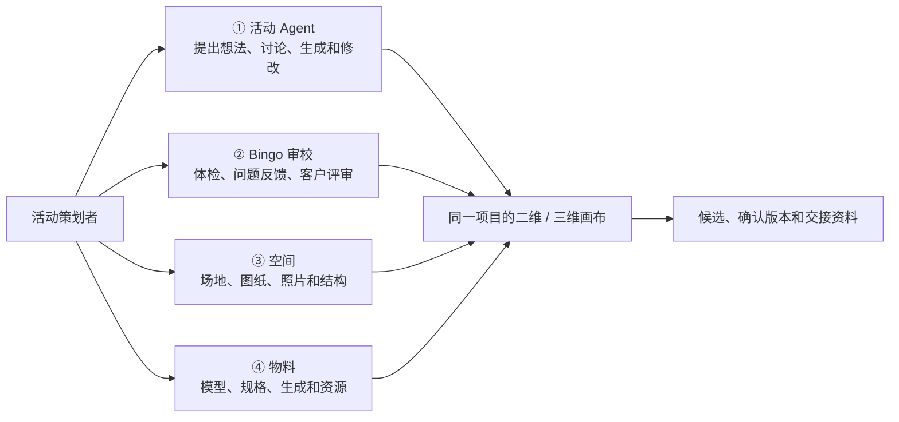
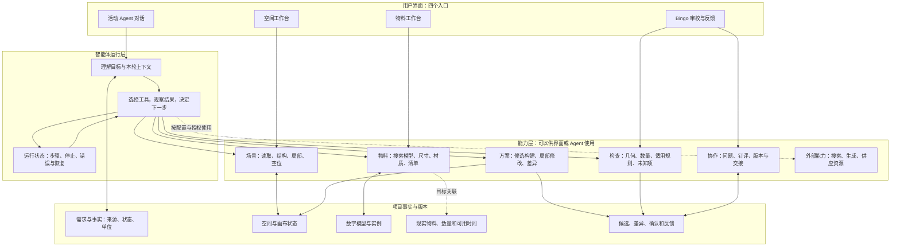
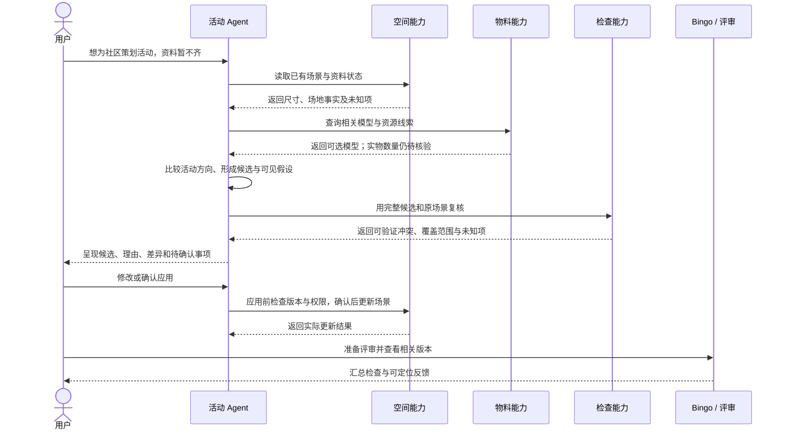

# 幕景四个入口与智能建造架构

这份图用于共同讨论产品结构。**产品决定：只做一个活动 Agent。** Bingo、空间与物料是用户可直接操作、活动 Agent 可逐步调用的工作台与工具能力，不设计多个智能体互相调度。**当前代码事实**和**建议演进方向**分开记录；图中的目标连接不代表已经实现。

## 1. 用户看到什么

用户不必先知道工具在哪里：可以直接对活动 Agent 说需求，也可以自己打开空间或物料手动操作。Bingo 负责审视和协作反馈；空间和物料既是人的工作入口，也是 Agent 可调用能力的来源。

**当前界面**：第一个入口在代码中称“活动”，图标同时承担品牌/导航含义；第二个入口称 Bingo，已有体检和客户评审入口；空间和物料各有侧栏。四者复用同一侧栏组件与工作台状态。第一个入口命名与视觉含义不够明确，仍需产品设计与真实用户验证。

补充实查：Bingo 的外部评审意见目前保存在评审者浏览器，需要导出后再导入，不能称为自动同步。空间和物料底部输入框保留原有明确快捷动作；当前工作区已把其余文字转交给同一个活动 Agent，等待时保留原文并检查会话身份。隔离浏览器已验证转交，但真实模型未在此路径验证。

## 2. 四个入口建议各管什么

| 入口 | 用户的主要问题 | 建议包含的内容 | 和其他入口的关系 |
|---|---|---|---|
| 活动 Agent | “帮我把这场活动从想法推进到方案” | 多轮理解、资料线索、方案比较、对话修改、任务进展、交付 | 根据用户授权调用空间、物料、审校能力；始终汇总依据与待确认项 |
| Bingo 审校 | “哪里有问题？客户怎么看？” | 系统检查及覆盖范围、问题定位、评审链接、评论与回复、版本确认 | 读取当前或冻结版本；反馈能定位方案并回到 Agent 修改；分享和反馈状态需实际支持 |
| 空间 | “这个场地是什么样、能怎么用？” | 场地资料、尺寸和比例、门窗/固定障碍、图纸照片、空间理解与重建 | 向画布和 Agent 提供带来源的空间事实；重建结果需确认，不能自动等于实测 |
| 物料 | “用什么？有多少？怎么放进场景？” | 搜索与连续放置、数字模型库、生成/导入、实际资源与数量、替换关系 | 场景中的模型可关联真实物料；模型、用户口述和真实库存分别记录 |

表格是目标分工，不等于现有功能已经全部实现。用户早先反馈物料不能连续点击进入场景，属于应单独复现、修复和验证的交互问题。

## 3. Agent、工具与同一份项目数据

图中的双向线表示目标上的数据读写关系，不代表每条线均已连通。联网搜索、真实库存、全面事实版本以及确认后的自动失效，必须逐项实现和验收；不会因为接入模型就自动具备。

## 4. 一次活动从想法走向交付

这是目标体验。当前 MiniMax 已有受限工具循环的模拟链路，但真实模型、完整界面、评审反馈回流以及现场验证不能以这张时序图代替验收。

## 5. 空间能力怎么理解

- **空间理解**：从图纸、照片或用户描述提取空间信息，并保留来源、不确定性与待确认项。
- **空间重建**：把资料转换成可查看或编辑的数字空间；观感相似不等于尺寸、出口或结构已核实。
- **空间生成**：在已知场地或明确假设上生成布局、区域和物件位置；检查几何及约束后给人审阅。
- **空间编辑**：用户与 Agent 调整对象、结构或功能区；关键改动需要重新检查受影响的结论。

这四项是空间工作中的能力，不一定各自占一个左侧入口。活动 Agent 可根据任务调用其中可用的能力，用户也能直接在空间入口操作。

## 6. 后续决策和验证顺序

1. 先验证活动 Agent 在真实工作台中能否使用现有场景和物料工具形成可审阅候选。
2. 梳理四个入口的实际入口名、空状态与动作归属；用真实任务观察用户找不找得到，不先假设必须增加或删除入口。
3. 复现并修复物料连续放置问题；分别验证数字模型、实际资源和库存线索的呈现。
4. 把 Bingo 的检查、版本、钉评与修改衔接成可追踪流程；不把本机检查或本地反馈称为已完成外部共享。
5. 再逐步关联真实场地、实物资源、活动流程及专业核验，使用真实任务衡量结果。

配套的流程与测试边界见 [智能建造闭环图](2026-11-07-幕景智能建造闭环图.md)。
