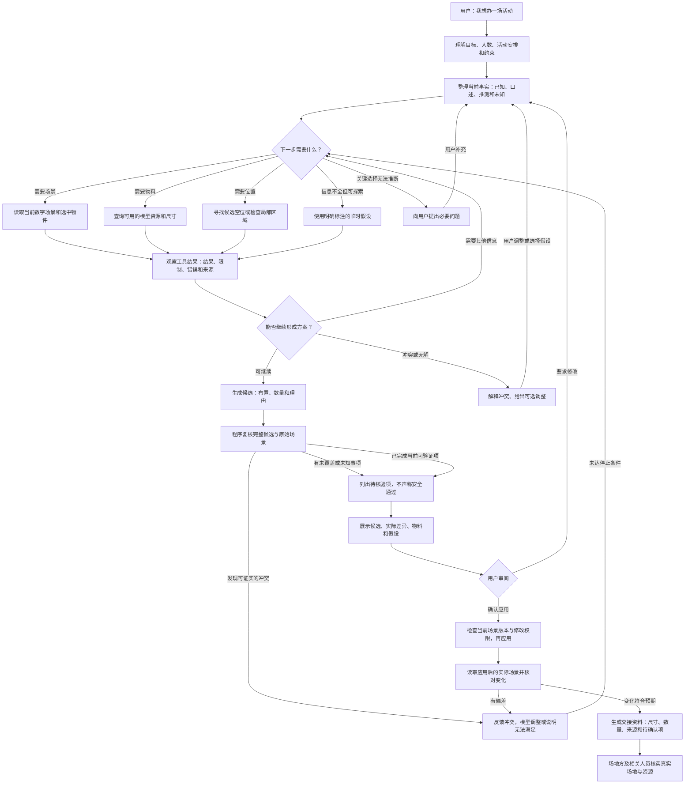
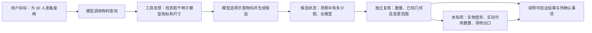
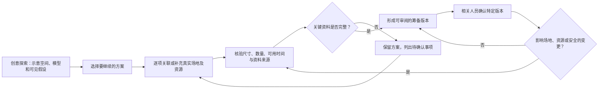

# 幕景智能建造：从想法到可审阅方案

这是用于讨论和持续修改的设计图，不代表图中每个环节都已经实现。它对应活动策划与空间布置，而不是通用聊天。代码进度以实际运行和测试为准。

## 一、用户和 Agent 如何协作

“读取应用后的实际场景并核对变化”是目标行为，需要针对实际应用链路逐项实现和测试，不能将候选预览当成已应用。执行预算、取消、重复请求、权限和版本冲突应由程序约束，而非仅依赖模型遵守提示。

## 二、工具反馈不等于结果完成

用户说“有 80 把椅子”，是用户口述的资源线索；模型库里找到的椅子是数字模型；候选里摆了 30 把是数字场景状态。这三件事可以关联，但不能互相冒充。确认规格、数量及时间可用性后，才可把实物与示意模型建立对应关系。

## 三、创意探索与落地筹备

这是拟议的产品行为，不代表当前已经有完整的模式切换或真实库存系统。两种阶段可以共用同一方案与模型；探索阶段也不能把推测描述为已确认事实，筹备阶段也可以继续探索和使用示意模型。

## 四、现有工具与能力边界

| 类别 | 工具 | 能做什么 | 不能据此断言 |
|---|---|---|---|
| 场景 | `get_scene`、`inspect_zone` | 读取本次数字场景、查看局部 | 图纸与现场一定一致 |
| 布置 | `find_free_areas` | 寻找满足输入几何条件的候选位置 | 已证明连续疏散或规范通过 |
| 批量布置 | `prepare_seating_candidate` | 明确数量和尺寸后试排桌椅，报告缺口并以句柄提交云端候选 | 超过普通云场景 50 物件上限；现场实物或安全条件已确认 |
| 资源 | `search_resources`、`inspect_materials`、`get_bom` | 查模型、模型材质、汇总场景对象 | 已有实物、库存实时、价格或档期已确认 |
| 创建 | `create_parametric_model`、`customize_material`、`start_lux3d_model` | 创建或生成数字资源 | 实物已采购或摆放；部分工具可能有副作用或费用 |
| 候选 | `validate_candidate`、`submit_candidates` | 检查和提交候选，供预览或按既有流程处理 | 所有消防、无障碍、容量及现场条件均已通过 |
| 地点 | `search_places`（可选） | 显式配置后查询高德地点，返回来源、查询时间、名称和坐标 | 场馆可租、开放时间、现场尺寸、价格或库存已确认 |

以上包含原有 11 个云端工具、新增组团试排和可选地点查询；地点工具默认关闭。MiniMax 的受限试验接入正在开发和验证，工具可见范围和可执行范围以实际配置为准；不应把固定模拟响应的结果当作真实模型自主决策。

### 当前进度（2026-11-07）

| 环节 | 当前证据 | 尚缺什么 |
|---|---|---|
| 理解活动与跨轮信息 | MiniMax 真实试用第一轮有回复；多轮结构化理解及口述物料有模拟测试 | 更多真实对话测试；已失败的旧试用无法还原原因 |
| 工具循环 | 当前工作区的 MiniMax 受限接入；隔离浏览器用固定模拟模型走通场景读取、找位置、候选提交和预览 | 用真实 MiniMax 和用户场景验证；用户原有试用进程尚未更新 |
| 候选复核 | 提交时重新检查完整场景与基线，针对部分新增或加重的几何冲突；未知安全项有提示 | 出口、连续通行、消防、无障碍与现场情况未被完整验证 |
| 实际应用与回读 | 既有预览与确认流程；隔离浏览器比较确认前数据库场景，证明本次模拟未自动修改 | 用完整工作台验证确认应用后的状态差异及故障恢复 |
| 真实物料与现场 | 可查模型目录和场景物料数量；空间入口新增本机事实记录，方案卡可核对用户手填的同规格物料数量 | 事实记录尚未关联画布及交付；真实库存、实际可用时间、场地方确认与现场验收仍未接通 |
| 创意探索 / 落地筹备 | 本文为目标设计 | 模式切换、资源关联与确认流程尚未作为完整功能实现 |

## 五、如何验证这张图对应的行为

1. **逻辑层**：用可复现输入检查数量、几何、锁定对象、未知项和冲突处理；样例通过不证明对所有输入均正确。
2. **工作台与模拟模型**：固定工具调用轨迹，验证请求、工具结果、候选预览、应用与取消，不对外发送模型请求。
3. **真实模型与服务**：分别验证模型的实际多轮工具选择、错误恢复、时延，以及外部服务是否可用；注明消耗和失败情况。
4. **真实场地与人员**：核对图纸与实测、实物规格和可用性，让执行人员与相关专业人员检查；不能用数字模型替代现场。

每次修改图时，优先记录“触发条件、实际状态变化、成功依据、未知项、失败后的动作”。通用技术步骤可以复用，空间几何与现实资源的证据必须依据本次活动单独确认。
