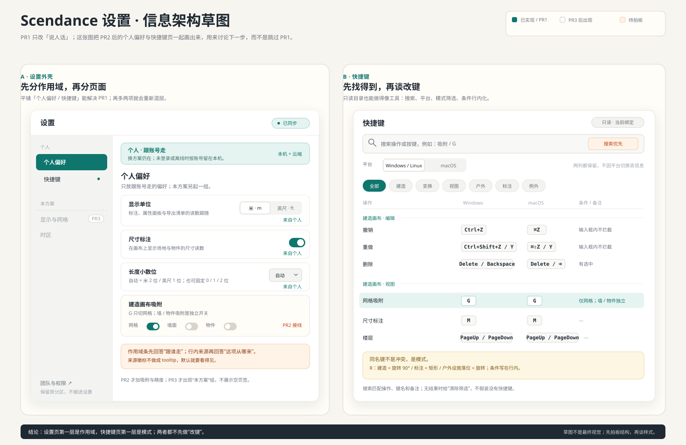
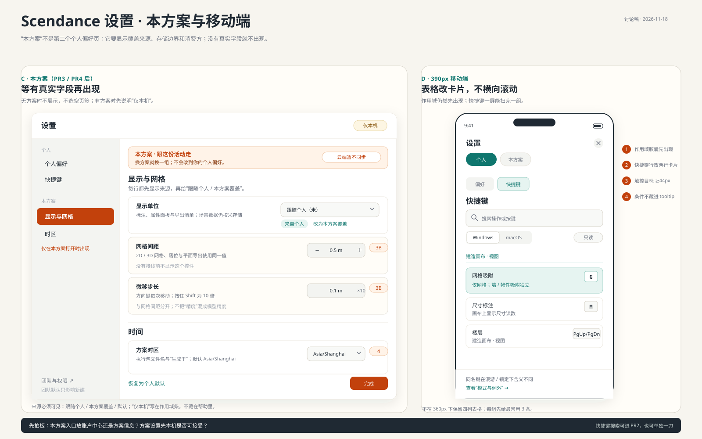

# 设置分层与快捷键参考：成熟案例补充

> 日期：2026-11-18
> 关联：`docs/plans/2026-11-18-settings-layers.md`、PR #169
> 状态：探索稿；不改代码，不改已开的 PR

---

## 0. 一句话结论

成熟产品不是把设置做多，而是把「作用域」做成第一层：

- **User / Workspace**（VS Code）
- **Preferences / Scene Properties**（Blender）
- **Preferences / Project Settings**（Unity）
- **Model Info / Preferences**（SketchUp）
- **Event / Account / Venue**（Cvent Event Diagramming）

Scendance 的下一步不是再加一个页签，而是把「个人 / 本方案」做成导航分组，并让每一行显示「来自个人 / 来自本方案 / 默认」。

---

## 1. 本轮补充的案例

| 产品 | 怎么分层 | 可借 | 不照搬 |
|---|---|---|---|
| **VS Code** | `User Settings` 全局生效；`Workspace Settings` 只在该工作区打开时生效 | 作用域切换放在设置页顶部；搜索是设置页的一等公民 | 不把设置做成一大坨 JSON；Scendance 的字段量还不需要 |
| **Blender** | `Preferences` 是应用级；`Scene Properties > Units` 是文件/场景级；`Keymap` 单独在 Preferences 里 | 单位、网格属于场景；快捷键说明与改键分开 | 本轮不做 Blender 级 keymap editor 与冲突检测 |
| **Unity** | `Preferences` 是编辑器级；`Project Settings` 是项目级；Preferences 带搜索框，另有 `Shortcuts Manager` | 搜索过滤 + 高亮关键词；快捷键单独管理 | 不把「快捷键管理」做成权限/团队设置 |
| **SketchUp** | `Model Info` 管文档单位与精度；`Preferences` 管应用与快捷键 | 文档级 vs 应用级分开；新建方案可用模板种子 | 不做多层模态设置树 |
| **Figma** | 快捷键说明按上下文/模式组织；偏好是个人级 | 按模式分组，先让人找得到 | 本轮不做自定义改键 |
| **Cvent Event Diagramming** | 活动图、账户、场地/团队信息分开；团队品牌用于客户产物 | 活动级设置与团队身份分开；团队抬头只影响客户产物 | 不把成员管理搬进设置页 |

> 说明：SketchUp、Figma、Cvent 的结论沿用 `2026-11-18-settings-layers.md` 的既有审计；本轮新增核对的是 VS Code、Blender、Unity 的官方文档。

---

## 2. 三个可借模式

### 2.1 作用域先行

设置导航的第一层回答「跟谁走」，第二层才回答「调什么」：

```text
个人
  偏好
  快捷键
本方案（有方案才出现）
  显示与网格
  时区
团队与权限 ↗（保留在原分区）
```

这比平铺「个人偏好 / 快捷键 / 本方案 / 团队」更不容易混层。代价是导航多一层；如果 PR2 想控制改动量，可以先保留平铺页签，只加作用域条，等 PR3 再分组。

### 2.2 来源可见

每一行都要能回答三个问题：

1. 当前值是什么？
2. 这个值来自哪里？（个人 / 本方案 / 默认）
3. 怎么回到上一层？（跟随个人 / 恢复默认）

草图中的做法是「行内来源徽标 + 右侧动作」，不把来源藏进 tooltip。

### 2.3 搜索只在密度足够时出现

- 快捷键页：值得搜索，因为操作名、键名、备注都可能成为查找入口。
- 个人偏好页：目前只有 4 行，搜索是负担，不是帮助。
- 设置全局搜索：等设置项超过 20 个再做，不要现在造一个空搜索框。

---

## 3. 草图

### A / B：设置外壳与快捷键



要点：

- 左侧导航按「个人 / 本方案」分组；「本方案」在无方案时不出现。
- 内容区第一块是作用域条，不是标题。
- 快捷键页：搜索、平台切换、模式筛选、条件行内化；`G` 明确只切网格。
- 同名键用「模式」解释，不叫「冲突」；例如 `R` 在建造、标注、户外设施落位下含义不同。

### C / D：本方案与移动端



要点：

- 本方案页先说明「仅本机 · 云端暂不同步」，再给字段。
- 显示单位行显示「跟随个人（米）」，并提供「改为本方案覆盖」。
- 网格间距、微移步长必须等接线完成才出现；没有消费方就不放控件。
- 移动端把快捷键表改成两行卡片，不做四列横向滚动；触控目标 ≥44px。

---

## 4. 需要拍板的四件事

### 4.1 设置导航要不要现在就分组？

- **建议**：PR2 先加作用域条与来源徽标，导航暂时保持平铺；PR3 出现「本方案」真实字段时再分组。
- **理由**：PR2 的存储改动已经够大，导航分组是纯 UI，可以晚一刀；但作用域条现在就该有。

### 4.2 快捷键搜索进 PR2 还是单独 PR？

- **建议**：如果 PR2 已经要改设置页布局，就一起做；否则单独开一个只读 UI PR，不碰存储。
- **理由**：搜索只读、无迁移、测试成本低，但不要和 `/preferences` 白名单混在一个 PR 里。

### 4.3 「本方案」放账户中心还是方案信息？

- **建议**：短期放账户中心，且只在有当前方案时出现；方案信息/场地入口后续加一个「本方案设置」上下文链接。
- **理由**：账户中心已有设置入口，用户不需要再记一个位置；但不能展示空页签。

### 4.4 方案设置先本机是否可以接受？

- **建议**：可以，但必须把「仅本机」写在作用域条，不要藏在帮助里。
- **理由**：`planSettings` 进 `sceneV2Schema` 是契约改动，应该独立 PR；先本机能验证交互，再决定是否上云。

---

## 5. 快捷键学习系统的追加案例（2026-11-18）

快捷键从「设置页一张表」扩成三层后，补充了以下参照；完整说明见 `docs/plans/2026-11-18-shortcut-learning.md`。

| 产品 | 借什么 | 用在哪一层 |
|---|---|---|
| **VS Code Keyboard Shortcuts** | 搜索是一等公民；命令与键位分列；只读状态在顶部说明原因 | 设置页搜索 / 表格；评审锁定的 toast |
| **Blender Keymap** | 按上下文/类别分组，而不是按键盘位置组织 | 设置页「编辑 / 变换 / 视图 / 户外 / 标注 / 例外」 |
| **Linear / GitHub `?`** | `?` 打开当前上下文的快捷键浮层；Esc / 遮罩关闭 | 画布内快捷键速查 |
| **Figma** | 快捷操作贴着当前选择/模式出现 | 画布入口带当前模式；先给此刻能用的键 |

结论：整键盘图只做索引，主界面仍是搜索 + 模式分组；不做自定义改键与冲突检测。

---

## 6. 对现有 PR 的影响

- **PR #169 不变**：仍是「个人偏好 / 快捷键」两个真实分区，零存储改动。
- **PR2 可增量**：作用域条、行内来源、吸附与精度；不建议把导航分组、方案页、团队设置塞进来。
- **PR3 才出现「本方案」**：有真实字段才出现；先本机，云端另开契约 PR。
- **团队不搬进设置**：团队与权限保留原分区；团队默认只影响新建方案。

---

## 7. 来源

- VS Code, *User and Workspace Settings*：<https://code.visualstudio.com/docs/customization/userandworkspace>
- VS Code, *Keyboard Shortcuts*：<https://code.visualstudio.com/docs/getstarted/keybindings>
- Figma, *Keyboard shortcuts*：<https://help.figma.com/hc/en-us/articles/360040328653-Keyboard-shortcuts>
- Linear, *Keyboard shortcuts*：<https://linear.app/docs/keyboard-shortcuts>
- GitHub, *Keyboard shortcuts*：<https://docs.github.com/en/get-started/accessibility/keyboard-shortcuts>
- Blender Manual, *Scene Properties / Units*：<https://docs.blender.org/manual/zh-hans/3.2/scene_layout/scene/properties.html>
- Blender Manual, *Keymap*：<https://docs.blender.org/manual/ja/2.81/editors/preferences/keymap.html>
- Unity Manual, *Preferences*：<https://docs.unity3d.com/Manual/Preferences.html>
- Cvent Event Diagramming（原 Social Tables）：<https://www.socialtables.com/>
- 既有方案与审计：`docs/plans/2026-11-18-settings-layers.md`
