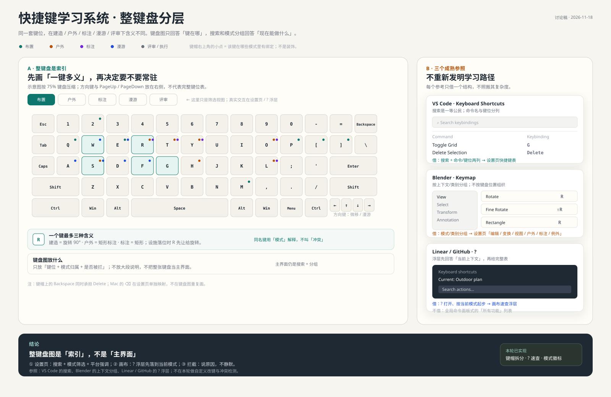
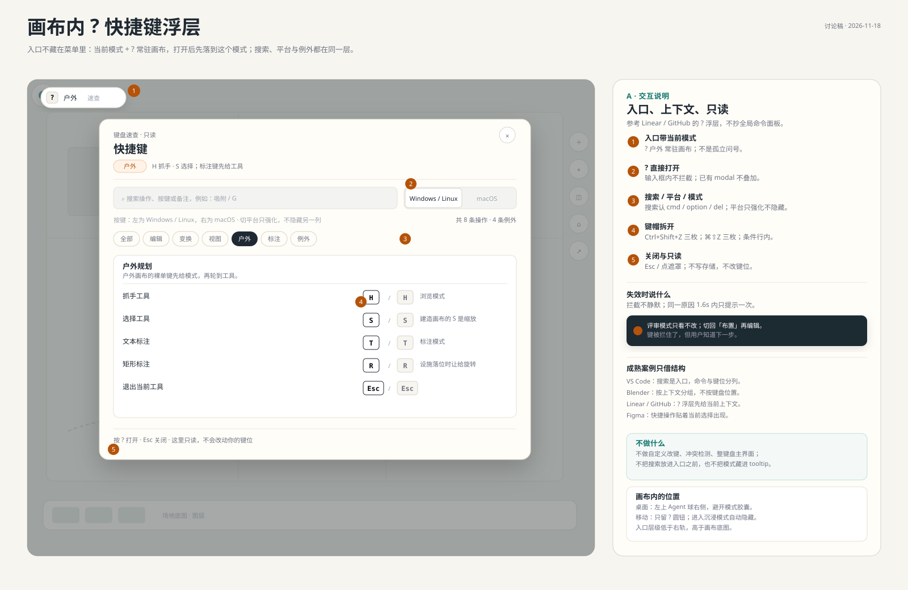
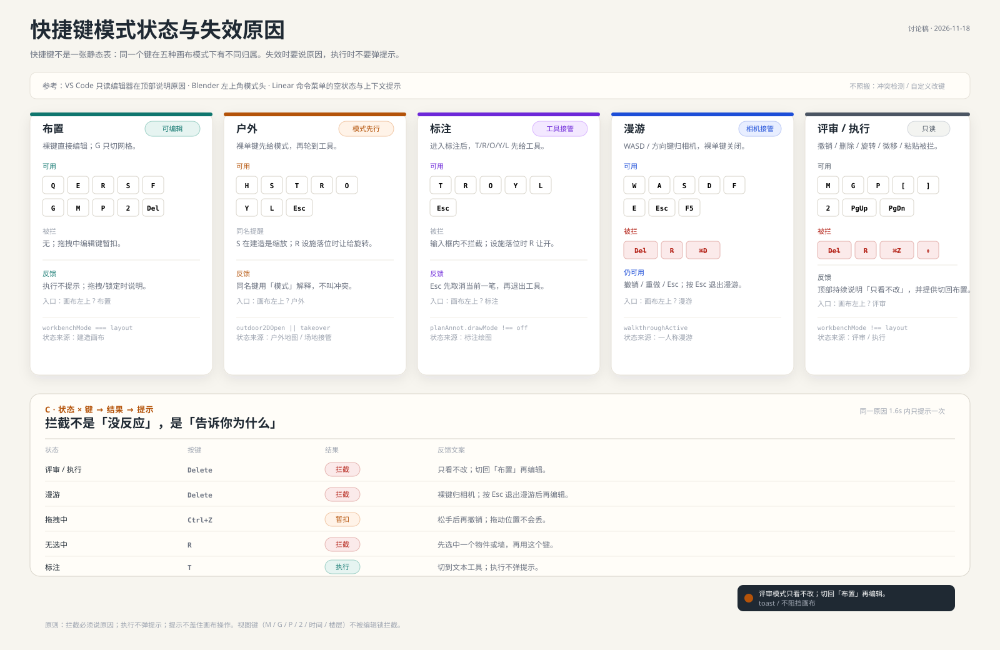

# 快捷键学习系统：三层交付与成熟案例

> 日期：2026-11-18
> 关联：PR #169（draft，不合并）、`docs/plans/2026-11-18-settings-cases.md`
> 状态：代码已进 #169 分支；本文是设计说明与评审稿，不是合并承诺

---

## 0. 一句话结论

快捷键学习不是「再放一张表」，而是三层：

1. **设置页**给完整、可搜索、可按模式筛选的参考；
2. **画布内 `?`** 只给此刻这个模式能用的键，先落到当前上下文；
3. **模式状态 / 失效原因**解释「为什么这个键没反应」，而不是静默。

整键盘图只做索引，不做主界面。参考 VS Code 的搜索、Blender 的上下文分组、Figma 的上下文优先、Linear / GitHub 的 `?` 浮层。

---

## 1. 三层分别回答什么

| 层 | 入口 | 回答的问题 | 当前实现 |
|---|---|---|---|
| 设置页 · 快捷键 | 账户中心 → 快捷键 | 「所有键是什么？怎么找？」 | 搜索、模式筛选、平台强调、键帽拆分、空结果恢复 |
| 画布 · `?` | 画布左上 `? + 当前模式` | 「我现在能按什么？」 | `ShortcutCoach`：`?` 打开、按模式预选、Esc / 遮罩关闭 |
| 模式 / 失效提示 | 顶部模式、toast | 「为什么没反应？下一步做什么？」 | `onBlocked(reason)` + 去重 toast；modal 打开时画布让路 |

---

## 2. 成熟案例：只借结构，不借复杂度

| 产品 | 观察到什么 | 借什么 | 不借什么 |
|---|---|---|---|
| **VS Code** | `Keyboard Shortcuts` 编辑器用搜索找命令，命令名与键位分列；只读编辑器会在顶部说明「为什么不能改」 | 搜索是一等公民；命令 / 键位两列；拦截时说明原因 | 不把设置做成 JSON 编辑器；不做完整 keymap 编辑器 |
| **Blender** | `Preferences > Keymap` 按上下文/类别组织；单位在 Scene Properties，不在 Preferences | 按「编辑 / 变换 / 视图 / 户外 / 标注 / 例外」分组；参考与改键分开 | 不做冲突检测、不做 Blender 级 keymap 管理 |
| **Figma** | 快捷操作与当前选择/上下文相关；右侧面板先给当下能做的事 | 先给当前模式，再给完整表；键帽贴近动作 | 不做自定义改键；不把整张键盘当主界面 |
| **Linear / GitHub** | `?` 打开快捷键浮层；浮层有关闭、搜索、分组，先回答当前上下文 | `?` 入口；dialog 焦点管理；Esc 关闭；当前模式预选 | 不做全局命令面板；不把「所有功能」塞进速查 |
| **SketchUp / Cvent**（既有审计） | 文档级与应用级设置分开；活动/团队/场地分开 | 作用域先行；个人偏好与方案设置不混层 | 不在本轮改存储或团队设置 |

> 结论：成熟产品的共同点不是「键位更多」，而是**入口可见、上下文先行、拦截可解释**。

---

## 3. 设计决策

### 3.1 键帽：拆开组合键，不把整串当一个键

- `Ctrl+Shift+Z` → `Ctrl` `+` `Shift` `+` `Z`
- `⌘⇧Z` → `⌘` `⇧` `Z`（macOS 不显示 `+`）
- `Ctrl+Shift+Z / Ctrl+Y` → 两组之间显示「或」
- `Delete / Backspace` → 同一动作的两个替代键，显示「或」
- 多动作不塞一行：`T / R / O / Y / L` 拆成五个条目，避免把「五个工具」误读成「五个替代键」

### 3.2 平台：强调而不是隐藏

- 首次打开按 `navigator.platform + userAgent` 检测 macOS / 其他；手动切换只保存在组件状态，不写存储。
- 两列都保留；非当前平台降低透明度，当前平台键帽描边加深。
- 这样用户把设置发给同事时，不会因为对方是另一平台而看不懂。

### 3.3 搜索：认操作、键名、备注和别名

- 多 token 全部匹配（AND）；组标题/描述命中时展示整组。
- 别名：`cmd` / `command` → `⌘`；`ctrl` / `control` → `Ctrl`；`alt` / `option` → `⌥`；`del` / `delete` → `Delete` / `⌫`；`esc` / `escape` → `Esc`；`return` / `enter`；`pageup` / `pagedown`。
- 搜不到时给「清除搜索与筛选」，不显示空白。

### 3.4 画布 `?`：先落到当前模式

| 模式 | 判定 | 打开时预选 | 说明 |
|---|---|---|---|
| 布置 | `workbenchMode === 'layout'` 且无户外/标注接管 | 全部 | 编辑、变换、视图 |
| 户外 | `outdoor2DOpen` / `outdoor3dTakeover` / 纯户外项目 | 户外 | H 抓手、S 选择；标注键先给工具 |
| 标注 | `planAnnot.drawMode !== 'off'` | 标注 | T/R/O/Y/L 切工具；Esc 退出 |
| 漫游 | `walkthroughActive` | 例外 | WASD 归相机；Esc 退出 |
| 评审 / 执行 | `workbenchMode !== 'layout'` | 例外 | 只看不改；视图键仍可用 |

`?` 的打开条件：

- 只在画布 enabled 时监听；
- 输入框 / textarea / select / contenteditable 内不拦截；
- 已有 `role="dialog" aria-modal="true"` 时不叠加；
- 自己打开时 `preventDefault`，避免浏览器快速查找等默认行为。

### 3.5 失效原因：拦截必须说原因

`useKeyboardShortcuts` 新增 `onBlocked(reason)`，当前覆盖：

| reason | 触发 | 提示 |
|---|---|---|
| `locked` | 评审/执行下按改布局的键 | 评审 / 执行模式只看不改；切回「布置」再编辑。 |
| `drag` | 拖拽中按会打断拖拽的键 | 拖动中先松手；视图类按键仍然可用。 |
| `walkthrough` | 漫游中按 Delete / Backspace / Ctrl+D / Ctrl+V | 漫游中裸键归相机；按 Esc 退出漫游后再编辑。 |
| `needs-selection` | 无选中按 Delete / R | 先选中一个物件或墙，再用这个快捷键。 |
| `no-signal-items` | 场景无信号物件时按 W | 当前场景没有可显示的信号物件。 |

去重：同一原因 1.6s 内只提示一次；视图键不提示；执行成功不弹提示。

### 3.6 可访问性

- dialog：`role="dialog"`、`aria-modal="true"`、`aria-labelledby`、`tabIndex={-1}`。
- 复用 `useDialogFocus`：打开时聚焦关闭按钮；Tab / Shift+Tab 在浮层内循环；Esc 关闭；关闭后把焦点还给原来的元素。
- 入口：`aria-haspopup="dialog"`、`aria-expanded`；平台切换用 `aria-pressed`；筛选按钮用 `aria-pressed`。
- 画布快捷键在任意 modal 打开时全部让路，避免「浮层里按 Delete 删掉背后物件」。

---

## 4. 草图

### 4.1 整键盘分层：索引，不是主界面

- 键帽右上角小点表示该键在哪些模式有绑定；`R` 最多三种含义。
- 右侧并列 VS Code / Blender / Linear+GitHub 三种参照；结论是搜索 + 模式分组才是主界面。
- 不在本轮做自定义改键与冲突检测。

### 4.2 画布 `?` 浮层

- 入口带当前模式，不是孤立问号。
- 浮层：搜索、平台强调、模式筛选、拆分键帽、条件行内、Esc / 遮罩关闭。
- 右下角示意「拦截说原因」的 toast；浮层只读，不改键位。

### 4.3 模式状态与失效原因

- 五张卡片：布置 / 户外 / 标注 / 漫游 / 评审执行；每张列可用键、被拦键、反馈与状态来源。
- 底部矩阵：状态 × 键 → 结果 → 文案；原则是「拦截必须说原因；执行不弹提示」。

---

## 5. 代码与验证

### 5.1 本轮改动

| 文件 | 作用 |
|---|---|
| `panels/shortcut-reference.tsx` | 搜索、筛选、平台强调、键帽拆分、别名、空结果 |
| `panels/shortcut-coach.tsx` | 画布 `?` 浮层、模式预选、dialog 焦点 |
| `hooks/use-keyboard-shortcuts.ts` | `onBlocked`、modal 让路、选中/无信号原因 |
| `lib/shortcut-catalog.ts` | 多动作拆成独立条目；`G` 仅网格 |
| `panels/cloud-panel.tsx` | 设置页分区与快捷键入口 |
| `panels/viewport.tsx` | 文案与模式说明同步 |
| `app/cloud.css` | 表格、浮层、入口、响应式样式 |

### 5.2 验证

- `shortcut-catalog.test.ts`：4 项
- `shortcut-reference.react.test.tsx`：5 项
- `shortcut-coach.react.test.tsx`：4 项
- `use-keyboard-shortcuts.react.test.ts`：50 项
- `cloud-panel.react.test.tsx`：85 项
- 合计：5 个文件 / 148 项通过
- `npm run typecheck`：通过
- `npm run lint`：0 error；仓库既有 `import/order` / `react-hooks` 警告仍在
- `npm run build`：成功；3368 个产物扫描，oneplan-icons 违规 0 条

### 5.3 明确没做

- 自定义改键、冲突检测、按键录制；
- 键位持久化 / `/preferences` / migration / `sceneV2Schema`；
- 团队级快捷键策略；
- 整键盘作为主界面、移动端手势；
- 把所有模式做成可点击的键盘模拟器。

这些留给后续 PR；本 PR 保持零存储改动、draft、不合并。

---

## 6. 评审时最该看的三个点

1. **入口是否太隐蔽？** 左上 `? + 模式` 是否会和 Agent 球 / 模式胶囊打架；移动端只留 `?` 圆钮是否够。
2. **模式判定是否符合直觉？** 标注优先于户外、漫游优先于其他；如果同时打开，是否应让用户看到「当前模式」而不是猜。
3. **拦截提示是否吵？** 1.6s 去重是否足够；哪些键应该静默（视图键）已经在实现里排除。
